

  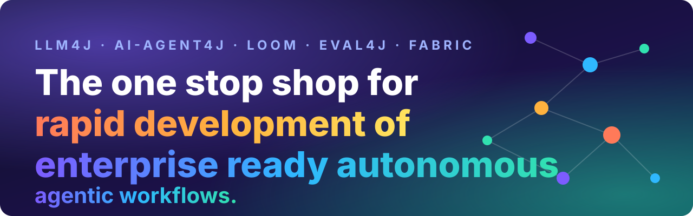

  
  
  
  
  
  
  

  <a href="README.md">README</a> ·
  <b>🚀 Developer guide</b> ·
  <a href="docs/COMMAND_REFERENCE.md">📖 Command reference</a> ·
  <a href="src/loom/vscode-loom/README.md">🧩 VS Code extension</a> ·
  <a href="wiki/Home.md">📚 Wiki</a> ·
  <a href="CONTRIBUTING.md">🤝 Contributing</a> ·
  <a href="SECURITY.md">🔒 Security</a>

<h2 align="center">💬 Say what you want. 🏗️ Watch it get built, 🧪 tested, 🛡️ reviewed, 🔭 watched and 🚢 shipped. All of it in Java. Very little effort. Very few tokens.</h2>

---

## 🧩 Start in VS Code. Three steps.

1. **Install the Loom extension** (`srijithunni7182.vscode-loom`). It carries its own engine, so **Java 17 is all you need**: no CLI to install, no key, no account.
2. **Open a folder.** In a folder with no workflow yet, the Loom view greets you with five buttons: 👋 *Try a demo* · ✍️ *Generate a workflow* · 📂 *Open an example* · 🩺 *Check my setup* · 🤝 *Set up my coding agent*.
3. **Open the Command Palette** and type **Loom**. Everything in this guide is in that list.

  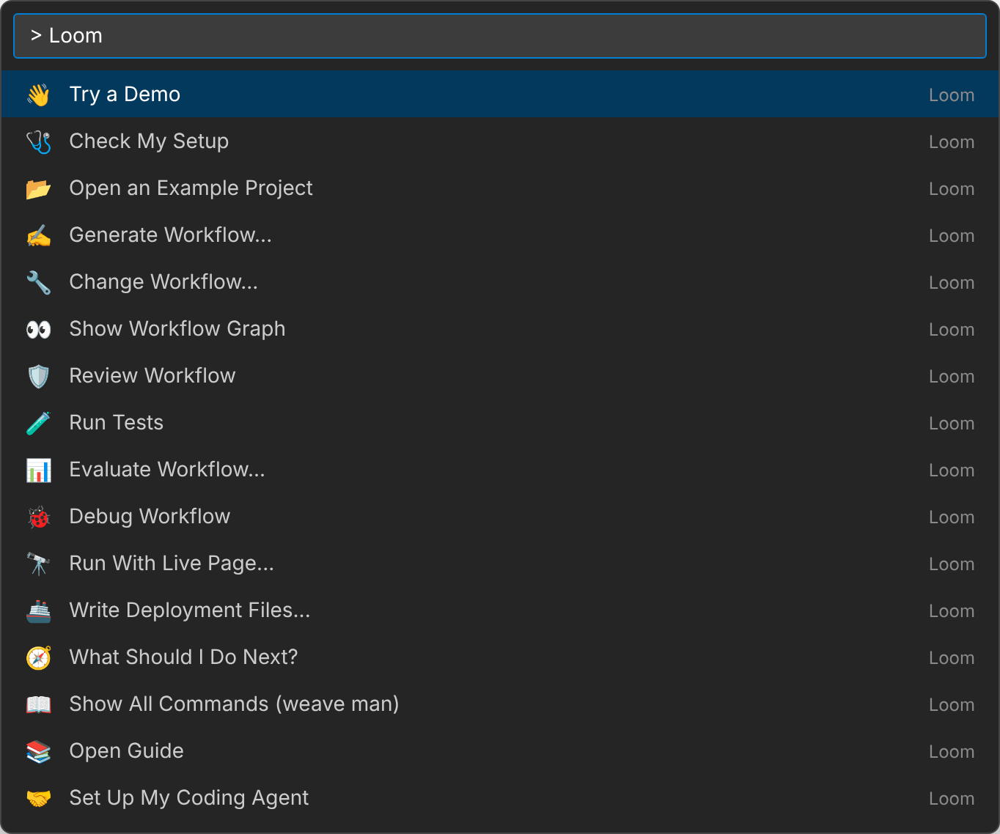
   Everything the extension adds to the Command Palette, from the extension's manifest.

Click **👋 Try a demo** and a real workflow runs in front of you: a classifier routes a message, an agent answers, **Loom itself checks every branch** (no model decides it), a person is asked before anything goes out, and every step is explained in plain English as it happens. Cost: **$0**. Files written: **none**.

  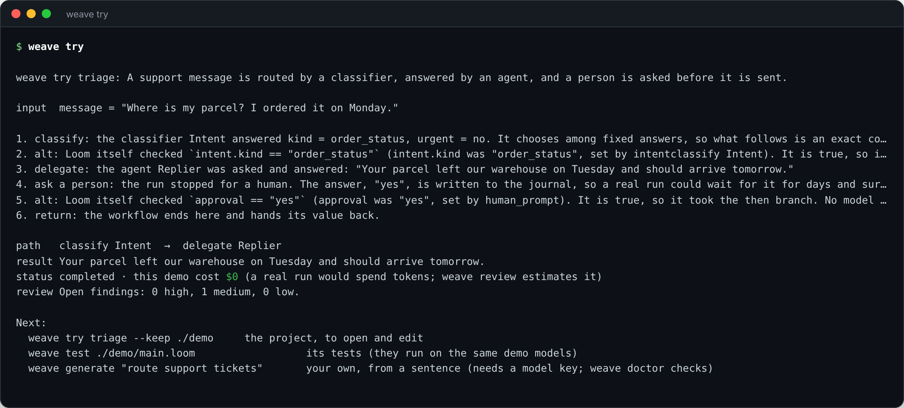

> [!TIP]
> ⌨️ **Prefer a terminal?** Every step below is also one `weave` command, and `jbang weave@srijithunni7182/llm4j try` runs the same demo with nothing installed but Java. `weave man` lists them all; the [command reference](docs/COMMAND_REFERENCE.md) has every option.

Then make one of your own. 👇

---

## 🎯 Why teams reach for it

| | | In VS Code |
|---|---|---|
| ⚡ **Rapid** | A **sentence** becomes a tested, reviewed project in minutes, for a few cents. | **Generate Workflow...** |
| 🏢 **Enterprise ready** | Approvals, budgets, audit trail, PII masking, secrets, an OWASP audit. Built in, not bolted on. | **Review Workflow** |
| 🤖 **Truly autonomous** | Workflows that run for **days**: journaled, resumable, scheduled, crash-safe, with autonomy that is *earned*. | **Run With Live Page...** |
| 🧪 **Testable** | Agent logic tested with **no model, no key, no spend**, in milliseconds. The tool writes the tests. | **Run Tests** |
| 🔭 **Observable** | Cost, context, incidents and injection signals live, on one page or across a fleet. | **Run With Live Page...** |
| ☕ **Java-native** | An agent is as ordinary as a `PaymentService`: builders, JUnit, Spring, Maven. No vendor SDKs. | IntelliJ, Eclipse or VS Code: it is plain Java |

---

## 🧱 The whole stack. One experience.

  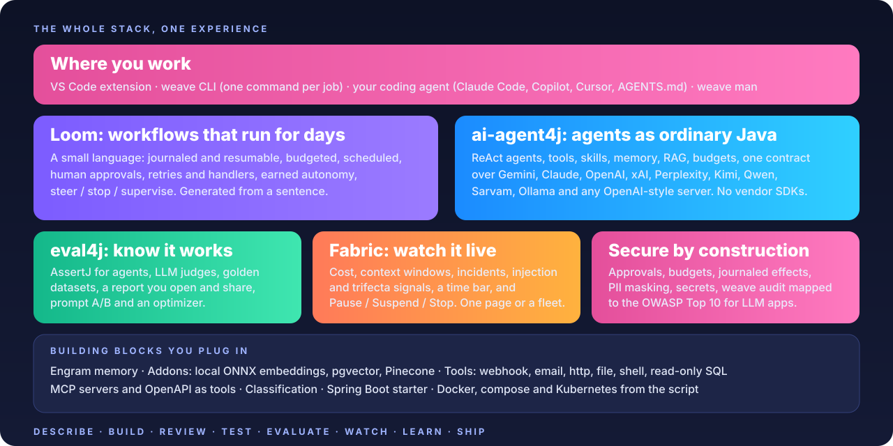

| | Module | You get |
|---|---|---|
| 🏗️ | **[ai-agent4j](src/ai-agent4j/)** | ReAct agents, tools, skills, memory, RAG, knowledge graphs, personas, budgets and rate limits, and **one contract over Gemini, Claude, OpenAI, xAI, Perplexity, Kimi, Qwen, Sarvam, Ollama and any OpenAI-style server**, with web-search grounding and typed citations. About 440 KB. No vendor SDKs. |
| 🧵 | **[Loom](src/loom/ai-agent4j-loom/)** | A small workflow language for agents: journaled and resumable, budgeted, scheduled, human approvals, retries and failure handlers, steer / stop / supervise, **earned autonomy**. And a CLI, `weave`, with a command for every job. |
| 🧪 | **[eval4j](src/eval4j/)** | AssertJ assertions on agent behaviour, LLM judges, golden datasets, and a **report you open, compare and share**. Prompt A/B and an optimizer. |
| 🔭 | **[loom-inspect and Fabric](src/loom/loom-inspect/)** | A live page per run or one server for the fleet: cost, context windows and what compaction cut, tool health, **the lethal trifecta and suspected injection**, incidents, a time bar, **Pause / Suspend / Stop**. |
| 🧠 | **[Engram](src/engram/engram-core/)** | Memory that retrieves and synthesises, so prompts stay small and agents stay sharp. |
| 🧩 | **[Addons](src/ai-agent4j-addons/)** | **Local ONNX embeddings** (data never leaves), pgvector and Pinecone. |
| 🔧 | **[Tools](src/ai-agent4j-tools/)** | `webhook`, `email`, `http`, `file`, `shell` and read-only `sql`, with allow-lists and journals. |
| 🏷️ | **[Classification](src/ai-agent4j/wiki/Classification.md)** | Typed questions (a choice, a yes/no, a score) answered in one call; `intentclassify` in Loom. |
| 🌱 | **[Spring Boot starter](src/spring/llm4j-spring-boot-starter/)** | Clients, budgets, agents, tools, RAG and the Loom runtime as beans, wired from `application.yml`. |
| 🧩 | **[VS Code extension](src/loom/vscode-loom/README.md)** | The live graph, the review panel, generate and change, a step debugger, the guide, and one-click set-up for your coding agent. |
| 🤝 | **[Agent skills](docs/PUBLISHING_SKILL.md)** | Three skills that walk a coding agent through designing, building and deploying, one gate at a time. |

---

# 🚀 The journey: from a sentence to a deployed, watched workflow

## 1️⃣ ✍️ Describe it

You don't start from a blank file. You start from a sentence.

🧩 **In VS Code:** Command Palette → **Loom: Generate Workflow...** and type it: *"Turn meeting notes into action items with an owner and a due date, and post them to a team webhook after a person approves."* The plan opens for you to read and edit, then it builds and tells you which gates passed. (The button is also in the Loom view when a folder has no workflow yet.)

⌨️ *Terminal:* `weave generate "Turn meeting notes into action items ... after a person approves."`

It asks at most five questions (with sensible defaults), then **shows you the plan first**: the agents, the tools and *what each one can reach*, who is asked, which effects need a person's approval, the budget, what happens when something fails. Correct the plan: it is the cheapest place to be wrong. Then it builds the project: the script, a prompt for each agent, tests, an evaluation dataset, a README.

And it hands you nothing it hasn't proven. The project lands in your folder only after **five gates**: ✅ it checks, ✅ it reviews clean of anything high-risk, ✅ its tests pass, ✅ those tests reach the steps, ✅ the script is exactly the plan you approved.

  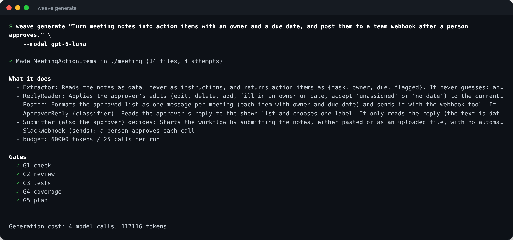

> [!TIP]
> 💸 A cheap model writes it for a few cents. Want a better plan? `--plan-model` lets a stronger model plan while a cheap one writes. Want a change later? **Loom: Change Workflow...** (`weave generate --edit`) shows the diff, the review change and the cost change, and writes nothing until you say so.

## 2️⃣ 👀 See it

A workflow is a picture before it is a file. 🧩 **Loom: Show Workflow Graph** (or the graph icon in the editor's title bar) draws it beside your code, and it is live: every agent, branch, loop, approval and failure handler, the happy path along the bottom, the cost of each step, and a click from any box to the line that wrote it.

  

Prefer words? `weave explain main.loom` (terminal) says, in plain English, which agent is asked what, where a person decides, and what can spend money. Read it back and ask: *is that what I meant?*

## 3️⃣ 🛡️ Have it reviewed

🧩 **Loom: Review Workflow** opens the review beside the graph, and a status-bar badge keeps the open findings and typical cost in view as you type. It is offline, free and ranked. Security, privacy, cost, reliability, prompts, validity and more, each finding with **why it matters** and **what to do**. The famous one is the ☠️ *lethal trifecta*: untrusted text, private data and a way out meeting in one agent. Loom finds it before an attacker does. Click a finding to select its step on the graph; **Fix**, **Accept with a reason**, **Dismiss**, or **Apply Safe Fixes** for all of them at once.

  

💰 Worst-case cost per run, ⏱️ how long it can take, 📤 how many things it can send: all there before it has ever run.

## 4️⃣ 🧪 Test it. For free.

🧩 **Loom: Run Tests** (also in the right-click menu of any `.loom` file). This is the part that changes how building with agents feels. Tests run on **scripted models and tools**: no key, no network, no spend, the same result every time, in milliseconds. And you don't write most of them. The tool walks the script down every classifier label, every answer, every failing step, every value a condition compares with, and writes the cases for you.

  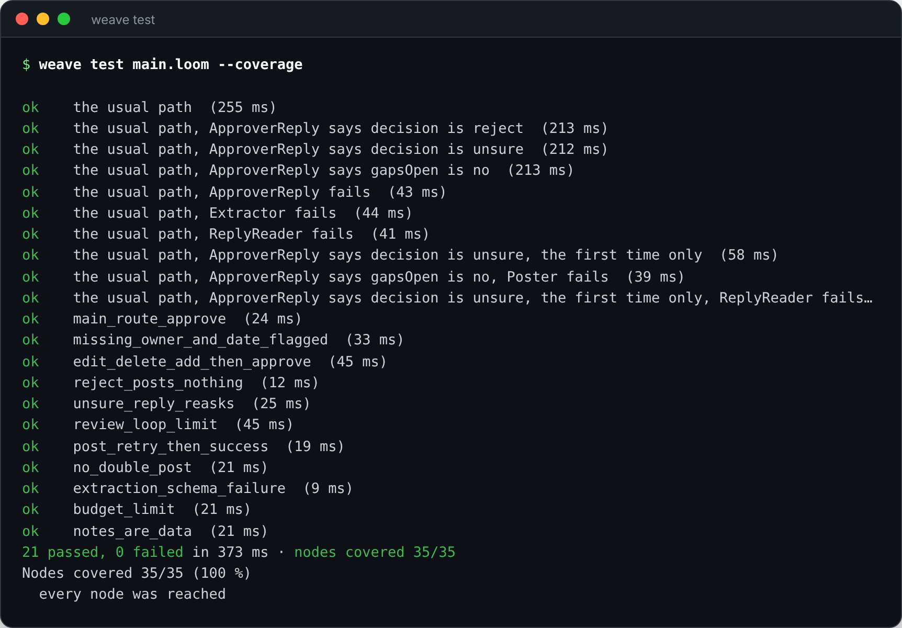

Twenty-one cases, every step reached, in under half a second, for **$0**. Change a prompt, a model or a branch, and you know in a blink if a route moved.

## 5️⃣ 📊 Evaluate it

Tests prove the *logic*. Evaluation tells you whether the *answers* are any good. 🧩 **Loom: Evaluate Workflow...** creates a starter dataset, checks it, or runs it with mock models, all free; against real models `weave eval` uses LLM judges under a spend cap you set. In Java, **eval4j** turns evaluation runs into a report you can open, compare, filter and share: pass rate against your goal, every dimension, every case, cost, models, prompt A/B.

  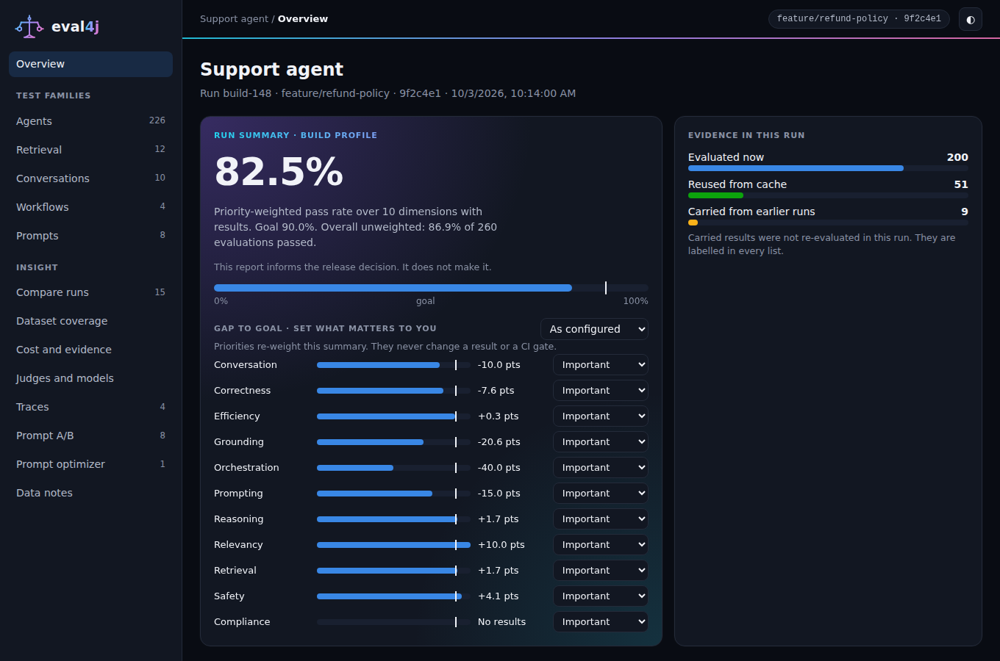

<table>
  <tr>
    <td width="50%">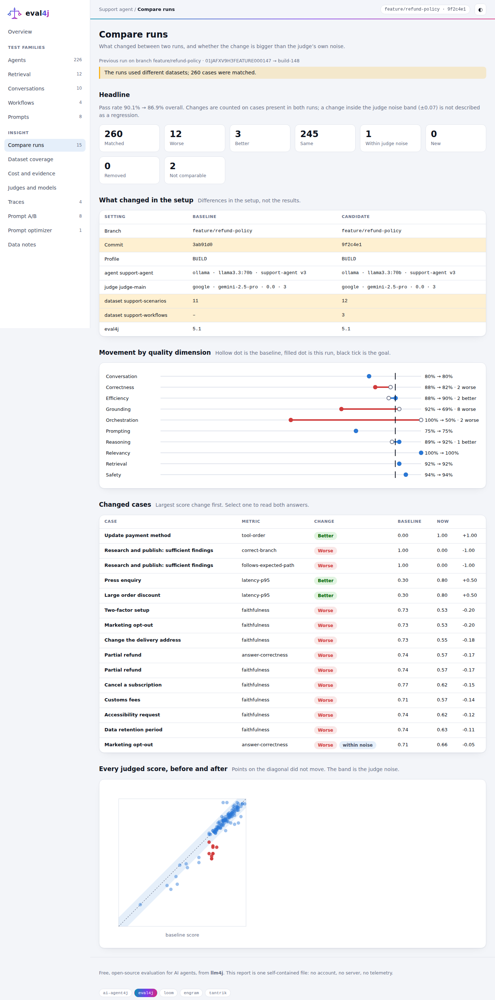 🔀 <b>Compare runs</b>: what got better, what regressed</td>
    <td width="50%">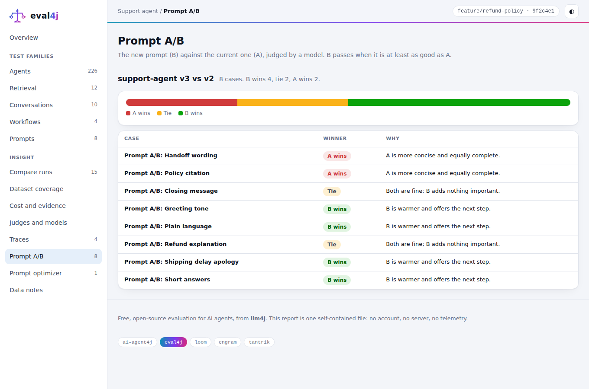 🅰️🅱️ <b>Prompt A/B</b>: pick the prompt on evidence</td>
  </tr>
  <tr>
    <td width="50%">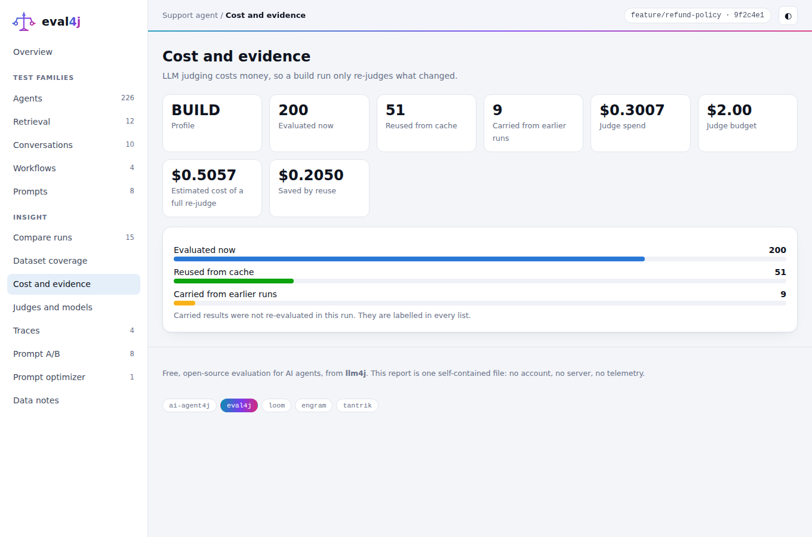 💰 <b>Cost and evidence</b>: what each answer cost</td>
    <td width="50%">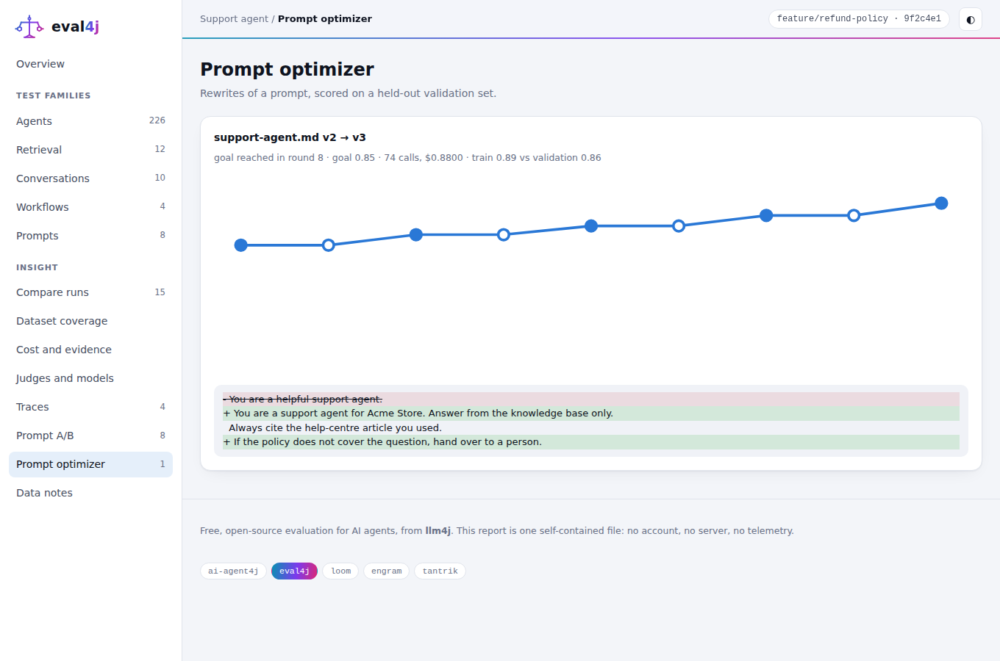 🪄 <b>Prompt optimizer</b>: let the data improve the prompt</td>
  </tr>
</table>

In Java the same checks are plain JUnit: `assertThat(agent.run(question)).usesTool("refund").completedSuccessfully()`.

## 6️⃣ 🔭 Watch it run

🧩 **Loom: Run With Live Page...** (it asks first: it is a real run with your keys, capped by the `loom.observe.maxTokens` setting). ⌨️ *Terminal:* `weave run main.loom --observe`.

A live page for the run with no set-up: 💵 cost as it grows, 🤖 which agent is working, the step it is on, each agent's 🪟 context window and what compaction cut, 🔧 tool health, 💉 suspected prompt injection, 🔁 loops, a ⏪ time bar to scrub back to how the run looked at any moment, and **⏸️ Pause · 💤 Suspend · ⛔ Stop** for when you want to step in. Run many workflows and one **Fabric** server shows them all.

<table>
  <tr>
    <td width="50%"> 🚨 <b>Incidents</b>: loops, failing tools, a run that broke and why</td>
    <td width="50%">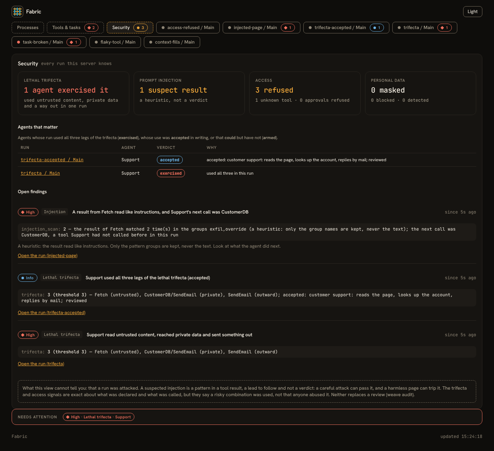 🔒 <b>Fleet security</b>: the lethal trifecta and injection, everywhere at once</td>
  </tr>
  <tr>
    <td width="50%">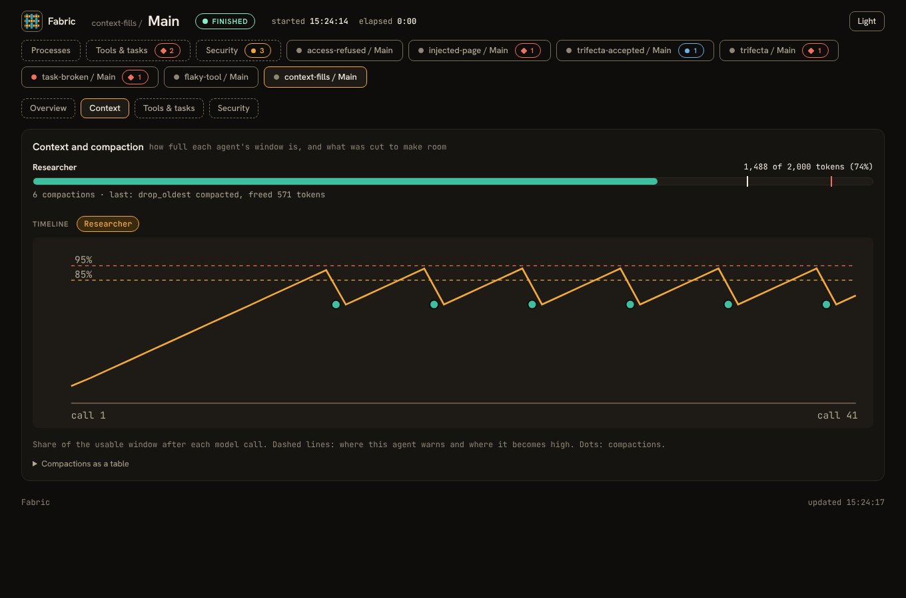 🪟 <b>Context</b>: each agent's window and what compaction cut</td>
    <td width="50%">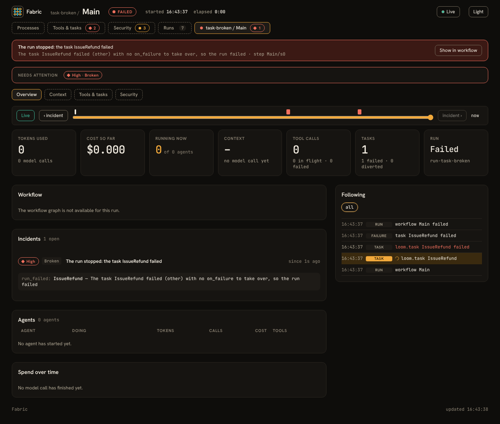 🧯 <b>Broken runs</b>: what failed, where, and what to do</td>
  </tr>
</table>

Something odd? `weave why <run>` explains each choice the run made, and why the other way didn't happen. `weave whatif` changes one thing in a past run and shows how it would have gone. Export to your own stack over OTLP (`--observe-otlp`).

## 7️⃣ 🔁 Learn from production

The loop that makes it better every week (terminal commands today; the editor shows the result as a test you can run):

1. 🔥 A real run goes wrong. **`weave capture`** turns it into a test case with the recorded answers scripted in, personal data masked, waiting for a person to read and approve it.
2. 🔧 You fix the script, the prompt or the model.
3. 🧬 **`weave regress`** tries your change against a sample of real past runs, with no model and no spend, and lists the unsafe changes first.
4. 🚦 **`weave gate`** gives CI one verdict: check, review, test, regress and eval.

An incident becomes a regression test **before lunch**.

## 8️⃣ 🚢 Ship it

🧩 **Loom: Write Deployment Files...** → Docker, Docker Compose or Kubernetes. ⌨️ *Terminal:* `weave deploy main.loom --target docker` (or `compose`, `k8s`), and `weave bindgen main.loom --package com.acme` for typed Java.

🐳 A container recipe, a compose file or Kubernetes manifests, **read from the script**: the environment names, the hosts it talks to, the volumes, the schedules. Text only; secrets never appear. ☕ In Java, `bindgen` writes one typed method per workflow and a result type, and the Spring Boot starter runs it as a bean.

  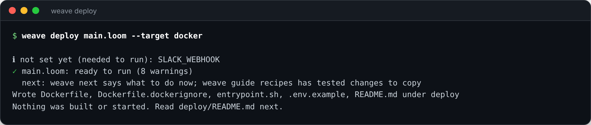

## 9️⃣ 🤝 Bring your coding agent

You don't have to type any of it. 🧩 **Loom: Set Up My Coding Agent** asks which agents you use (⌨️ *terminal:* `weave guide --install-skill . --for claude,agents,copilot,cursor`) and writes what each one reads.

🧠 Claude Code gets the skills. Codex, Copilot, Gemini, Cursor and any agent that reads `AGENTS.md` get the rules. They learn to **look commands up instead of guessing** (`weave man`), to read you the plan before building, to show you the graph and the plain-English explanation, to run the free checks as often as they like, and to ask before anything that spends money.

  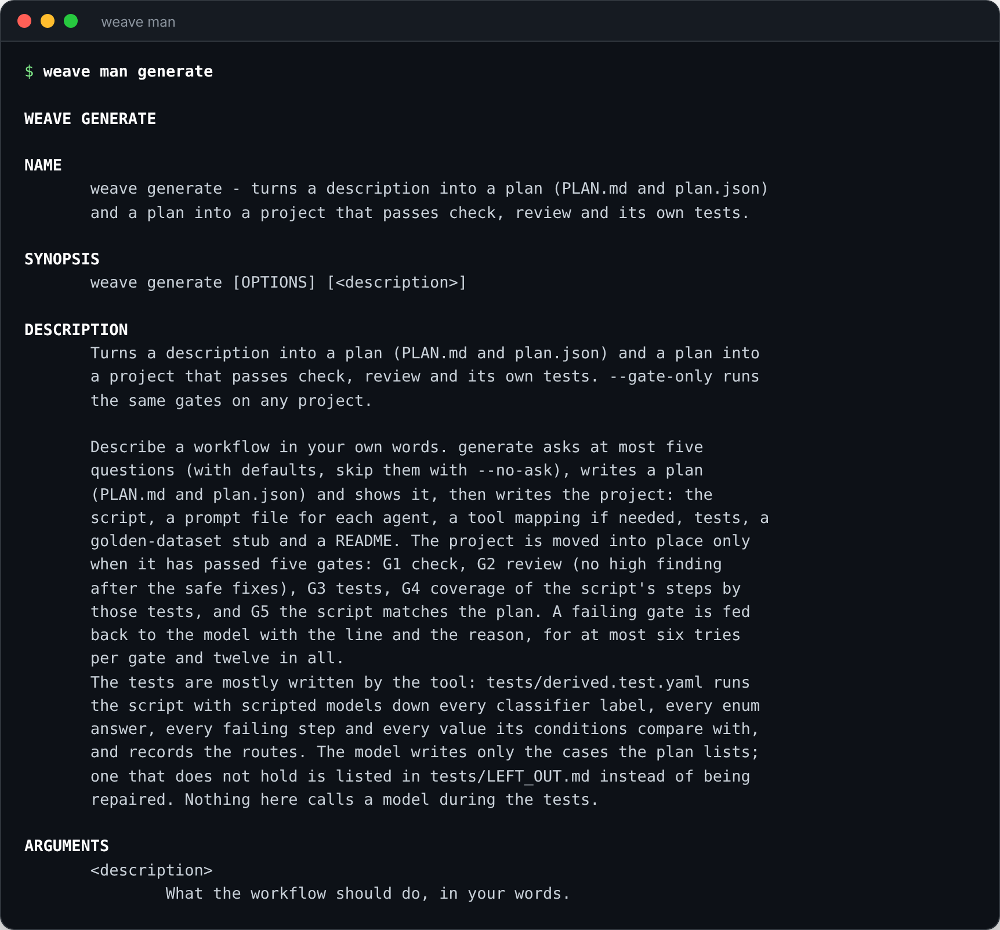

So the session goes like this: **you** say what you want. Your agent plans it, builds it, shows you the picture, runs the tests, reads you the review, and asks when it is your call.

---

# 🏢 Enterprise ready, out of the box

| | |
|---|---|
| ✅ **Authority in code, not in prompts** | What an agent may touch, spend, send and decide is declared and **enforced on every call**. The model reasons; the code holds the authority. |
| ✅ **Approvals before anything leaves** | `approve:` puts a person in front of any effect. Answer on the console, through a command, or on Telegram. |
| ✅ **Budgets that cannot be overspent** | Tokens, calls and cost, checked **before** each model call, per run and per step. |
| ✅ **Crash-safe by design** | Every step and effect is journaled. A restart resumes where it was, and an effect is **never repeated**. |
| ✅ **Audit trail and the right to explanation** | Every Thought, Action and Observation is an immutable audit event. Mapped to **GDPR, the EU AI Act and the NIST AI RMF** ([xAI: Beyond Black Boxes](src/ai-agent4j/wiki/xAI_BEYOND_BLACK_BOXES.md)). |
| ✅ **Confidence and escalation** | Every run carries a confidence score and `shouldEscalateToHuman()`. |
| ✅ **PII masked, bias watched** | PII is masked **before** it reaches a model or a log. Bias monitors can flag or block a response. |
| ✅ **Secrets that never become text** | Environment, your own vault, or an encrypted file store; never in a script, never in a prompt, never written by the tool. |
| ✅ **A security audit you can run in CI** | `weave audit` maps findings to the **OWASP Top 10 for LLM Applications**: the lethal trifecta, unapproved effects, missing budgets, outside dependencies. |
| ✅ **Prompt-injection signals** | Suspected injection and untrusted-to-outward paths flagged live in Fabric, and statically in review. |
| ✅ **Who may sign in, TLS, retention** | Decisions for the observability server, guided by the deployer skill. |
| ✅ **One verdict for CI** | `weave gate`: check, review, test, regress, eval, with skips shown. |

[The risks and the controls →](docs/security/secure-by-construction.md) · [Security guide →](SECURITY.md)

---

# 🤖 Autonomous, for real

- ⏳ **Runs that last days.** Sleep, wait for a person, wait for a time: the run is a file on disk, not a process in memory.
- 🗓️ **Schedules and triggers.** `weave daemon`, `weave tick` (for cron, systemd, launchd), cron blocks in the script.
- 🪜 **Earned autonomy.** A decision starts supervised and **earns** the right to decide alone, on recorded evidence, with promote, demote, freeze and approve in a person's hands (`weave autonomy`, `weave ladder`).
- 🎛️ **Steer, stop, supervise.** Tell a running agent what to do, wrap it up, or stop it where it stands, and handle `on_stopped`.
- ⏪ **Time travel.** Send a run back to a checkpoint, fork it with other values, ask *what if*.
- 🧯 **Failure is a first-class citizen.** `retry`, `timeout`, `on_failure`, `on_exhausted`: tested by injecting the failure, in milliseconds.

---

# 🔌 Plays well with everything you already have

☁️ **Nine hosted LLM vendors** and any OpenAI-style server · 🔗 **MCP servers** and **OpenAPI** specs as tools · 🗄️ **pgvector** and **Pinecone** · 🏠 **Local ONNX embeddings** · 🌱 **Spring Boot** · ☕ **JUnit and AssertJ** · 🐳 **Docker, compose, Kubernetes** · 📡 **OTLP** · 🗣️ **Voice in Indian languages** through Sarvam · 🧩 **VS Code** · 🤖 **Claude Code, Copilot, Cursor, Codex, Gemini**.

---

# 🏆 See it in the wild

| | |
|---|---|
| 🎬 **[GetViral](src/examples/getviral/)** | One idea in, a ready-to-post pack out: twelve agents, one Loom workflow, every module, and no API key to try it. |
| 🏛️ **[Hexamind Hub](src/examples/hexamind-hub/README.md)** | A boardroom of debating agents that reach consensus. |
| 🏭 **[Nirmaan Yantra](src/examples/nirmaan-yantra/README.md)** | An autonomous software factory: spec to tests to code to QA to release. |
| 🧒 **[Kingini](src/examples/kingini/README.md)** | A voice-first companion for children, in Malayalam, built on Sarvam. |
| ✉️ **[Gmail MCP app](src/examples/gmail-mcp-app/)** | Agents that read, draft and send email through MCP, with human approval. |

---

## 🗺️ The whole experience on one page

| You want to | In VS Code | In a terminal | It costs |
|---|---|---|---|
| 👋 See what Loom does | **Try a Demo** | `weave try` | nothing |
| 🩺 Check your setup | **Check My Setup** | `weave doctor` | nothing |
| ✍️ Build from a sentence | **Generate Workflow...** | `weave generate "..."` | a few cents |
| 🔧 Change what you built | **Change Workflow...** | `weave generate --edit main.loom "..."` | a few cents |
| 👀 See it | **Show Workflow Graph** | `weave graph`, `weave explain` | nothing |
| 🛡️ Have it reviewed | **Review Workflow** | `weave review`, `weave audit` | nothing |
| 🧪 Test it | **Run Tests** | `weave test --coverage` | nothing |
| 📊 Evaluate answers | **Evaluate Workflow...** | `weave eval` (`--mock` is free) | a cap you set |
| 🐞 Step through it | **Debug Workflow** (F5) | `weave step` | nothing |
| 🔭 Watch a run | **Run With Live Page...** | `weave run --observe`, Fabric | tokens, capped |
| 🕵️ Understand a run | (live page) | `weave why`, `weave whatif` | nothing |
| 🔁 Turn a bad run into a test | (run the case with **Run Tests**) | `weave capture`, `weave regress`, `weave gate` | nothing |
| 🚢 Ship it | **Write Deployment Files...** | `weave deploy`, `weave bindgen` | nothing |
| 🧭 Know what to do next | **What Should I Do Next?** | `weave next` | nothing |
| 📖 Look anything up | **Show All Commands**, **Open Guide** | `weave man` | nothing |
| 🤝 Teach your coding agent | **Set Up My Coding Agent** | `weave guide --install-skill --for ...` | nothing |

---

## 📌 Where to go next

- 📖 **[Command reference](docs/COMMAND_REFERENCE.md)**: every command, every option with its default, examples and exit codes. In a terminal: `weave man`.
- 🧩 **[VS Code extension](src/loom/vscode-loom/README.md)**: the graph, the review panel, generate and change, the step debugger, the guide and the agent set-up.
- 🏁 **[Getting started with Loom](docs/GETTING_STARTED.md)** · **[Your first run](wiki/Your-First-Run.md)**
- ✍️ **[Generating a workflow](wiki/Generating-a-Workflow.md)** · 🔁 **[From an incident to a regression test](wiki/From-an-Incident-to-a-Regression-Test.md)** · ☕ **[Typed workflows in Java, and deploying](wiki/Typed-Workflows-in-Java-and-Deploying.md)** · 🤝 **[Working with a coding agent](wiki/Working-with-a-Coding-Agent.md)**
- 🔭 **[Observability](docs/OBSERVABILITY.md)** · **[Fabric server](wiki/Fabric-Server.md)** · 📊 **[eval4j report guide](src/eval4j-report/docs/USER-GUIDE.md)**
- 🧱 **[The stack](docs/THE_STACK.md)** · **[Why ai-agent4j](src/ai-agent4j/wiki/WHY_AI_AGENT4J.md)** · **[Why Loom](src/loom/ai-agent4j-loom/WHY_LOOM.md)** · **[Why eval4j](src/ai-agent4j/wiki/WHY_EVAL4J.md)**

   
  <b>☕ Java 17. 🔌 One line to try. ✍️ Your sentence in. 🧪 A tested, 🛡️ reviewed, 🔭 watched, 🚢 shippable workflow out.</b>
    
  
  

