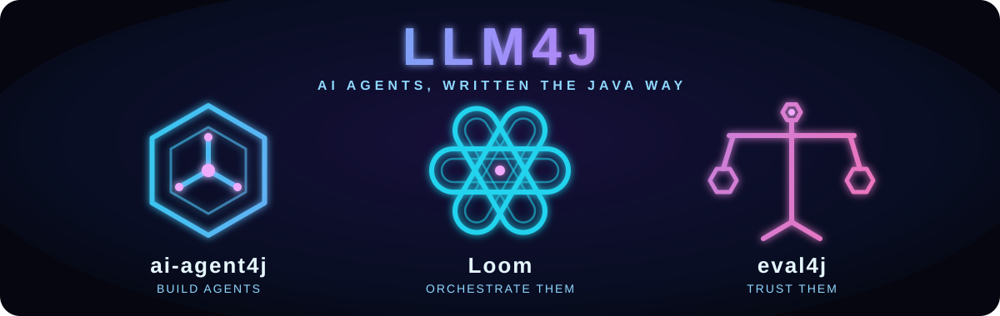
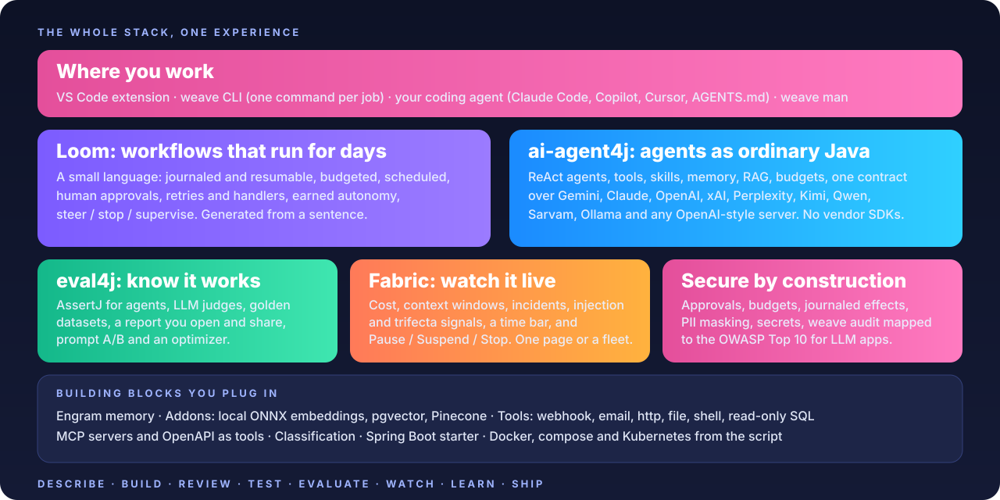

<p align="center">
  
</p>

<h1 align="center">llm4j</h1>

<p align="center">
  <b>The agent platform for Java enterprise applications.</b><br>
  Build, orchestrate, test and operate AI agents on the JVM, with a workflow language<br>
  whose architecture is reviewed before anything runs.
</p>

<p align="center">
  <a href="https://central.sonatype.com/artifact/io.github.srijithunni7182/ai-agent4j"></a>
  <a href="https://www.oracle.com/java/technologies/downloads/#java17"></a>
  <a href="src/spring/llm4j-spring-boot-starter/"></a>
  <a href="LICENSE"></a>
</p>

<p align="center">
  <a href="docs/QUICKSTART.md"><b>Quickstart</b></a> &nbsp;·&nbsp;
  <a href="DEVELOPER_GUIDE.md">Developer guide</a> &nbsp;·&nbsp;
  <a href="docs/README.md">Documentation</a> &nbsp;·&nbsp;
  <a href="docs/WHY_LLM4J.md">Comparisons</a> &nbsp;·&nbsp;
  <a href="SECURITY.md">Security</a>
</p>

---

## Two ways in

| You want | Use |
|---|---|
| An agent inside a Java service you already have | The **`ai-agent4j`** library: one Maven dependency, plain Java, no workflow language |
| Multi-agent workflows that are durable, bounded and reviewed before they run | **Loom** workflows, built on the same library |

An agent is an ordinary Java object: a client, tools that are plain classes, and a budget checked before every model call.

```java
LLMClient client = new DefaultLLMClient(new GoogleProvider(LLMConfig.builder()
        .apiKey(SecretRef.of(EnvSecretStore.system(), "GEMINI_API_KEY"))   // resolved per request, never stored
        .defaultModel("gemini-2.5-flash")
        .build()));

ReActAgent agent = ReActAgent.builder()
        .llmClient(client)                                    // or Claude, OpenAI, xAI, Ollama...: one interface
        .addTool(new OrderStatusTool(orders))                 // a class that implements Tool
        .budget(Budget.builder().tokens(20_000).calls(10).build())
        .build();

AgentResult result = agent.run("Where is order A-123?");
```

**The names, in one line.** llm4j is the project. `ai-agent4j` is the library on Maven Central. Loom is the workflow language, and `weave` is its command line. eval4j tests agents in JUnit. Inspect and Fabric show runs as they happen.

---

## Architecture review, before the first run

In code-first agent frameworks, a workflow's architecture is a convention spread through the code. In llm4j it is written in **Loom**, a small workflow language, so it can be read by a reviewer and checked by a tool.

`weave check`, `weave review` and `weave audit` read the whole workflow offline, with no model and no API key, and exit non-zero so they can gate CI.

```loom
tool Web   { use: duckduckgo }
tool Files { use: file  root: "customers"  mode: read }
tool Mail  { use: email  host: "smtp.example.com"  to: "team@example.com" }

agent Helper {
    model: "any-model"
    system: "Research the customer's question and mail the team a summary."
    tools: [Web, Files, Mail]
}

workflow Main(question) {
    delegate "Research: {question}" to Helper -> summary
    return summary
}
```

```text
$ weave audit main.loom

HIGH    LA01  One agent holds the lethal trifecta with an open way out
MEDIUM  LA03  No run budget
MEDIUM  LA02  An effect with no approval
LOW     LA04  Private data with no PII guard

4 findings: 1 high, 2 medium, 1 low
```

Every finding names the step, explains the risk and prints the fix. Findings are mapped to the OWASP Top 10 for LLM Applications.

**What the checks catch**

| Mistake | Example | Rule |
|---|---|---|
| A rule that lives only in a prompt | A reply reaches a customer with no check against the written policy | `weave check` error |
| Error cascading | One agent invents an amount, the next one pays it | LR11 |
| Retrying a side effect | A post that timed out is retried and sent twice | `weave check` error |
| The model chooses the route | Untrusted input steers work to the agent that can send mail | `weave check` error, LA22 |
| Unbounded fan-out | A model-written list decides how many steps run | LR13 |
| The doer grades itself | The agent that wrote the work decides it is finished | LR12 |

The same scenarios built on LangGraph, LangChain and Google ADK raised no warnings. The [probes](probes/README.md) that show this run with fake models and no keys, so you can rerun them.

**[Architecture you can review: all thirteen mistakes, with checker output](docs/REVIEWABLE_ARCHITECTURE.md)** · [Security audit walkthrough](docs/SECURITY_AUDIT.md)

---

## A complete stack for Java enterprise applications

<p align="center">
  <a href="docs/THE_STACK.md"></a>
</p>

| Layer | Module | What it does |
|---|---|---|
| **Build** | [ai-agent4j](src/ai-agent4j/) | ReAct agents, tools, memory, RAG and budgets over Gemini, Claude, OpenAI, xAI, Perplexity, Kimi, Qwen, Sarvam, Ollama and any OpenAI-compatible server. No vendor SDKs. |
| **Orchestrate** | [Loom](src/loom/ai-agent4j-loom/) | Journaled, resumable workflows with approvals, schedules, budgets and earned autonomy. |
| **Verify** | [eval4j](src/eval4j/) | Agent tests in JUnit 5: no-model tests, golden datasets, LLM judges, and a local report. |
| **Operate** | [Inspect and Fabric](src/loom/loom-inspect/) | Live view of every run: cost, context, incidents, and pause, suspend or stop. Self-hosted. |
| **Act** | [Tools](src/ai-agent4j-tools/) | `webhook`, `email`, `http`, `file`, `shell` and read-only `sql`, with allow-lists and journals. |
| **Integrate** | [Spring Boot starter](src/spring/llm4j-spring-boot-starter/) | Clients, agents, tools and the Loom runtime as Spring beans. |
| **Remember** | [Addons](src/ai-agent4j-addons/) · [Engram](src/engram/engram-core/) (not yet published) | Local embeddings, pgvector and Pinecone; Engram adds long-term memory. |

**Built for production**

- **Durable.** Every step is journaled. Runs survive restarts, and a crash never sends the same message twice.
- **Bounded.** Token, call and dollar budgets are enforced before each model call.
- **Governed.** Approvals at the edge, tools granted per agent, audit events, PII masking, mapped to GDPR, the EU AI Act and the NIST AI RMF ([xAI guide](src/ai-agent4j/wiki/xAI_BEYOND_BLACK_BOXES.md)).
- **Yours to run.** Apache 2.0, minimal dependencies, on the JVM you already operate. Evaluation reports and observability run locally, with no hosted service.

[The stack in detail](docs/THE_STACK.md) · [Every module, skill and example](docs/OVERVIEW.md)

---

## Get started

Try Loom with one command. Java 17, no API key, no account:

```bash
jbang weave@srijithunni7182/llm4j try
```

Or add the library to an existing service:

```xml
<dependency>
    <groupId>io.github.srijithunni7182</groupId>
    <artifactId>ai-agent4j</artifactId>
    <version>6.2.0</version>
</dependency>
```

The [Quickstart](docs/QUICKSTART.md) covers the CLI, the VS Code extension, generating a workflow from a sentence, and your first agent in Java.

---

## Documentation

| | |
|---|---|
| **Learn** | [Quickstart](docs/QUICKSTART.md) · [Developer guide](DEVELOPER_GUIDE.md) · [Tutorial](docs/tutorial/README.md) · [18 starters](src/loom/starters/README.md) · [Examples](docs/EXAMPLES.md) |
| **Reference** | [Loom language guide](src/loom/ai-agent4j-loom/LOOM_GUIDE.md) · [Command reference](docs/COMMAND_REFERENCE.md) · [Documentation index](docs/README.md) |
| **Operate** | [Observability](docs/OBSERVABILITY.md) · [Deployment](docs/OBSERVABILITY_DEPLOYMENT.md) · [Spring Boot guide](docs/SPRING_BOOT_LOOM_GUIDE.md) · [A2A](docs/a2a/README.md) |
| **Evaluate** | [Why llm4j](docs/WHY_LLM4J.md) · [vs LangChain4j and Spring AI](src/ai-agent4j/wiki/WHY_AI_AGENT4J.md) · [Loom vs LangGraph](src/loom/ai-agent4j-loom/WHY_LOOM.md) · [eval4j vs deepeval](src/ai-agent4j/wiki/WHY_EVAL4J.md) |
| **Tooling** | [VS Code extension](https://marketplace.visualstudio.com/items?itemName=srijithunni7182.vscode-llm4j-loom) · [Skills for coding agents](docs/PUBLISHING_SKILL.md) |

## Project

[Security policy](SECURITY.md) · [Contributing](CONTRIBUTING.md) · [API compatibility](docs/API_COMPATIBILITY.md) · [Version matrix](docs/VERSION_MATRIX.md) · [Release notes 6.2.0](docs/RELEASE_NOTES_6_2_0.md) · [About](docs/ABOUT.md)

Licensed under the [Apache License 2.0](LICENSE). See [NOTICE](NOTICE).
