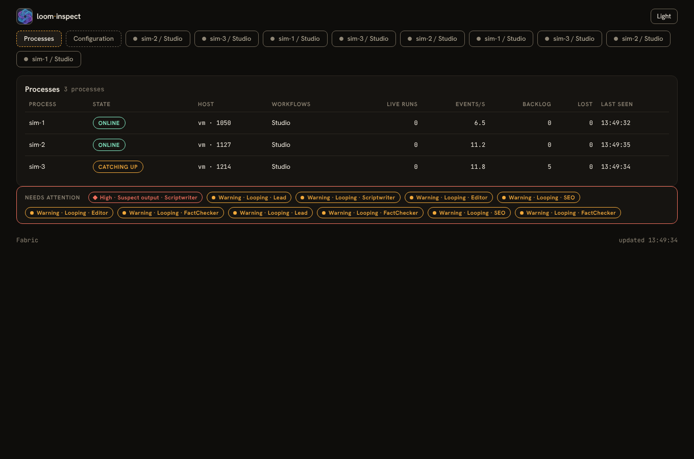
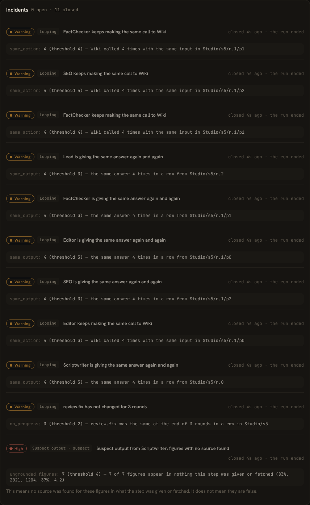
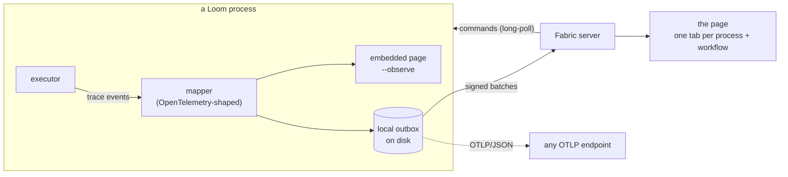

# Observability: watching Loom workflows while they run

[← Back to the README](../README.md)

A Loom workflow can run for days, call dozens of agents and tools, sleep, pause for a rate limit and wait for a person.
When it misbehaves you do not want to read a log: you want to see, now, which agent is doing what, what it has cost, and
whether something has gone wrong. **loom-inspect** and **Fabric** do that.

- **loom-inspect** is an add-on jar. Put it on the class path beside `weave` and add `--observe`: the process serves a
  page about its own runs.
- **Fabric** (`loom-fabric`) is a separate server. Many processes report to it and you watch all of them in one place,
  with one tab per process and workflow.

Both show the same page. Neither changes how a workflow behaves, and a missing or broken Fabric never slows or stops a run.


*The page for one run: total tokens and cost across the top, the workflow with each step marked done, running or waiting, the incidents raised, and a plain-language trace of what agents and tools are doing. Fabric shows one such tab per process and workflow.*

> **Try it first, with no model and no key:** `./fabric-sim.sh` at the repository root starts a Fabric server and
> several simulated Loom processes. See [fabric-sim](../src/examples/fabric-sim/README.md).

## What you get

| Capability | What it shows or does |
|---|---|
| **Live run view** | Tokens, model calls, cost, which agents and tools are running now, tool counts and error rates, a spend-over-time chart, and the latest events in plain language |
| **Workflow graph** | The script's own graph with each step marked done, running, waiting or paused |
| **Sleeps and pauses** | A sleeping run shows its wake time; a rate-limit or budget-window pause is information, not an error |
| **Autonomy ladders** | Where each decision sits on its earned-autonomy ladder |
| **Incidents** | Looping calls and answers, failing tools, no progress across loop rounds, figures with no source, long pauses, budgets nearly spent. Thresholds live in a file beside the script ([details](../wiki/Observability-Incidents-and-Rules.md)) |
| **One tab per process and workflow** | In Fabric, runs of different processes are never merged. A Processes page lists every process: online or offline, backlog, loss, last seen |
| **Controls** | **Pause, resume, suspend and stop** a run from the page, embedded or through Fabric. Admin sign-in, confirm dialog, CSRF protection, audit log ([details](../wiki/Observability-Controls-and-Security.md)) |
| **Secrets** | List the app's secrets (hosts, last update, fingerprint, used-by) and replace a value. Embedded only; values are never shown |
| **Fault tolerance** | Events go to a local on-disk outbox first. A server that is down, slow or restarted loses nothing; the page shows *catching up*, then no gaps |
| **OpenTelemetry** | Traces and logs in OTLP/JSON, to Fabric and optionally to any OTLP endpoint (Collector, Tempo, Honeycomb, Datadog) |
| **Privacy levels** | `--observe-detail full`, `truncated` (default) or `metadata`: how much of what agents say leaves the process |
| **Central configuration** | In Fabric, an admin edits the **inspect rules** and the **price table** on a Configuration page: checked on save, in force at once, kept across restarts ([details](../wiki/Fabric-Server.md#configuration-page)) |
| **Cost** | From a price file at the process, or from the price table kept on Fabric ([cost](#cost)) |

## What the page looks like



*Fabric's Processes page: every process that reports, its state, backlog and last seen, with one tab per process and workflow along the top.*



*Incidents. This run (from the [simulator](../src/examples/fabric-sim/README.md)) is built to trip every rule; each incident says what was measured against which threshold.*


*Configuration (Fabric, signed in): the inspect rules and the price table, checked on save and in force at once.*

## Quick start

### One process, its own page

```bash
# the add-on's jars on the class path beside weave: loom-inspect and loom-inspect-core
weave run flow.loom --observe                       # http://127.0.0.1:8787
weave run flow.loom --observe --observe-linger 5m   # keep the page up after the run
```

Without the jars, `--observe` says so and nothing runs. The page is read-only until you set an admin password
([controls](../wiki/Observability-Controls-and-Security.md)).

### Many processes, one Fabric

```bash
# on the server
LOOM_FABRIC_ADMIN_PASSWORD='a long password' java -jar loom-fabric-5.0-all.jar init --data /var/lib/fabric
java -jar loom-fabric-5.0-all.jar clients add getviral-prod --data /var/lib/fabric     # prints the process's key once
java -jar loom-fabric-5.0-all.jar serve --data /var/lib/fabric --port 9090

# on each process
weave secrets set LOOM_FABRIC_CLIENT_KEY --secrets keys.store                         # paste the key
weave daemon triggers/ --secrets keys.store \
      --observe-fabric https://fabric.example.com:9090 --observe-name getviral-prod --observe-ca ca.pem
```

Full server set-up, TLS, retention and operations: [Fabric server](../wiki/Fabric-Server.md).

## How it works



1. The executor emits trace events. The add-on turns each into an **OpenTelemetry-shaped** record (spans for agent and
   tool steps, log records for events) and applies the detail level **in the process**, before anything is sent or shown.
2. The record is appended to a local **outbox** and forced to disk once a second. A separate thread sends it to Fabric
   (and/or an OTLP endpoint) and moves a cursor forward only after the server acknowledges.
3. The page's numbers are **built only from these records**, in the embedded page and in Fabric alike, so what you see
   locally and on the server cannot disagree. Records carry a sequence number per process instance, so a repeat is
   ignored and a gap is counted and shown.
4. Processes only ever connect **outward**. A pause, suspend or stop from Fabric reaches a process because the process
   holds a long-poll open to the server and the server answers it with a signed command.

## Detail levels and privacy

`--observe-detail` decides what agent text leaves the process:

| Level | Prompts, answers, thoughts, tool input and output |
|---|---|
| `full` | sent whole |
| `truncated` (default) | the first 500 characters |
| `metadata` | not sent at all; names, counts, timings and hashes only |

The incident rules use **hashes and counts computed in the process** (of a tool call, of an answer, of how many figures an
answer has that appear in nothing the step saw), so they work at every level, including `metadata`. A test runs a real
workflow at `metadata` through a real Fabric with planted text and searches every file, the page and the console: nothing
leaks. Secrets never travel at all.

## Cost

The page shows a cost in dollars. It comes from a price table: Loom's runtime computes it at the process, or Fabric computes it
from the table an admin keeps on its Configuration page. Either way the table is lines of `model = input / output` per
million tokens, because prices go stale and none ship with Loom.

**At the process**, the file is found without a flag, in this order:

1. `--prices <file>`
2. `<script>.prices` beside the script (`flow.prices` for `flow.loom`)
3. `prices.properties` in the script's folder
4. the file named by the `LOOM_PRICES` environment variable

```
# flow.prices
gemini-2.5-flash = 0.30 / 2.50
gpt-4o-mini      = 0.15 / 0.60
```

**On Fabric**, the same lines go in the Configuration page. A step whose process reported tokens but no cost is costed from
them; a process that reports its own cost keeps it. Costs already counted do not change when the table does.

A model with no price reports no cost, and the page then shows `$0.000`, which means *unpriced*, not free. Local
`ollama/*` models are free.

## Choosing embedded or Fabric

| | Embedded (`--observe`) | Fabric (`--observe-fabric`) |
|---|---|---|
| Needs | the two add-on jars | the Fabric server, a key per process |
| Shows | this process's runs | every process, with a Processes page |
| History | the life of the process | on disk, 30 days or 2 GB by default; a restart rebuilds the page |
| Controls | yes, with `LOOM_INSPECT_ADMIN_PASSWORD` in the app's secret store | yes, with Fabric's admin password; delivered as signed commands |
| Secrets page | yes | no: values never leave a process |
| Process is down | the page is gone | its runs stay visible, marked offline |

You can use both at once, and add `--observe-otlp` for an OpenTelemetry backend.

## Limits, stated plainly

- A pause, suspend or stop takes effect **between steps**. A model call or tool call already under way finishes first.
- **Pause** keeps the run's thread; **suspend** frees it and needs a journal to resume from (`weave resume`).
- The incident rules flag *signals*, not truth. An answer whose figures appear in nothing the step was given is labelled
  **suspect**: it means no source was found, not that the figures are false.
- One admin password; per-user accounts and roles are not built.
- The simulator and the tests exercise transport, server, page and controls. Real-agent behaviour is for your own
  workflow and, for a long real run, the [30-minute soak](../src/examples/inspect-soak/README.md).

## Where to go next

- [**Deployment guide**](OBSERVABILITY_DEPLOYMENT.md): setting it up for production, step by step, with a checklist
- [Fabric server](../wiki/Fabric-Server.md): install, TLS, clients, retention, operations, packaging
- [Incidents and the rules file](../wiki/Observability-Incidents-and-Rules.md)
- [Controls, secrets and security](../wiki/Observability-Controls-and-Security.md)
- [Reference](../wiki/Observability-Reference.md): every option, route and record
- [fabric-sim](../src/examples/fabric-sim/README.md): try everything with no model
- [Design and phase-by-phase status](loom-inspect/DESIGN.md)
- [Loom guide: watching runs live](../src/loom/ai-agent4j-loom/LOOM_GUIDE.md)
