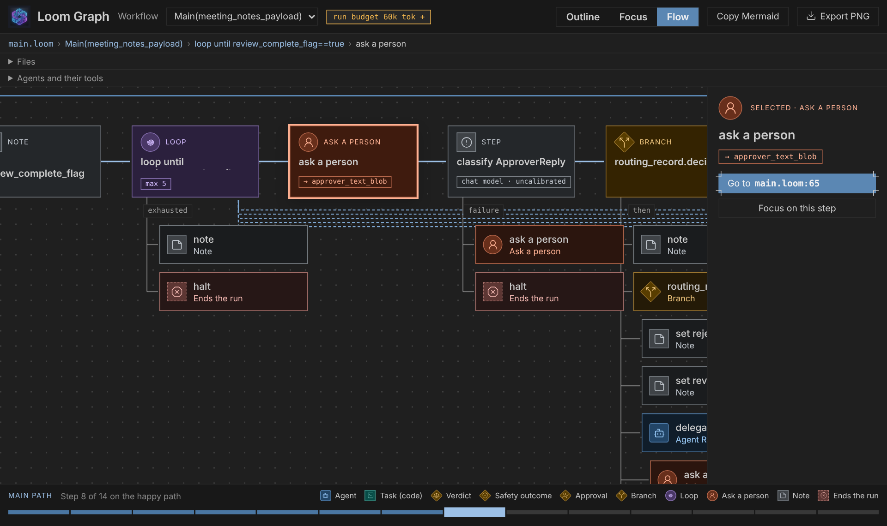
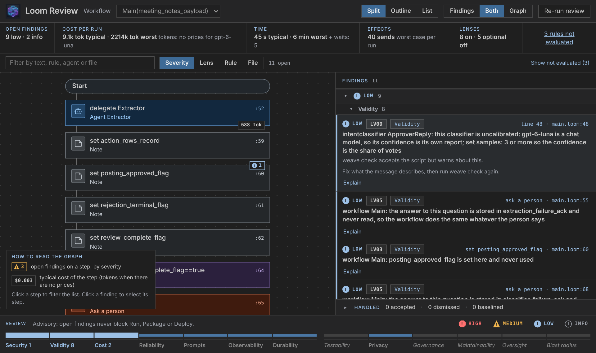

# Quickstart

[← Back to the README](../README.md)

Four ways in. All need Java 17.

## 1. Try Loom from the command line

```bash
jbang weave@srijithunni7182/llm4j try
```

No key, no account, nothing written. To keep `weave` on your PATH:

```bash
jbang app install weave@srijithunni7182/llm4j
```

See [install](../install/README.md) for other options.

## 2. Generate a workflow from a sentence

```bash
weave generate "Turn meeting notes into action items and post them to a team webhook after a person approves."
```

You read a plan first. The project lands in your folder only after it passes five gates: it checks, it reviews clean, its tests pass, the tests reach every step, and it matches the plan.

<p align="center">
  
  
</p>

## 3. Use VS Code

Install the [Loom extension](https://marketplace.visualstudio.com/items?itemName=srijithunni7182.vscode-llm4j-loom), press `Ctrl/Cmd+Shift+P` and run **Loom: Try a Demo**, then **Loom: Generate Workflow...**. See [Loom in VS Code](../wiki/Loom-in-VS-Code.md).

## 4. Use the library in Java

```xml
<dependency>
    <groupId>io.github.srijithunni7182</groupId>
    <artifactId>ai-agent4j</artifactId>
    <version>6.2.0</version>
</dependency>
```

An agent is an ordinary object: built with a builder, tested with JUnit, bounded by a budget.

```java
ReActAgent support = ReActAgent.builder()
        .llmClient(client)                                   // Gemini, Claude, OpenAI, xAI, Ollama and more: one contract
        .addTool(new RefundTool(payments))                   // requiresApproval(args) puts a person in the loop
        .budget(Budget.builder().tokens(20_000).build())     // it cannot overspend
        .build();

assertThat(support.run(question)).usesTool("refund").completedSuccessfully();   // eval4j, in plain JUnit
```

Using Spring? Add the [Spring Boot starter](../src/spring/llm4j-spring-boot-starter/) and inject clients, agents, tools and the Loom runtime as beans ([guide](SPRING_BOOT_LOOM_GUIDE.md)).

## Next

- [Developer guide](../DEVELOPER_GUIDE.md): from a sentence to a deployed, watched workflow
- [Tutorial](tutorial/README.md), chapter by chapter
- [18 starters](../src/loom/starters/README.md)
- [Getting started with ai-agent4j](../src/ai-agent4j/wiki/Getting-Started.md) · [Secret Store](../src/ai-agent4j/wiki/Secret-Store.md)
- [Command reference](COMMAND_REFERENCE.md)
