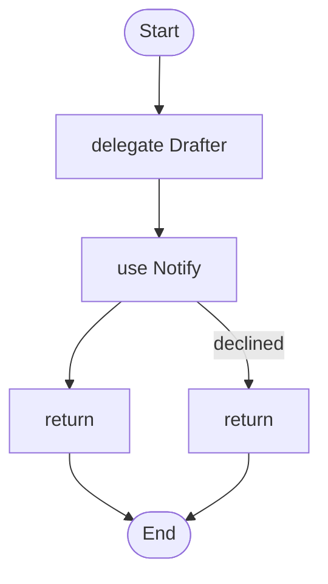

# Architecture you can review

> **Loom distils multi-agent best practice into a language that can be reviewed, by people and by tools. In code-first frameworks the architecture is a convention; in Loom it is checked.**

This page is the idea behind the guarantees on [Why teams choose llm4j and Loom](WHY_LLM4J.md). It shows thirteen mistakes that multi-agent workflows tend to make, what Loom does about each one, and what you see: the script a reviewer reads, and the exact words `weave` prints about the broken version. Every `weave` output below is generated by a test from the script above it, so it cannot go stale. Every statement about another framework links the [probe](../probes/README.md) that checked it.

## Why a language makes it possible

In a code-first framework the workflow is general-purpose code. Which step sees what, which call changes something, where a person is asked and what is checked before a value leaves are all spread through the plumbing. A reviewer has to read the plumbing, and a tool cannot analyse arbitrary code. [Nine probes](../probes/README.md#p9-to-p17-the-architecture-mistakes-on-loom-langgraph-langchain-and-google-adk) ran the same scenarios on LangGraph, LangChain and the Python Google ADK with fake models. In each one the framework offered a hook, and in none did anything read the workflow before the run and say that the hook was missing.

In Loom the workflow is a small language. A tool can know, before anything runs, which agents and tools are declared, what each tool does to the world (`effect: none | reads | changes`), where a value written by a model can flow, and where a value leaves the workflow. That is what makes the checks below possible. Here is a small workflow and the graph `weave graph` draws from it:

```loom
substitution: braces

tool Notify { use: webhook  url: env.SLACK_WEBHOOK  format: slack  effect: changes }
agent Drafter { model: "gemini-2.5-flash"  system: "Draft a short announcement." }

workflow Main(facts) {
    delegate "Draft an announcement from: {facts}" to Drafter -> draft
    use Notify(text = draft) approve "Send this to the team channel?" -> receipt
        on_declined { return "Not sent." }
    return receipt
}
```



A reviewer can see in these ten lines that one agent writes text, that a person is asked once about the exact text, and that the only thing that changes the world is a tool declared as changing it. The tool sees the same.

## The thirteen mistakes

| # | Mistake | What Loom does | What you see |
|---|---|---|---|
| 1 | The god prompt | Rules live in a policy file and are checked at the exits by an evaluator; an agent's own changing tool calls are checked automatically | `weave check`'s exit error; LY07; the leak guard |
| 2 | The JSON trap | Reason in prose, then an `extractor` | LP10 and its `split` fix |
| 3 | Evaluation as an afterthought | The golden dataset is the requirements; an untested evaluator or extractor does not pass `weave check` | the gate's error; LT06; `weave eval --requirements` |
| 4 | Asking a person in the middle of the agent's reasoning | `use ... approve` at the edge; tool effects; earned autonomy as an option | LH05; LH03 |
| 5 | Global state leakage | Internal nodes see only their inputs; `transcript:` on agents; the transcript in the audit | LP08, LP09, LA21 |
| 6 | Premature agentification | Tasks and classifiers are first-class; a model is used where judgement is needed | LC07, LC01 |
| 7 | Error cascading | Extract, `check` or `approve` before a step acts | LR11 |
| 8 | Stringly-typed state | The script is the state machine; a long agent's progress is a journaled variable | starter 16; the graph |
| 9 | Unbounded action loops | Bounded loops, retries and budgets | LR03, LB01, LO04 |
| 10 | The model chooses the route | Routing only within an allow-list; results only where the script says | `weave check`'s route error; LA22 |
| 11 | Unbounded fan-out | `for each ... max N`; a longer list fails and points upstream | LR13 |
| 12 | The doer grades itself | A different default judge; a reviewer, a task or a `check` decides "done" | LR12, LR14 |
| 13 | Self-reported confidence | Calibrated classifiers; calibration measured before a threshold is trusted | taught, not checked |

Mistakes 6 and 9 were mostly addressed before this program (the cost rules and the loop bounds); mistake 13 is taught in the guide and the skills, not checked, because detecting it would rest on field names.

### 1. The god prompt

*A reviewer can see this in ten lines, and so can the tool.* A reply is made by a model and returned. Nothing checks it against the rules the company wrote, so the only thing standing between the model and a customer is a sentence in a prompt. Here a policy is declared, and the reply leaves with no check before it:

```loom
substitution: braces

evaluator Compliance { model: "gemini-2.5-pro" }
policy HouseRules: "house-rules" checked by Compliance
agent Support { model: "gemini-2.5-flash"  system: "Answer customers." }

workflow Main(question) {
    delegate "{question}" to Support -> reply
    return reply
}
```

```text check
✗ line 9: return in Main: a value written by a model (Support, line 8) reaches this return without a check against HouseRules. Add: check <variable> against HouseRules using <Evaluator> before the return.
1 problem in main.loom
```

The fix puts the check at the exit, where an editor rewrites a reply that breaks a rule. The rules stay in `policies/house-rules.md`, written for whoever owns compliance, and never go into a prompt:

```loom clean LR11
substitution: braces

evaluator Compliance { model: "gemini-2.5-pro" }
policy HouseRules: "house-rules" checked by Compliance
agent Support { model: "gemini-2.5-flash"  system: "Answer customers." }
agent Editor { model: "gemini-2.5-flash"  system: "Rewrite the reply so it follows the rules." }

workflow Main(question) {
    delegate "{question}" to Support -> reply
    check reply against HouseRules using Compliance -> verdict on_violation { rewrite with Editor }
    return reply
}
```

An agent that holds a tool that sends is covered too: with a policy declared, its own calls to the tool are checked before the send (the repository's `ToolCallPolicyTest`). What the probe found elsewhere: in LangGraph, LangChain and ADK a reply that breaks a rule left with no check, a hook exists for a check you write, and nothing reported that none was installed ([probe P11](../probes/README.md#p11-a-reply-that-breaks-a-written-rule-can-it-leave-without-a-check)). Teaching: [tutorial chapter 6](tutorial/06-tools-and-tasks.md) and [the Loom guide, "Policies"](../src/loom/ai-agent4j-loom/LOOM_GUIDE.md).

### 2. The JSON trap

An agent that has to think (it has tools) and must also answer in a large nested schema has no room to reason in its answer. It makes leaps or breaks the format. Thinking and formatting are two jobs.

```loom
substitution: braces

tool Files { use: file  root: "data"  mode: read }
agent Analyst {
    model: "gemini-2.5-flash"
    system: "Read the order files and report on the request."
    tools: [Files]
    output_schema: {
        customer: string,
        shipping: { street: string, city: string, country: string },
        lines: list<{ sku: string, qty: number, price: number }>
    }
}

workflow Main(request) {
    delegate "Look at {request}" to Analyst -> order
    return order
}
```

```text review LP10
MEDIUM  LP10  Prompts        main.loom:4
        Agent Analyst reasons (it has tools) and must answer in a schema with a nested object
        why: An agent told to answer in JSON only has no room to think in its answer, so it makes logical leaps or breaks the format. The thinking and the formatting are two jobs.
        fix: Let the agent answer in prose, and pull the fields out with an extractor; or make the schema small and flat; or accept the finding with a reason.
```

The fix is to let the agent write prose, and then pull the fields out with an `extractor`:

```loom clean LP10
substitution: braces

tool Files { use: file  root: "data"  mode: read }
agent Analyst { model: "gemini-2.5-flash"  system: "Read the order files and report on the request in plain prose."  tools: [Files] }
extractor Invoice {
    model: "gemini-2.5-flash"
    instructions: "Read the report."
    fields {
        vendor: string
        total: number
    }
    optional: [total]
}

workflow Main(request) {
    delegate "Look at {request}" to Analyst -> report
    extract Invoice from report -> order
    return order
}
```

`weave review --fix-finding LP10 --option split` writes that rewrite for you, as a diff. In the probe, none of the three frameworks noticed the combination before the run ([probe P10](../probes/README.md#p10-a-step-that-uses-tools-and-must-answer-in-a-large-nested-schema)). Teaching: [tutorial chapter 5](tutorial/05-structured-answers-and-failure.md).

### 3. Evaluation as an afterthought

An evaluator is a model judging, in production, whether a reply breaks a rule. If nobody has tested it, the rule is a hope. In Loom the gate is in `weave check`, and no flag skips it:

```loom
substitution: braces

evaluator Compliance { model: "gemini-2.5-pro" }
policy HouseRules: "house-rules" checked by Compliance
agent Support { model: "gemini-2.5-flash"  system: "Answer customers." }

workflow Main(question) {
    delegate "{question}" to Support -> reply
    check reply against HouseRules using Compliance -> verdict on_violation { fail }
    return reply
}
```

```text check bare
✗ line 3: evaluator Compliance: Evaluator `Compliance` has no case that breaks `HouseRules.no_refund_promise` (and no clean case). A policy rule nobody has tested is not binding: write one of each in `eval/golden/compliance.yaml`.
1 problem in main.loom
```

The same script with a case that breaks the rule and a clean case, in `eval/golden/compliance.yaml`, passes. A person who owns the rules can read the whole dataset as a page with `weave eval --requirements` and sign it off. In the probe, a guard with no test built and ran without a word in each of the three frameworks ([probe P13](../probes/README.md#p13-a-guard-that-enforces-a-rule-can-it-be-used-with-no-test-of-it)). Teaching: [tutorial chapter 10](tutorial/10-testing.md).

### 4. Asking a person in the middle of the agent's reasoning

When the question is put to a person from inside an agent's tool loop, the person is asked a question about an action whose text may change when the loop restarts. In a scheduled workflow, nobody may be there:

```loom
substitution: braces

schedule Weekly {
    cron: "0 9 * * 1"
    run: Main(facts = "weekly news")
}
tool Notify { use: webhook  url: env.SLACK_WEBHOOK  format: slack  effect: changes }
agent Drafter {
    model: "gemini-2.5-flash"
    system: "Draft an announcement and send it."
    tools: [Notify]
    approve: [Notify]
}

workflow Main(facts) {
    delegate "Draft and send from: {facts}" to Drafter -> done
    return done
}
```

```text review LH05
MEDIUM  LH05  Human oversight main.loom:8
        Agent Drafter asks a person part-way through its work, in a workflow nobody is watching
        why: The run stops in the middle of the agent's reasoning and holds its whole conversation until someone answers, possibly hours later, from a phone. The person sees one tool call without the job it belongs to.
        fix: Let the agent propose, then approve once at the edge: use Tool(...) approve, run Task(...) approve, or a decide. In an interactive assistant, an approval inside the loop is fine.
```

The fix is the script at the top of this page: the agent proposes, a person is asked once about the exact text, and the script sends. In the probe, LangGraph's `interrupt()` inside a node made the node start again after the answer, so the text sent was not the text shown ([probe P12](../probes/README.md#p12-a-sending-tool-that-needs-a-persons-yes-where-does-the-run-pause)); LangChain and ADK ask at the tool call. `weave review` also reports LH03 for a run that can put more than ten questions to a person. The same declared effect is honoured by retries: `weave check` refuses `retry` on a step that uses a tool that changes something and is not marked safe to repeat. In the probe a tool that posted and then timed out was posted twice under the retry of each of the three frameworks, whatever was written on the tool ([probe P14](../probes/README.md#p14-a-tool-that-posts-is-it-changes-something-stated-once-and-honoured)). Teaching: [tutorial chapter 8](tutorial/08-people-in-the-loop.md).

### 5. Global state leakage

In most frameworks a step sees everything said before it. A step that only reads fields out of text then answers differently depending on what ran earlier, so testing it alone does not predict its behaviour in the workflow. In Loom an agent used for this is reported:

```loom
substitution: braces

agent Chat { model: "gemini-2.5-flash"  system: "Chat with the customer." }
agent Reader {
    model: "gemini-2.5-flash"
    system: "Read the invoice."
    output_schema: { vendor: string, total: number }
}

workflow Main(text) {
    delegate "{text}" to Chat -> reply
    delegate "Read the invoice in: {text}" to Reader -> invoice
    return invoice
}
```

```text review LP09
MEDIUM  LP09  Prompts        main.loom:4
        Agent Reader pulls fields out of text
        why: An agent is briefed with the whole run so far and the shared prompt, so what it extracts can depend on what ran before it. An extractor does the same job without seeing either.
        fix: Declare an extractor with the same fields and use extract instead of delegate (weave review --fix-finding LP09 shows the rewrite).
```

An `extractor` is handed only the text it is told to read. The probe ran the extractor and the agent form with a recording model: the extractor's request did not contain the earlier step's output and the agent's did. LangGraph and LangChain can pass only the text, with code you write. In ADK, `include_contents='none'` removed the user's message but the previous agent's output still arrived in `SequentialAgent`; wrapping the agent as an `AgentTool` ran it on only the call's arguments ([probe P9](../probes/README.md#p9-a-utility-step-that-pulls-fields-out-of-text-can-it-be-given-only-its-inputs)). An agent that receives the whole transcript after one that read untrusted content is treated as reading untrusted content too (LA21); `transcript: none` on the receiver fixes it. Teaching: [tutorial chapter 5](tutorial/05-structured-answers-and-failure.md).

### 6. Premature agentification

Using a model for something a program does in a line. Asking an agent to add numbers is slow, costs money and sometimes gets the answer wrong:

```loom
substitution: braces

agent Helper { model: "gemini-2.5-flash"  system: "You help." }

workflow Main(figures) {
    delegate "Calculate the total of {figures}" to Helper -> total
    return total
}
```

```text review LC07
INFO    LC07  Cost and performance main.loom:6
        delegate Helper asks a model for something a program could do
        why: Arithmetic, format checks and table lookups are exact in code and cost nothing per call; a model does them at a price and can get them wrong.
        fix: Do it in a run task and keep the model for what needs judgement.
```

LC07 is a guess from the wording of the prompt, so it runs only with `heuristics = on` in `review.properties`.

The fix is a task: a few lines of Java registered with the host, called with `run Total(figures = figures) -> total`. Choosing a label is an `intentclassifier` step, not an agent that writes an answer to be parsed (LC01). The cost rules existed before this program; nothing new is claimed about other frameworks here.

### 7. Error cascading

If the first agent invents a fact, an amount or an order number, the second acts on it with confidence. The mistake travels downstream and becomes an action:

```loom
substitution: braces

tool Pay { use: webhook  url: env.PAY_HOOK  effect: changes }
agent Planner { model: "gemini-2.5-flash"  system: "Work out what refund the customer is owed." }
agent Payer { model: "gemini-2.5-flash"  system: "Make the payment you are told to make."  tools: [Pay] }

workflow Main(complaint) {
    delegate "{complaint}" to Planner -> plan
    delegate "Do this: {plan}" to Payer -> done
    return done
}
```

```text review LR11
MEDIUM  LR11  Reliability    main.loom:9
        delegate Payer acts on what agent Planner wrote (plan), and nothing checks it on the way
        why: If the first agent invents a fact (an amount, an order id), the second acts on it with confidence. The mistake travels downstream and becomes an action.
        fix: Check the hand-off with the cheapest thing that works: extract the fields and test them (alt, or a task), check the text against a policy, or add approve to the acting step.
```

Check the hand-off with the cheapest thing that works: pull the fields out with an extractor and test them in code, check the text against a policy, or ask a person once at the acting step:

```loom clean LR11
substitution: braces

tool Pay { use: webhook  url: env.PAY_HOOK  effect: changes }
agent Planner { model: "gemini-2.5-flash"  system: "Work out what refund the customer is owed." }
extractor Invoice {
    model: "gemini-2.5-flash"
    instructions: "Read the plan."
    fields {
        vendor: string
        total: number
    }
    optional: [total]
}
agent Payer { model: "gemini-2.5-flash"  system: "Make the payment you are told to make."  tools: [Pay] }

workflow Main(complaint) {
    delegate "{complaint}" to Planner -> plan
    extract Invoice from plan -> refund
    alt (refund.total > 100) {
        halt "Too large for automatic payment."
    } else {
        delegate "Pay {refund.total} for {refund.vendor}" to Payer -> done
    }
    return done
}
```

In the probe, a made-up amount reached a paying tool with nothing between the agents and no warning, in LangGraph, LangChain and ADK ([probe P15](../probes/README.md#p15-one-agents-invented-amount-handed-to-an-agent-that-pays)). Teaching: [the Loom guide, "Where to ask a person" and "Never pipe an agent straight into an action"](../src/loom/ai-agent4j-loom/LOOM_GUIDE.md).

### 8. Stringly-typed state

A long agent job whose progress lives only in a chat transcript that may be compacted. In Loom the script is the state machine: what is done and what is next is a typed variable the script owns, the worker is fresh each round, and an extractor writes the new progress. This is [starter 16](../src/loom/starters/16-step-by-step-agent/), and its graph shows the loop. There is no review rule here; it is a recipe.

```loom
substitution: braces

agent Worker {
    model: "gemini-2.5-flash"
    system: "You do ONE step of a larger job. Report in plain prose what you did."
    memory { transcript: none }
}
extractor Progress {
    model: "gemini-2.5-flash"
    instructions: "Read the goal, the previous progress and the worker's report."
    fields {
        done: list<string>
        next: string
        finished: boolean
    }
}

workflow Main(goal) {
    set progress = { done: "nothing yet", next: "plan the first step", finished: "false" }
    loop until (progress.finished == "true") max 6 {
        delegate "GOAL: {goal}\nDO THIS ONE STEP NOW: {progress.next}" to Worker -> report
        extract Progress from (goal = goal, previous = progress, report = report) -> progress
    }
    return progress.done
}
```

In the probe, each framework could keep progress where compaction does not touch it, with a state field or tool you write, and LangChain resumed from a checkpoint after a crash ([probe P16](../probes/README.md#p16-a-long-agent-loop-that-runs-past-its-context-window)).

### 9. Unbounded action loops

A loop that runs until a model says it is done, with nothing to stop it if it never does. Loom bounds loops, retries and budgets, and reports the ones that are not:

```loom
substitution: braces

agent A { model: "gemini-2.5-flash"  system: "Work." }

workflow Main(q) {
    loop until (x == "yes") {
        delegate "{q}" to A -> x
    }
    return x
}
```

```text review LR03
MEDIUM  LR03  Reliability    main.loom:6
        loop until x==yes has no maximum number of rounds
        why: A loop that only stops when its condition becomes true can run for ever if the condition never does, and every round may call a model.
        fix: Add a maximum, such as max 5, and say what happens when it is reached.
```

The fix is a maximum, with a handler for when it runs out: `loop until (x == "yes") max 5 { ... } on_exhausted { ... }`. These rules existed before this program; the page makes no claim about other frameworks here.

### 10. The model chooses the route

A planner reads untrusted input and names the agent that runs next. If its reply can be any agent, then a sentence in the input can send work to the one that can send mail:

```loom
substitution: braces

tool Mail { use: webhook  url: env.MAIL_HOOK  effect: changes }
agent Planner { model: "gemini-2.5-flash"  system: "Pick the agent for the task."  output_schema: { owner: string, task: string } }
agent Worker { model: "gemini-2.5-flash"  system: "Do the task." }
agent Privileged { model: "gemini-2.5-flash"  system: "Do the task and mail the result."  tools: [Mail] }

workflow Main(request) {
    delegate "{request}" to Planner -> plan
    delegate "{plan.task}" to {plan.owner} -> result
    return result
}
```

```text check
✗ line 10: delegate {plan.owner}: a model chooses which agent runs here, and any agent could be chosen, including Privileged, which can change things or reach private data. Bound it: write the agents after it, delegate ... to {plan.owner} in [Researcher, Writer], or make the field an enum in the schema of the agent or extractor that writes it.
1 problem in main.loom
```

The fix names the agents the planner may pick, and keeps each result under a key that cannot overwrite anything. A value outside the list is refused when the step runs. `weave audit` still notes the choice (LA22, low here, because the agent it can reach changes nothing) so a reviewer sees that a model's word picks a route:

```loom clean -
substitution: braces

tool Mail { use: webhook  url: env.MAIL_HOOK  effect: changes }
agent Planner { model: "gemini-2.5-flash"  system: "Pick the agent for the task."  output_schema: { owner: string, task: string } }
agent Worker { model: "gemini-2.5-flash"  system: "Do the task." }
agent Privileged { model: "gemini-2.5-flash"  system: "Do the task and mail the result."  tools: [Mail] }

workflow Main(request) {
    delegate "{request}" to Planner -> plan
    delegate "{plan.task}" to {plan.owner} in [Worker] -> results[plan.owner]
    return results
}
```

In the probe, LangGraph's `Command(goto=<the model's reply>)` ran the privileged node, and a list of allowed targets on a conditional edge refused it at run time; a LangChain supervisor's tool list and an ADK agent's `sub_agents` are an allow-list by construction ([probe P17](../probes/README.md#p17-a-planner-told-to-route-a-task-to-a-privileged-agent)). Teaching: [tutorial chapter 4](tutorial/04-control-flow.md).

### 11. Unbounded fan-out

A planner returns a list and the workflow runs one step per item. If the list is long because the input told the planner to make it long, the bill and the blast radius are the model's choice:

```loom
substitution: braces

agent Planner { model: "gemini-2.5-flash"  system: "You plan."  output_schema: { tasks: list<string> } }
agent Worker { model: "gemini-2.5-flash"  system: "You work." }

workflow Main(q) {
    delegate "plan {q}" to Planner -> plan
    for each t in plan.tasks {
        delegate "{t}" to Worker -> r retry 1 timeout 30s
    }
    return plan
}
```

```text review LR13
MEDIUM  LR13  Reliability    main.loom:8
        for each t in plan.tasks walks over plan.tasks, a list a model wrote, with no maximum
        why: The length of the list is chosen by a model (or by text that steered it), so this step may run once for every item of a list of any length. Budgets stop the total, but they stop it part-way, with some items done.
        fix: Add max N after the list (and tell the agent that wrote it the limit in its instructions). Add on_too_many { ... } if something other than failing should happen.
```

The fix is `for each t in plan.tasks max 4 { ... }`: a longer list fails the workflow before any item starts, names the agent that wrote it, and shows as an incident on the live page. The cost estimate shows the worst case of an unbounded fan-out as unknown. Teaching: [tutorial chapter 4](tutorial/04-control-flow.md).

### 12. The doer grades itself

A loop that stops when the agent that wrote the work says it is finished. Such an agent tends to say yes:

```loom
substitution: braces

agent Writer {
    model: "gemini-2.5-flash"
    system: "Write the report, then say whether it is finished."
    output_schema: { done: boolean }
}

workflow Main(topic) {
    loop until (verdict.done == true) max 4 {
        delegate "Write a report on {topic}" to Writer -> draft
        delegate "Is {draft} finished?" to Writer -> verdict
    }
    return draft
}
```

```text review LR12
MEDIUM  LR12  Reliability    main.loom:10
        loop until verdict.done==true ends when agent Writer says it is done, and Writer also wrote the work
        why: An agent that decides its own work is finished tends to say yes. The loop stops when the writer is satisfied, not when the work is good.
        fix: Let a different agent review it (starter 03's shape), check the criteria in code with a task (best when they can be checked, such as tests passing), or check the text against a policy.
```

Let a different agent review it (starter 03's shape), check the criteria in code, or ask a person:

```loom clean LR12
substitution: braces

agent Writer { model: "gemini-2.5-flash"  system: "Write the report." }
agent Reviewer {
    model: "gemini-2.5-pro"
    system: "Review the report."
    output_schema: { verdict: enum["OK", "REVISE"] }
}

workflow Main(topic) {
    delegate "Write a report on {topic}" to Writer -> draft
    loop until (review.verdict == "OK") max 3 {
        delegate "Review {draft}" to Reviewer -> review
        delegate "Revise {draft} using {review}" to Writer -> draft
    }
    return draft
}
```

`weave eval` applies the same rule to its own judge: by default a different model than the one being judged, and a caution when it must use the same one. LR14 reports an evaluator that runs on the same model as the agent whose text it checks. There is no probe for this one; the page makes no claim about other frameworks.

### 13. Self-reported confidence

A number a chat model writes about its own answer is not a calibrated probability. Gating on it needs a calibrated source or calibration measured on the golden dataset before the threshold is trusted:

```loom
substitution: braces

agent Triage { model: "gemini-2.5-flash"  system: "Classify the ticket and say how confident you are."  output_schema: { label: string, confidence: number } }

workflow Main(ticket) {
    delegate "{ticket}" to Triage -> answer
    alt (answer.confidence > 0.8) {
        return "automatic: {answer.label}"
    } else {
        return "send to a person"
    }
}
```

Loom does not check this one: detecting it would rest on field names. It is taught in the Loom guide ("Output Schema Enforcement"), the workflow-guide skill and the evaluation-design skill. An `intentclassify` step with `confidence at least` is the structured form, and calibration is measured as one of the quality dimensions.

## What a coding agent sees

A coding agent, or a developer who has never heard of these practices, does not need to know them. It writes a first draft, runs `weave check`, and reads what comes back. Here is a plausible first draft of a support workflow that sends the reply to a channel:

```loom
substitution: braces

tool Notify { use: webhook  url: env.SLACK_WEBHOOK  format: slack  effect: changes }
evaluator Compliance { model: "gemini-2.5-pro" }
policy HouseRules: "house-rules" checked by Compliance
agent Support { model: "gemini-2.5-flash"  system: "Answer customers." }

workflow Main(question) {
    delegate "{question}" to Support -> reply
    use Notify(text = reply) -> receipt retry 2
    return reply
}
```

```text check
⚠ line 10: workflow Main: receipt is set here and never used (warning)
✗ line 10: use Notify: Notify changes things and is not marked safe to repeat, so a retry after an unknown outcome could do it twice; remove retry, or declare the tool idempotent
✗ line 11: return in Main: a value written by a model (Support, line 9) reaches this return without a check against HouseRules. Add: check <variable> against HouseRules using <Evaluator> before the return.
2 problems in main.loom
```

Each line names the step and says what to do. The exit code is 2, and `weave check --format json` gives the same problems as data, so a loop can read them, fix them and run the check again. The draft has two errors and a warning: a retry on a step that changes something could post twice, the reply reaches the caller with no check against the policy, and the receipt is never used. The agent fixes the errors, puts the check before the send, and asks a person once about the exact text. The second run has only the warning left, which it can fix or leave:

```loom
substitution: braces

tool Notify { use: webhook  url: env.SLACK_WEBHOOK  format: slack  effect: changes }
evaluator Compliance { model: "gemini-2.5-pro" }
policy HouseRules: "house-rules" checked by Compliance
agent Support { model: "gemini-2.5-flash"  system: "Answer customers." }
agent Editor { model: "gemini-2.5-flash"  system: "Rewrite the reply so it follows the rules." }

workflow Main(question) {
    delegate "{question}" to Support -> reply
    check reply against HouseRules using Compliance -> verdict on_violation { rewrite with Editor }
    use Notify(text = reply) approve "Post this reply?" -> receipt
        on_declined { return "Not posted." }
    return reply
}
```

```text check
⚠ line 12: workflow Main: receipt is set here and never used (warning)
✓ main.loom: ready to run (1 warning)
  next: weave next says what to do now; weave guide recipes has tested changes to copy
```

```loom clean LR11,LA02,LH05
substitution: braces

tool Notify { use: webhook  url: env.SLACK_WEBHOOK  format: slack  effect: changes }
evaluator Compliance { model: "gemini-2.5-pro" }
policy HouseRules: "house-rules" checked by Compliance
agent Support { model: "gemini-2.5-flash"  system: "Answer customers." }
agent Editor { model: "gemini-2.5-flash"  system: "Rewrite the reply so it follows the rules." }

workflow Main(question) {
    delegate "{question}" to Support -> reply
    check reply against HouseRules using Compliance -> verdict on_violation { rewrite with Editor }
    use Notify(text = reply) approve "Post this reply?" -> receipt
        on_declined { return "Not posted." }
    return reply
}
```

The same workflow is now clean of the hand-off, unapproved-effect and mid-loop-question findings that `weave review` would raise. In the probes the other frameworks gave no such feedback: builds raised zero warnings, and no installed package analysed a workflow for a missing check ([probe P11](../probes/README.md#p11-a-reply-that-breaks-a-written-rule-can-it-leave-without-a-check)).

Two honest limits. Only `weave check` errors stop a run of the loop; `weave review` findings are advice with exit code 0 until a team sets `--fail-on` (the CI file `weave init` writes uses `high`, and several of the rules above are medium). And the checks read structure: they make the cheap path the right one and the wrong path visible, but they cannot tell whether a policy's rules or a golden case are good ones. `weave eval --requirements` puts those in front of a person.

## What is not enforced

Said plainly, because a reviewer should know where the tool stops:

- Whether an agent's words reach a person, and what a prompt means, are judgements a language cannot make. The skills teach them; no rule reads a prompt.
- A Java task is trusted code. A declared effect is the developer's word: `effect: reads` on a tool that posts is believed until a test or a person catches it.
- The checks read structure. They do not know whether a policy's rules are the right rules, or whether a golden case is a good case; `weave eval --requirements` puts both in front of a person.
- Where the tool offers a fix it never applies it without a yes, and some structure (a `rewind` condition) is not read yet.

## Where to go next

- [The tutorial](tutorial/README.md), chapter by chapter, with every example tested.
- [The workflow guide](guide/README.md) and the `llm4j-workflow-guide` skill, which walk the same checks in order.
- [Why teams choose llm4j and Loom](WHY_LLM4J.md), the guarantees these checks sit under, each with its probe.
- [The probes](../probes/README.md): everything said here about another framework, rerunnable.
