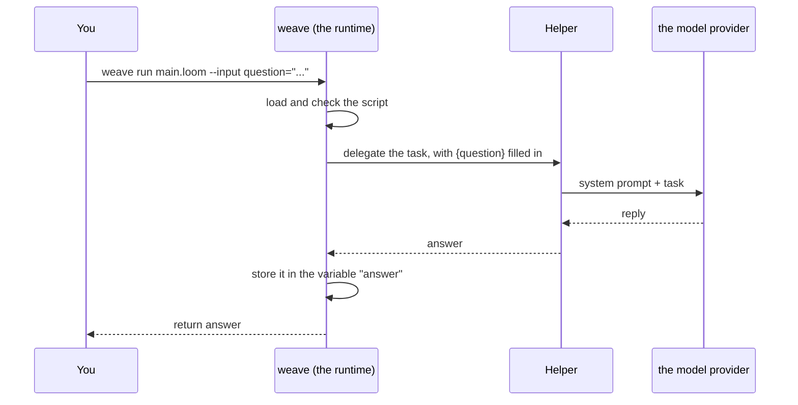

# 1. Your first workflow

In this chapter you install `weave`, write the smallest useful Loom script, check it, test it without spending anything, and run it for real. You will also meet the loop you will use for everything else.

## What Loom is for

A single agent is easy: ask a model a question, get an answer. The trouble starts when you have several agents, steps that must happen in a fixed order, limits on spend, a person who has to approve something, or a job that takes days. Then you need to say *exactly* what happens and have the system keep to it, even when a model misbehaves.

Loom splits the work in two:

- **The models reason.** They read, write, judge and decide what to say.
- **The script decides.** It says which agent runs, in what order, how many times, what happens when something fails, and who must approve what. The script is plain logic, so no wording in an email can talk it into skipping a step.

That split is the idea behind everything in this tutorial.

## Install

`weave` is the Loom command line. You need Java 17 or newer.

```bash
jbang app install weave@srijithunni7182/llm4j     # once; needs JBang (jbang.dev)
weave --version
```

Prefer an editor? Install the **Loom** extension from the VS Code Marketplace. It needs only Java 17 and brings its own copy of `weave`.

Want to see it work before you write anything? This runs a demo with no key and no account:

```bash
jbang weave@srijithunni7182/llm4j try
```

## The smallest workflow

Make a folder and put this in `main.loom`:

```loom
agent Helper {
    model: "gemini-2.5-flash"
    system: "You are a friendly assistant. Answer in two sentences at most."
}

workflow Main(question) {
    delegate "{question}" to Helper -> answer
    return answer
}
```

Read it aloud. *There is an agent called Helper. It uses this model and this instruction. There is a workflow called Main that takes a question. It hands the question to Helper and keeps the reply in a variable called `answer`. Then it returns the answer.*

That is the whole language in miniature:

| Piece | What it is |
|---|---|
| `agent Helper { ... }` | A worker: a model plus its instructions. You declare agents once, at the top. |
| `workflow Main(question) { ... }` | A list of steps. It can take inputs (here, `question`). |
| `delegate "..." to Helper -> answer` | One step: give a task to an agent, and store its reply in `answer`. |
| `{question}` | A variable, filled in with its value when the step runs. |
| `return answer` | Hand a value back to whoever started the workflow. |

Lines starting with `//` are comments.

### What happens when it runs



The runtime fills in the variable, hands the task to the agent, waits, stores the reply under the name after `->`, and moves to the next step. Nothing else happens unless you wrote it.

## The loop you will use for everything

### 1. Check it (free)

```bash
weave check main.loom
```

`weave check` reads the script and tells you whether it will load: a typo in a name, an agent that is not declared, a key you have not set. It runs nothing and costs nothing. Fix what it says, run it again.

If you want it to ignore missing keys while you are still writing, add `--no-env`.

### 2. Test it (free)

A test runs your workflow with **scripted models**: you say what each agent will reply, and the run follows the script exactly. No key, no network, no cost, the same answer every time. Put this in `tests/main.test.yaml`:

```yaml
script: ../main.loom
workflow: Main
cases:
  - name: the answer comes back from the helper
    input: { question: "What is a workflow?" }
    models:
      Helper: "A workflow is a list of steps done in order."
    expect:
      result: { contains: "list of steps" }
      calls: { Helper: 1 }
```

```bash
weave test main.loom
```

This is the same file as [starter 01](../../src/loom/starters/01-hello/). You will write many more of these: [Chapter 10](10-testing.md) is all about them.

### 3. Look at it (free)

```bash
weave graph main.loom --format mermaid     # a picture of the steps
weave explain main.loom                     # the same thing in plain English
weave review main.loom                      # security, cost and reliability findings, ranked
```

In VS Code the graph is live: it redraws as you type.

### 4. Run it, small and capped (this costs money)

Put your key in the environment (or a `.env` file beside the script, which you keep out of git). For Gemini that is `GEMINI_API_KEY`. Then:

```bash
weave run main.loom --input question="What is a workflow?" --max-tokens 20000 --max-calls 5
```

`--max-tokens` and `--max-calls` cap the run. If it would go over, it stops cleanly instead of billing you. You will meet budgets properly in [Chapter 9](09-safety-and-cost.md).

> **Never write a key in a script.** Loom refuses a literal secret on purpose. Keys come from the environment or the encrypted secret store.

## Starting from a project instead

Instead of an empty folder you can start from a template:

```bash
weave init pipeline my-newsletter --flat   # research, write, and a bounded editor loop
weave init approval my-support --flat      # a person approves risky replies
weave init classifier my-triage --flat     # one agent that labels, and asks a person when unsure
weave init empty my-project --flat         # the smallest possible project
```

By default `weave init` makes a small Maven project (the script and its prompts are in `src/main/resources`, with a golden dataset and JUnit tests). Add `--flat` for a plain folder with `main.loom`, `prompts/`, `tests/` and `eval/` side by side, which is the shape this tutorial uses. Each template passes `weave check`, `weave audit` and `weave eval --mock`. The [starter set](../../src/loom/starters/README.md) goes further: fifteen workflows, one idea each, in the flat shape.

If you are not sure what to do next, ask:

```bash
weave next
```

It looks at your project and says which step is next: write the script, add tests, run the audit, and so on.

## Try it yourself

1. Change the agent's `system:` line to make the Helper answer in the style of a pirate. Run `weave test` again. Does it still pass? Why? *(Because the test scripts the model, so your prompt is never used. Tests check the **shape** of the workflow, not the quality of a prompt. Quality is the job of evaluation, in [Chapter 10](10-testing.md).)*
2. Add a second agent called `Shortener` that rewrites the answer in ten words, and a second `delegate` to use it. Run `weave graph main.loom --format mermaid` and see the new step.
3. Run `weave check` on a script where you misspell `Helper` in the `delegate`. Read the message.

Next: [Data and variables](02-data-and-variables.md).
