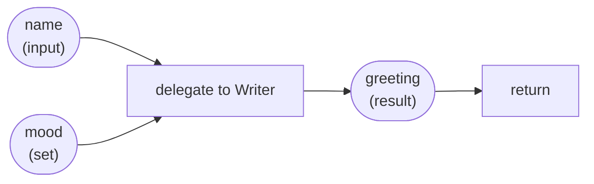

# 2. Data and variables

A workflow is a list of steps, and the steps pass information to each other through **variables**. This chapter covers where a variable comes from, how to use it in text, how to build values of your own, and how to hand results back.

## Where a variable comes from

There are four ways to get one.

1. **A workflow input.** `workflow Main(question)` makes `question` a variable. When you run it, you give its value: `weave run main.loom --input question="..."`. Inputs are text.
2. **The result of a step.** `delegate "..." to Helper -> answer` stores the reply in `answer`. The name after `->` is yours to choose.
3. **`set`.** `set greeting = "Hello"` gives a variable a value without calling a model.
4. **Loop and error variables the runtime fills in**, such as `_loopRound`, `_index` and `_error`. They start with an underscore so they never clash with yours.

```loom
substitution: braces

agent Writer { model: "gemini-2.5-flash"  system: "You write short greetings." }

workflow Main(name) {
    set mood = "cheerful"
    delegate "Write a {mood} greeting for {name}." to Writer -> greeting
    return greeting
}
```



## Using a variable in text: `{name}`

Any text that Loom fills in treats `{name}` as "put the variable's value here". That includes the task in a `delegate`, the messages of `human_prompt`, `note` and `halt`, the value of `set` and `return`, and the arguments of a task. Wrap the name in curly braces and it works everywhere.

When a variable holds structured data (an agent's reply with an `output_schema`, a list), you reach into it with dots:

| Written | Means |
|---|---|
| `{review.verdict}` | the field `verdict` of the variable `review` |
| `{plan.tasks.0}` | the first item of the list `tasks` inside `plan` |
| `{plan.hooks.2.title}` | the field `title` of the third item |

The same paths work in conditions: `alt (review.verdict == "OK") { ... }`.

A variable that was never set reads as **empty text**, not as an error. That is convenient, and it is also how a typo can hide: `{anwser}` quietly becomes nothing. `weave check` warns about a variable you set and never use, and that catches most of them.

## Always write `substitution: braces`

Older Loom scripts replaced a variable's **bare name** wherever it appeared in a prompt, not only inside braces. So a variable called `draft` turned the sentence "Review this draft" into "Review this *the whole draft text*". That is almost never what you want, and it is easy to do by accident.

Put this line at the top of your script and only `{name}` is ever replaced:

```loom
substitution: braces

agent Reviewer { model: "gemini-2.5-flash"  system: "You review drafts." }

workflow Main(draft) {
    delegate "Review this draft:\n{draft}" to Reviewer -> review
    return review
}
```

The default is still the older behaviour so that existing scripts keep working, but every starter and every example in this tutorial says `substitution: braces`. If you have an older script, `weave check --substitution braces script.loom` lists exactly what would change, and `--fix-substitution` rewrites it after showing you a diff.

## Strings

A string is written between double quotes. It may run over several lines. Inside it:

- `\"` is a double quote, and `\\` is a backslash. So a string can contain a quote, and can end with a backslash.
- `\n` is a new line and `\t` a tab.

```loom
substitution: braces

agent Greeter { model: "gemini-2.5-flash"  system: "You greet people." }

workflow Greet(name) {
    delegate "Say \"hello\" to {name}.
Then sign off as C:\\Greeter\\" to Greeter -> greeting
    return greeting
}
```

## `set`: values of your own

`set` stores a value without calling a model. The value can be text, a number, `true` or `false`, another variable, or an object.

```loom
substitution: braces

workflow Prepare(customer) {
    set attempts = 0
    set vip = true
    set label = "Customer {customer}"
    set contact = { name: "{customer}", channel: "email" }
    note "Prepared {label} via {contact.channel} (attempts so far: {attempts}, vip: {vip})."
    return contact
}
```

Use `set` for small things: a flag, a counter you will compare later, a default to fall back on. Anything that needs judgment belongs to an agent. Anything that must be *exact* (money, policy) belongs to a [task](06-tools-and-tasks.md#tasks-exact-steps-in-java).

## `return`: handing a result back

`return value` ends the workflow and hands a value back to whoever started it. It can be a variable, text, or an object:

```loom
substitution: braces

agent Extractor {
    model: "gemini-2.5-flash"
    system: "Extract the person's name and city."
    output_schema: { name: string, city: string }
}

workflow Main(text) {
    delegate "Extract from: {text}" to Extractor -> person
    return { name: "{person.name}", city: "{person.city}" }
}
```

When another workflow calls this one with `call Main(text="...") -> who`, `who.name` and `who.city` are available to the caller ([Chapter 4](04-control-flow.md#call-workflows-that-call-workflows)). From the command line you get the result printed.

You do not need a `return` at all if the point of the workflow is its effects.

## `note`: saying something

`note "text"` records a message in the run. It does not call a model and it costs nothing. Use it for progress, for what a branch decided, or for the final output of a workflow whose only job is to show a result:

```loom
substitution: braces

agent Writer { model: "gemini-2.5-flash"  system: "You write one-line slogans." }

workflow Main(product) {
    delegate "A slogan for {product}" to Writer -> slogan
    note "Slogan ready: {slogan}"
}
```

## `observe`: a label in the trace

`observe "label" {expression}` writes a labelled value into the trace and the audit log, so you can see what a variable held at that point when you read the run later. It changes nothing.

```loom
substitution: braces

agent Analyst { model: "gemini-2.5-flash"  system: "You answer briefly." }

workflow Main(question) {
    observe "Question received" {question}
    delegate "{question}" to Analyst -> answer
    observe "Answer length" {answer}
    return answer
}
```

## Special variables

| Variable | Where it exists | What it holds |
|---|---|---|
| `_error` | Inside an `on_failure { ... }` block | Why the step failed |
| `_loopRound` | Inside a `loop` | The current round, starting at 1 |
| `_loopRounds` | Inside `on_exhausted` | How many rounds ran |
| `_index` | Inside a `for each` | The position of the current item, from 0 |
| `_rewind`, `_rewindReason`, `_rewindTo` | After a [rewind](11-advanced-orchestration.md#checkpoints-and-rewind) | How many times, why, and to where |
| `{agent_citations}` | After a step by an agent that searches the web | The sources the answer used |

## Common mistakes

- **Forgetting the braces.** `delegate "Review draft"` sends the words, not the draft. Write `{draft}`.
- **Reusing a name.** Every `-> name` overwrites the last one with that name. That is useful in a loop (the draft gets replaced by the rewrite), and a bug if you did not mean it. Give things different names unless you mean to replace them.
- **A variable set and never read.** `weave check` warns. Either use it or remove it.
- **Sharing a variable between `parallel` branches.** The branches run at the same time. Give each branch its own variable. See [Chapter 4](04-control-flow.md#parallel-do-several-things-at-once).

## Try it yourself

1. Take starter [02-chain](../../src/loom/starters/02-chain/). Add a `set` at the top that stores a word limit, and use `{limit}` in the Summarizer's task.
2. In starter [08-extract-and-validate](../../src/loom/starters/08-extract-and-validate/), what does the workflow return? Where does each field come from?
3. Remove `substitution: braces` from any starter and run `weave check`. Do new warnings appear?

Next: [Agents](03-agents.md).
