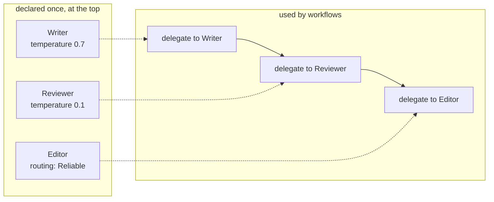

# 3. Agents

An agent is a worker: a model plus the instructions, tools and limits that shape how it behaves. You declare agents once, at the top of the script, and the workflow gives them tasks. This chapter covers everything you can put on an agent except tools, knowledge and memory, which have their own chapters.

## The anatomy of an agent

```loom
substitution: braces

agent Analyst {
    model: "gemini-2.5-flash"
    system: "You are an analyst. Be precise and say when you are unsure."
    temperature: 0.2
    max_iterations: 8
}

workflow Main(question) {
    delegate "{question}" to Analyst -> answer
    return answer
}
```

| Setting | What it does |
|---|---|
| `model:` | Which model answers. See [Models and providers](#models-and-providers). |
| `system:` | The instruction the model starts with: who it is, how to behave, what to avoid. |
| `temperature:` | How adventurous it is, from 0 (steady, repeatable) to 2 (varied). Use low values for checkers, classifiers and extractors; higher for writers and brainstormers. |
| `max_iterations:` | How many reasoning steps it may take when it has tools, so it cannot wander forever. |

Every setting takes effect, and anything Loom cannot honour is rejected when the script loads, with a line number. `weave check` runs those checks without running anything.

## Writing a good `system:` prompt

The prompt is the part you will edit most. A few habits make a large difference:

- **Give one job.** An agent that "reviews and rewrites and publishes" is three agents. One job each makes each one testable.
- **Say what good looks like.** "Say OK only if the text is clear and under 60 words" beats "review the text".
- **Say what to do when unsure.** "If the documents do not answer, say so" prevents confident invention.
- **Keep it stable.** Dates, run ids and other things that change each time belong in the task (the `delegate` text), not the system prompt.

## Prompt files

A long prompt gets awkward inside a script. Put it in a markdown file instead and refer to it by name:

```
my-project/
  main.loom
  prompts/
    researcher/v1.md       # a prompt with versions: <id>/<version>.md
    researcher/v2.md
    writer.md              # a prompt with one version: <id>.md (this is v1)
```

```loom-parse
agent Researcher { model: "gemini-2.5-flash"  prompt: "researcher" }                    // the latest version
agent Writer     { model: "gemini-2.5-flash"  prompt: "writer@v1"  system: "Keep it under 300 words." }   // pinned, plus an extra line
```

Why bother: each prompt gets its own history in version control, its own review, and versions you can compare. `weave run main.loom --prompt researcher@v1` runs a different version for one run without touching the file, so two runs are a fair comparison. If an agent has both `prompt:` and `system:`, the file comes first and `system:` follows.

## Personas

A persona is a reusable character: a role, a tone and some rules. Declare it once and give it to several agents:

```loom
substitution: braces

persona Mentor {
    role: "a patient senior engineer"
    tone: "warm and direct"
    constraints: ["Never write the whole solution for the learner.", "Ask one question at a time."]
}

agent Coach {
    model: "gemini-2.5-flash"
    persona: Mentor
    system: "Help the learner debug their code."
}

workflow Main(problem) {
    delegate "{problem}" to Coach -> advice
    return advice
}
```

Loom also ships a few built-in personas by name, such as `technicalAnalyst`.

## A prompt every agent starts with

Rules that belong to the whole team (house style, what never to do) can go in one place:

```loom
substitution: braces
shared_prompt: "Rules for every agent: answer in plain English, never invent a source, and say 'I do not know' when you do not."

agent Writer   { model: "gemini-2.5-flash"  system: "You write short articles." }
agent Reviewer { model: "gemini-2.5-flash"  system: "You review articles." }

workflow Main(topic) {
    delegate "Write about {topic}" to Writer -> draft
    delegate "Review:\n{draft}" to Reviewer -> review
    return review
}
```

It is put first in every agent's system prompt, byte for byte the same, which also lets providers that reuse the start of a prompt reuse it across agents. Keep it free of dates and ids.

## Models and providers

`model:` understands these names:

| Written | Provider | Key variable |
|---|---|---|
| `gemini-2.5-flash` | Google Gemini | `GEMINI_API_KEY` |
| `claude-haiku-5-5`, `anthropic/claude-opus-5-5` | Anthropic Claude | `ANTHROPIC_API_KEY` |
| `openai/gpt-4o`, `gpt-4o` | OpenAI | `OPENAI_API_KEY` |
| `xai/grok-4`, `grok-4` | xAI | `XAI_API_KEY` |
| `ollama/llama3` | A local Ollama server | `OLLAMA_BASE_URL` (default `http://localhost:11434`) |
| `sarvam/sarvam-m` | Sarvam (Indian languages) | `SARVAM_API_KEY` |
| `perplexity/openai/gpt-5.6-sol` | Perplexity | `PERPLEXITY_API_KEY` |
| `kimi/...`, `qwen/...` | Kimi, Qwen (preview) | `MOONSHOT_API_KEY`, `DASHSCOPE_API_KEY` |

A name that only one vendor could own works without a prefix (`gpt-…`, `grok-…`). A name like `qwen3` is not guessed, because it usually means a local model: write `qwen/qwen3-max` or `ollama/qwen3`. An unknown model, or a missing key, is reported when the script loads.

To reach one specific endpoint, or use a different key for one agent, declare a **provider**:

```loom
provider Box  { use: ollama  base_url: "http://gpu-box:11434" }
provider Gate { use: openai_compatible  base_url: "https://gateway.example/v1"  api_key: env.GATE_KEY }

agent Local   { model: "Box/llama3"  system: "You answer briefly." }
agent Gateway { model: "Gate/qwen3"  system: "You answer briefly." }

workflow Main(q) {
    delegate "{q}" to Local -> a
    delegate "{q}" to Gateway -> b
    return { local: "{a}", gateway: "{b}" }
}
```

`openai_compatible` reaches any OpenAI-style server: DeepSeek, Groq, Together, vLLM, LM Studio. The key must come from the environment (`env.NAME`) or the [secret store](09-safety-and-cost.md#secrets) (`secret.NAME`). It can never be written in the script.

## Routing: fallbacks and cost

A routing policy chooses the model for you and falls back when one is down or rate-limited. Declare it once and give it to agents with `routing:` instead of `model:`:

```loom
substitution: braces

routing Reliable {
    strategy: fallback
    primary: "gemini-2.5-pro"
    fallback: ["gemini-2.5-flash", "ollama/gemma3"]
}

agent Analyst {
    routing: Reliable
    system: "You analyse questions carefully."
}

workflow Main(q) {
    delegate "{q}" to Analyst -> answer
    return answer
}
```

`strategy: fallback` tries the models in the order written. `strategy: cost_aware` prefers the cheaper ones. Declared providers work in routing policies too.

## Skills: instructions in files

A skill is a markdown file of instructions an agent loads, for expertise you want to maintain separately from the prompt:

```loom-parse
agent Analyst {
    model: "gemini-2.5-flash"
    skills: ["fs://skills/analyst_best_practices.md"]    // relative to the script
}
```

## Searching the web

Some models can search the web inside their own calls. Turn it on with `grounding`:

```loom
substitution: braces

agent Researcher {
    model: "perplexity/openai/gpt-5.6-sol"
    system: "Answer with sources."
    grounding: web { allow: ["who.int"]  recency: year }
}

workflow Main(question) {
    delegate "{question}" to Researcher -> notes
    return notes
}
```

The sources are in `{notes_citations}` (a list with `index`, `url`, `title` and `snippet`). Only some models can be grounded, and each honours only some of the options (for Perplexity: `allow`, `block`, `recency` and `country`). `weave check` tells you exactly which when you ask for something your model cannot do. For an agent that uses a search *tool* instead, see [Chapter 6](06-tools-and-tasks.md).

## Several agents, one team

A team is just several agents in one script. What makes it a team is the workflow: [Chapter 4](04-control-flow.md) covers how they hand work to each other.



## Try it yourself

1. Open starter [10-memory-assistant](../../src/loom/starters/10-memory-assistant/). Find its `persona` and the agent that uses it. Change the tone and run `weave check`.
2. Give starter [02-chain](../../src/loom/starters/02-chain/) a different model on one agent (`ollama/llama3`). What does `weave check` say about the key you have not set?
3. Write a routing policy with two fallbacks and attach it to an agent.

Next: [Control flow](04-control-flow.md).
