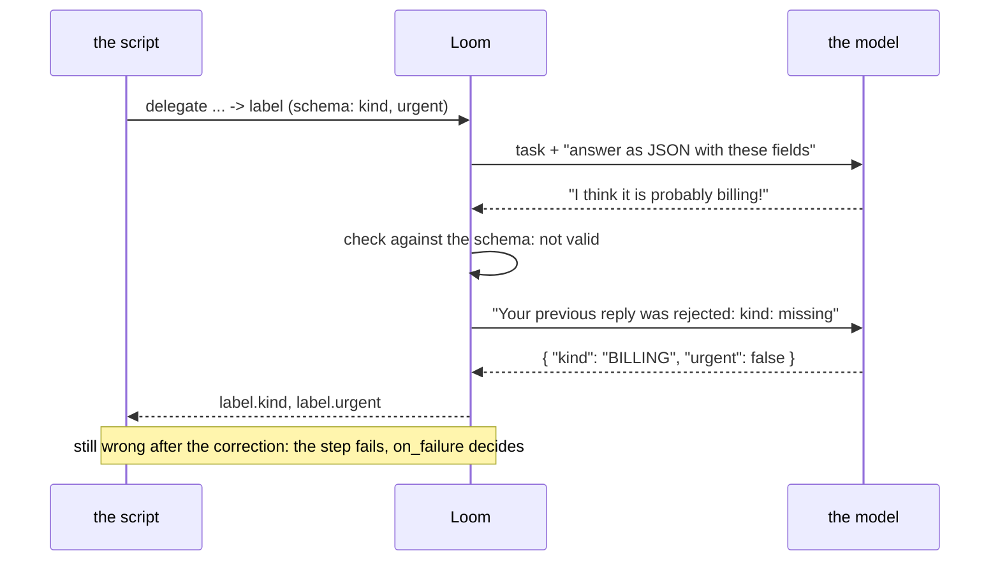
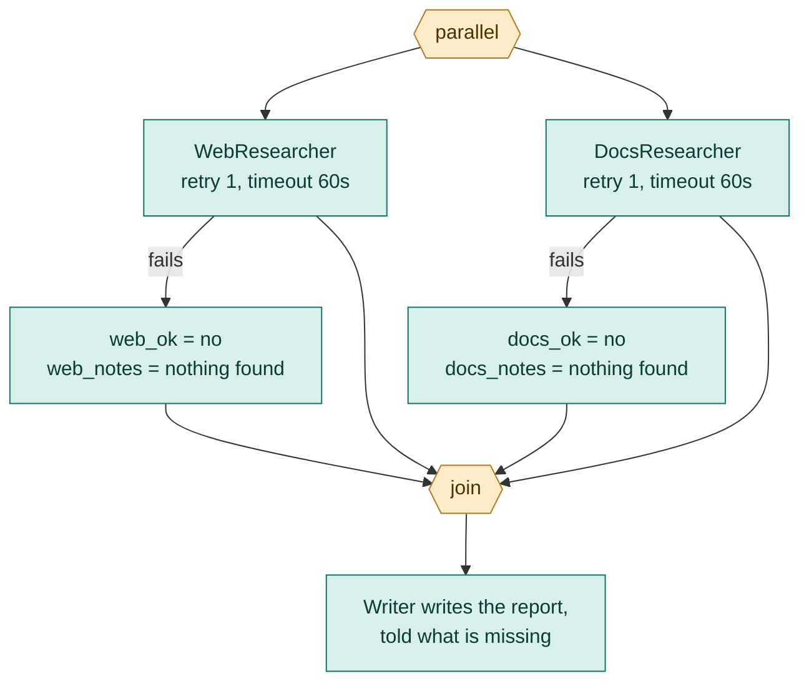

# 5. Structured answers and failure

Models return text. Workflows need values they can branch on and fields they can pass along. And any step that talks to a model, a tool or the network can fail. This chapter is about the two habits that make a workflow dependable: **make answers checkable**, and **say what happens when a step fails**.

## Structured answers

If you ask an agent "is this billing or technical?", it might reply "I think this is probably about billing!" A script cannot branch on that. Give the agent an `output_schema` and it must answer in a fixed shape:

```loom
substitution: braces

agent Classifier {
    model: "gemini-2.5-flash"
    system: "Classify the customer message."
    temperature: 0.0
    output_schema: { kind: enum["BILLING", "TECHNICAL", "OTHER"], urgent: boolean }
}

workflow Main(message) {
    delegate "Classify: {message}" to Classifier -> label
    alt (label.kind == "BILLING") {
        note "billing, urgent: {label.urgent}"
    } else {
        note "not billing"
    }
}
```

Loom tells the model to answer in JSON, parses the reply, and puts the fields in the variable: `label.kind`, `label.urgent`.



### The kinds of field

| Written | Means |
|---|---|
| `string` | text (a number or true/false is accepted as text) |
| `number` | a number |
| `boolean` | true or false |
| `enum["A", "B"]` | exactly one of these words |
| `list<string>` | a list whose items are all of that kind |
| `list` | a list of items of any shape |
| `{ ... }` | a nested object, with fields of its own |

Every field is **required**. Write the schema as the contract you need, not the one you hope for. Fields keep the order you write them in.

```loom
substitution: braces

agent Auditor {
    model: "gemini-2.5-flash"
    system: "Audit the system description."
    output_schema: {
        status: enum["SECURE", "VULNERABLE"],
        issues: list<string>,
        owner: { team: string, contact: string }
    }
}

workflow Main(description) {
    delegate "Audit: {description}" to Auditor -> report
    alt (report.status == "VULNERABLE") {
        note "First issue: {report.issues.0}. Contact: {report.owner.contact}."
    }
}
```

### What is checked

An answer is checked where it arrives:

- The JSON may be wrapped in a code fence or a sentence of chatter; Loom finds the first complete object.
- Every field must be present with the right kind. An `enum` must be exactly one of its words.
- An answer that is not valid JSON, is cut off, or does not match is a **failed attempt**. The agent is told what was wrong ("Your previous reply was rejected: files: missing") and asked again. One such correction is always allowed.
- If it still does not match, the step fails, and `on_failure` (below) decides what happens.

So a model that answers in YAML costs you one extra call, not a broken run.

### A schema for one step: `expecting`

If an agent is used in several ways, put the schema on the step instead of the agent:

```loom
substitution: braces

agent Lead { model: "gemini-2.5-flash"  system: "You lead the review." }

workflow Main(text) {
    delegate "Review:\n{text}" to Lead -> review expecting { verdict: enum["OK", "FIX"], fixes: list<string> }
    alt (review.verdict == "FIX") {
        note "Fix: {review.fixes.0}"
    }
}
```

`expecting { ... }` overrides the agent's own schema for that step only. On a `delegate`, `expecting` comes **before** `retry`: `delegate "..." to A -> x expecting { ok: boolean } retry 1`.

## When a step fails

Things go wrong. The model provider returns an error, a tool times out, an answer never matches its schema. Three tools let you say what to do about it.

### `retry`, `backoff`, `timeout`

```loom
substitution: braces

agent Writer { model: "gemini-2.5-flash"  system: "You summarise documents." }

workflow Main(doc) {
    delegate "Summarise {doc}" to Writer -> summary retry 2 backoff 2s timeout 90s on_failure {
        note "Writer unavailable: {_error}"
    }
    return summary
}
```

- **`retry 2`**: try up to two more times.
- **`backoff 2s`**: wait between tries, doubling each time (2 seconds, then 4).
- **`timeout 90s`**: give up on an attempt that hangs after 90 seconds. Without a timeout, one hung call can stall the whole run.

### `on_failure`

`on_failure { ... }` runs when a step still fails after its retries. Inside it, `{_error}` says why. You decide what the fallback is:

| Fallback | Written as |
|---|---|
| Record it and carry on | `on_failure { note "skipped: {_error}" }` |
| Use a default | `on_failure { set summary = "(no summary)" }` |
| Ask a person | `on_failure { human_prompt "Summary failed: {_error}. What now?" -> choice }` |
| Stop on purpose | `on_failure { halt "Cannot continue: {_error}" }` |
| Go back and try differently | `on_failure { rewind to start at most 1 time carrying hint = "{_error}" }` |

A step with no `on_failure` that fails ends the run as failed. That is often right for a step the rest cannot do without. It is wrong for steps that only enrich the result.

A step refused by a **budget** goes to `on_failure` too, but is never retried: retrying would only spend more.

### A failing branch that must not stop the others

When one branch of a `parallel` block may fail and the others should still count, give each branch its own flag and set it in its own `on_failure`:

```loom
substitution: braces

agent WebResearcher  { model: "gemini-2.5-flash"  system: "Search the web and report what you find in five lines."  tools: [web_search] }
agent DocsResearcher { model: "gemini-2.5-flash"  system: "Report what the company documents say, in five lines." }
agent Writer         { model: "gemini-2.5-flash"  system: "Write a short report from the notes. Say what is missing." }

workflow Main(topic) {
    set web_ok = "yes"
    set docs_ok = "yes"

    parallel {
        delegate "Find recent public information about {topic}" to WebResearcher -> web_notes retry 1 timeout 60s
            on_failure { set web_ok = "no"  set web_notes = "nothing found on the web" }
        delegate "Find what our documents say about {topic}" to DocsResearcher -> docs_notes retry 1 timeout 60s
            on_failure { set docs_ok = "no"  set docs_notes = "nothing found in the documents" }
    }

    alt (web_ok == "no") {
        note "The web research failed, so the report rests on documents only."
    }
    alt (docs_ok == "no") {
        note "The document research failed, so the report rests on the web only."
    }

    delegate "Topic: {topic}\nWeb: {web_notes}\nDocuments: {docs_notes}" to Writer -> report
    return report
}
```



This is starter [05-parallel-research](../../src/loom/starters/05-parallel-research/). The run is then reported as **degraded**: it finished, but used a fallback, and the report names which agents took it. In a test you assert this with `degraded: true` and `fallbacks: [ WebResearcher ]`.

## `halt` versus a failure

| | Failure | `halt` |
|---|---|---|
| Is it an error? | Yes | No, it is a decision |
| Retried? | Yes, if you say so | Never |
| Handled by `on_failure`? | Yes | Never |
| Use it for | Something went wrong | A stage cannot go on and later stages must not work on something broken |

## Putting it together: extract, then validate

This is starter [08-extract-and-validate](../../src/loom/starters/08-extract-and-validate/): free text becomes checked fields, the script applies its own rule, and the run stops on purpose when the text cannot be read.

```loom
substitution: braces

agent Extractor {
    model: "gemini-2.5-flash"
    system: "Extract the invoice fields from the text. Use 0 when the amount is missing."
    temperature: 0.0
    output_schema: { vendor: string, invoice_number: string, total: number, currency: enum["USD", "EUR", "INR", "OTHER"] }
}

workflow Main(text) {
    delegate "Extract the invoice from:\n{text}" to Extractor -> invoice retry 1 on_failure {
        halt "Could not read an invoice from the text: {_error}"
    }

    alt (invoice.total <= 0) {
        human_prompt "No total could be read for invoice {invoice.invoice_number} from {invoice.vendor}. What is the total?" -> typed_total
        set invoice_total = "{typed_total}"
    } else {
        set invoice_total = "{invoice.total}"
    }

    return { vendor: "{invoice.vendor}", number: "{invoice.invoice_number}", total: "{invoice_total}", currency: "{invoice.currency}" }
}
```

The model *reads*; the script *decides*. A missing total is asked of a person, never guessed.

## Try it yourself

1. In [05-parallel-research](../../src/loom/starters/05-parallel-research/), make both researchers fail in a new test case. What does the run report?
2. Add `currency` handling to starter 08: if the currency is `OTHER`, ask a person.
3. Remove the `retry` from a step and run its tests. Nothing changes, because tests script the failures. Add a `fail:` entry to prove the failure path is reached ([Chapter 10](10-testing.md#scripting-failures)).

Next: [Tools and tasks](06-tools-and-tasks.md).
