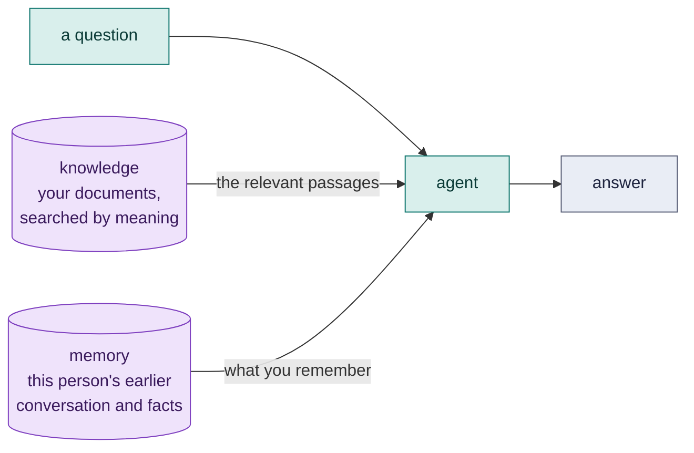

# 7. Knowledge and memory

A model knows what it was trained on. It does not know your handbook, your product, your customers, or what you told it yesterday. This chapter shows the three ways Loom gives an agent that missing context: **knowledge** (your documents), **memory** (earlier conversations and facts), and **language and voice** tools.



## Knowledge: answers from your own documents

A **knowledge base** indexes a folder of documents. When an agent that uses it is asked something, Loom finds the passages whose *meaning* is closest to the question and puts them in front of it, with their source files.

```loom-parse
knowledge Handbook {
    source: "handbook/"                          // a file or folder: md, txt, html, json, csv
    embedding: "gemini/text-embedding-004"       // how meaning is measured
    chunk_size: 600                              // characters per passage (default 1000)
    top_k: 3                                     // passages per question (default 4)
    store: "index/handbook.json"                 // keep the index in a file (default: memory)
}

agent Answerer {
    model: "gemini-2.5-flash"
    system: "Answer only from the handbook passages you are given. If they do not answer the question, say: The handbook does not say."
    temperature: 0.1
    knowledge: [Handbook]
}

workflow Main(question) {
    delegate "{question}" to Answerer -> answer
    return answer
}
```

This is starter [09-handbook-qa](../../src/loom/starters/09-handbook-qa/). Three things to notice:

1. **The instruction matters as much as the documents.** "Answer only from the passages, and say so when they do not answer" is what turns retrieval into grounded answers instead of confident guesses.
2. **Low temperature.** Facts from documents want steady answers.
3. **The index is built when the script loads.** With a file `store`, later loads re-embed only the files that changed, drop removed files, and rebuild if the embedding model or chunking changes.

### Two modes

| `mode:` | What happens |
|---|---|
| `context` (default) | Before each `delegate`, the most relevant passages are put in front of the task. The agent always sees them. |
| `tool` | The agent gets a `search_handbook` tool and looks things up when it decides to. Good when most questions do not need the documents. |

### Embeddings

`gemini/<model>` uses `GEMINI_API_KEY`. To keep documents on your own machine, `onnx/<model.onnx>|<tokenizer.json>` and `djl/<url>` run locally. The packaged `weave` jar does not carry those engines (they are large), so the host puts the `ai-agent4j-addons` jar and the engine on the classpath; without them the script fails to load with a message saying what is missing. Embedding calls are not LLM calls and are not charged to budgets.

### Testing knowledge

`weave test` cannot script the embedding calls that index documents, so a starter like 09 is checked with `weave check` but not run in a hermetic test. Test everything *around* the retrieval (what the agent does with an answer, what happens when it says "the handbook does not say") in a workflow whose agent has no knowledge base, and test retrieval quality itself with an evaluation ([Chapter 10](10-testing.md#weave-eval-the-quality-with-a-golden-dataset)).

## Memory: remembering between runs

Memory lets an agent remember conversations and facts **across runs**. It is separate from the way a workflow passes variables between its own steps.

```loom
substitution: braces

persona Concierge {
    role: "a hotel concierge"
    tone: "warm and concise"
    constraints: ["Never promise a room you cannot confirm.", "Ask one question at a time."]
}

agent Assistant {
    model: "gemini-2.5-flash"
    persona: Concierge
    temperature: 0.5
    memory { conversation: "chats"  limit: 10  session: "{user_id}" }
    guard { pii: mask }
}

workflow Main(user_id, message) {
    delegate "{message}" to Assistant -> reply
    return reply
}
```

| Setting | Meaning |
|---|---|
| `conversation: "chats"` | A folder (kept across runs), or `memory`. Before each task, the session's earlier messages come first; afterwards the task and answer are added. |
| `limit: 10` | How many messages are put in front of each task (default 20). |
| `session: "{user_id}"` | Whose conversation. It is read from the workflow's variables on every call, so one agent serves many people and they never see each other's messages. |
| `facts: "memory/facts.json"` | Long-term facts. The agent gets a `save_memory_fact` tool, and facts relevant to a task are recalled by meaning before it starts. Needs `embedding:`. |
| `recall: 5`, `min_similarity: 0.7` | How many facts, and how close they must be. |

This is starter [10-memory-assistant](../../src/loom/starters/10-memory-assistant/). Run it twice with the same `user_id` and the second run starts with the first conversation. Run it with another `user_id` and it starts fresh.

A few honest cautions:

- **Memory holds personal data.** The `guard { pii: mask }` above keeps it from the model, but the folder itself is yours to protect and to delete when asked.
- **A rewind does not undo memory.** Going back to a checkpoint never forgets a fact an agent already saved. `weave check` warns about agents with fact memory for this reason.
- **A resumed run does not duplicate it.** A replayed step neither recalls nor records.

## Language and voice

For Indian languages and speech, a set of tools (Sarvam; `SARVAM_API_KEY`) work by name, like the other built-ins:

| Tool | Does |
|---|---|
| `translate` | `text`, `target` (such as `hi-IN` or `Hindi`), optional `source` |
| `transliterate` | writes `text` in another script |
| `detect_language` | returns a language code |
| `speak` | saves speech as a WAV under `audio/` and returns its path |
| `transcribe` | turns an audio file into text |

Declare one to set defaults, and give an agent a `voice` to listen to audio tasks and speak its answers:

```loom
substitution: braces

tool Hindi { use: translate  target: "hi-IN" }

agent Helper {
    model: "sarvam/sarvam-m"
    system: "You help callers in their own language."
    tools: [Hindi]
    voice { listen: "sarvam/saarika:v2.5"  speak: "sarvam/bulbul:v2"  language: "hi-IN" }
}

workflow Main(question) {
    delegate "{question}" to Helper -> answer
    return answer
}
```

## Knowledge graphs and skill discovery

Two more tool kinds store and find knowledge:

```loom-parse
tool Graph  { use: knowledge_graph  store: "graphs/people.json" }      // entities and relationships
tool Skills { use: skill_registry  url: "https://skills.example.com" }  // find skills at run time
```

## Which one do I need?

| I want the agent to... | Use |
|---|---|
| answer from documents that change rarely | `knowledge` |
| remember what this user said last time | `memory { conversation }` |
| learn lasting preferences | `memory { facts }` |
| pass what step 1 learned to step 3 | a variable ([Chapter 2](02-data-and-variables.md)) |
| look something up live | a tool ([Chapter 6](06-tools-and-tasks.md)) |
| carry long-run context without overflowing the window | compaction ([Chapter 11](11-advanced-orchestration.md#context-and-compaction)) |

## Try it yourself

1. Add two documents of your own to starter 09's `handbook/` folder and ask a question only one of them answers.
2. Change `mode: context` to `mode: tool` and read what `weave explain` says changes.
3. Run starter 10 twice with the same `user_id`, then once with another, and look inside the `chats/` folder.

Next: [People in the loop](08-people-in-the-loop.md).
