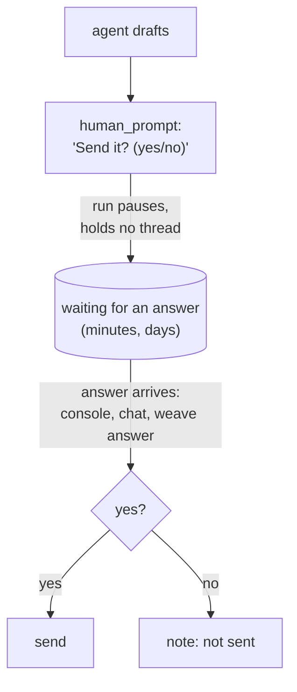
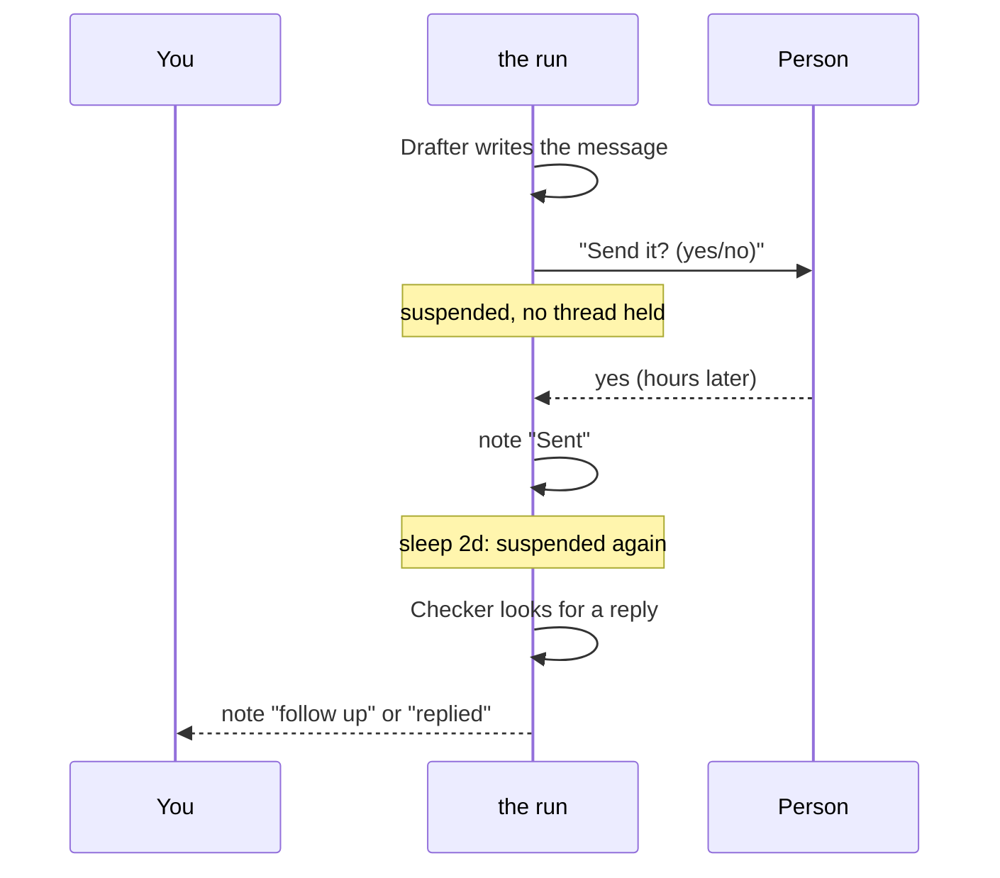

# 8. People in the loop

Some steps should not be taken by a model alone: sending money, publishing, deleting, anything a customer will read. Loom lets a person step in at the points *you* choose, wait for them without tying up a thread (for days if needed), and even step in on an agent while it works. This chapter covers asking, waiting, steering and supervising.



## `human_prompt`: ask a person

```loom
substitution: braces

agent Drafter { model: "gemini-2.5-flash"  system: "Draft a short, polite announcement from the facts."  temperature: 0.4 }

workflow Main(facts) {
    delegate "Draft an announcement from: {facts}" to Drafter -> draft

    human_prompt "Here is the draft:\n\n{draft}\n\nSend it to the team? (yes/no)" -> answer
    alt (answer == "yes") {
        note "Approved. Ready to send:\n{draft}"
    } else {
        note "Not sent. The draft is kept for editing:\n{draft}"
    }
}
```

Write the script as if the answer simply arrives. **Where** the person is reached is not the script's business: at a console, it reads the terminal. On a server nobody sits at, it can arrive as a chat message, as you will see below. The same script runs in both places.

Always *use* the answer. `weave check` warns when the answer is stored and never read, or when both answers lead to the same steps, because then the question changes nothing. A good question has a branch for each answer, and a safe default for "no" and for no answer at all.

### Make the safe choice the default

An `alt (answer == "yes")` sends only on an exact yes. Anything else, including an empty answer from a question that expired, takes the `else` branch. Write approvals so that doing nothing is what happens when nobody answers.

## Approvals on tools

The script can ask before a step, as above. An agent's tool can also ask before *each call*:

```loom
substitution: braces

tool Notify { use: webhook  url: env.SLACK_WEBHOOK  format: slack }

agent Publisher {
    model: "gemini-2.5-flash"
    system: "Publish the announcement you are given."
    tools: [Notify]
    approve: [Notify]
}

workflow Main(text) {
    delegate "Publish:\n{text}" to Publisher -> receipt
    return receipt
}
```

The person sees which agent wants which tool with which arguments. A rejection tells the agent its call was rejected. The answer is recorded against the exact call, so a resumed run does not ask the same question twice. Starter [07-approval](../../src/loom/starters/07-approval/) uses both: a `human_prompt` in the script, and `approve:` on the sender.

## Durable runs: waiting without holding a thread

Every step that has an effect (a `delegate`, a `human_prompt`, a `broadcast`) records its result in a **run journal** under a stable step id. Run the workflow again with the same journal and Loom *replays* the recorded steps (no model is called twice) and carries on from the first step that has not happened yet.

That gives you three things:

- **Waiting for people without holding a thread.** A question to a person pauses the run. Record the answer whenever it arrives, even days later, and run it again on any machine.
- **Crash recovery.** If a process dies mid-run, run it again with its journal and it resumes after the last recorded step.
- **No repeated effects.** A step that sent something is not sent again on resume.

From the command line:

```bash
weave run main.loom --input facts="Office closed Friday" --journal runs/today --store runs/.loom-triggers
# exits with code 4 and says "paused: waiting for an answer"
weave questions runs/.loom-triggers            # what is waiting
weave answer runs/.loom-triggers K7F3QX yes    # answer from a terminal
weave resume runs/today                         # carry on from the journal
```

With `--wait` the process stays alive and resumes by itself. Something has to wake a paused run: `weave daemon` running, `weave tick` from a scheduler, or `weave triggers install` for a system trigger.

## `sleep`: wait for time to pass

`sleep` waits a fixed time and carries on. Use it to poll without spinning, to space out rounds, or to follow up some hours after a message. It costs nothing: no model, no tokens.

```loom
substitution: braces

agent Checker {
    model: "gemini-2.5-flash"
    system: "You check whether a job has finished. Answer with its state: running or done."
    output_schema: { state: string }
}

workflow Poll(job) {
    loop until (status.state == "done") max 24 {
        delegate "Has job {job} finished?" to Checker -> status
        sleep 5m
    } on_exhausted {
        note "Job {job} is still running after two hours."
    }
}
```

Write the time as a whole number and a unit: `30s`, `5m`, `2h`, `1d`. What a sleep does depends on the run:

| Run | A sleep of | What happens |
|---|---|---|
| With a journal | more than 30 seconds | The run **pauses** and holds no thread, then resumes at the wake time |
| With a journal | 30 seconds or less | Waited out in place |
| Without one | any length | Waited out in place, holding the thread |

A sleep is never lengthened by a restart: the wake time is recorded first. And it is not a rate limit, so it does not count against `max_resumes`. For something that repeats on a clock, use a [`schedule`](11-advanced-orchestration.md#schedules), not a long sleep.

### Waiting out rate limits

Providers limit how fast you can call them. Instead of failing, a durable run can pause and carry on later:

```loom
substitution: braces

rate_limits { on_limit: suspend  max_wait: 24h  max_resumes: 50 }     // suspend | wait | fail

agent Drafter { model: "gemini-2.5-flash"  system: "Write a short message."  temperature: 0.4 }

workflow Main(topic) {
    delegate "Write about {topic}" to Drafter -> message
    return message
}
```

## Putting it together: a workflow that waits for days

Starter [12-wait-for-a-person](../../src/loom/starters/12-wait-for-a-person/) drafts a message, asks a person, sends, sleeps two days and follows up:

```loom
substitution: braces

rate_limits { on_limit: suspend  max_wait: 24h  max_resumes: 50 }

agent Drafter { model: "gemini-2.5-flash"  system: "Write a short, polite message to the customer."  temperature: 0.4 }
agent Checker { model: "gemini-2.5-flash"  system: "State whether the customer replied. Answer yes or no."  output_schema: { replied: enum["yes", "no"] } }

workflow Main(customer, topic) {
    delegate "Write to {customer} about: {topic}" to Drafter -> message
    human_prompt "Draft for {customer}:\n{message}\nSend it? (yes/no)" -> go
    alt (go == "yes") {
        note "Sent to {customer}."
        sleep 2d
        delegate "Did {customer} reply about {topic}?" to Checker -> status
        alt (status.replied == "no") {
            note "No reply from {customer} after two days: follow up."
        } else {
            note "{customer} replied."
        }
    } else {
        note "Not sent."
    }
}
```



In a test, time is virtual: `sleep 2d` costs no real time, and a test can assert `elapsed_virtual: 2d` ([Chapter 10](10-testing.md#time-and-people-in-tests)).

## Answering from your phone

A run that needs a person pauses and holds nothing, so on a machine nobody sits at, the question has to reach the person another way. Point the run store at a **channel** and Loom sends the question to a chat, pauses, and carries on when the answer comes back. With Telegram:

1. Message **@BotFather**, send `/newbot`, and keep the token.
2. Open a chat with your bot and press Start.
3. Find your chat id by messaging **@userinfobot**.
4. On the machine that runs Loom, set `TELEGRAM_BOT_TOKEN` and `TELEGRAM_CHAT_IDS`.
5. Run:

```bash
weave triggers install runs/.loom-triggers --apply
weave run main.loom -w Main -i facts="Office closed Friday" --journal runs/today --store runs/.loom-triggers --ask-via telegram
```

The question arrives as a message with a short code (`Reply: K7F3QX yes | no`). Reply to that message and the next heartbeat (or `weave daemon`, within seconds) records the answer and the run goes on. Only people on the channel's allow-list can answer, an answer applies once, and the token is never in the script.

## Steering and stopping an agent while it works

Sometimes you do not want to wait for an agent to finish: it is going the wrong way, or it has said enough. Mark it `steerable` and a person can intervene, with the script deciding what happens next.

```loom
substitution: braces

agent Writer {
    model: "gemini-2.5-flash"
    system: "Write the report."
    streaming: true          // show the reply as it is written
    steerable: true          // the person this run serves may steer it (off unless you say so)
}

workflow Report(topic) {
    delegate "Write a report on {topic}" to Writer -> draft
        timeout 90s
        on_stopped {
            alt (_stop.reason == "budget") { use partial }
        }
    return draft
}
```

- **Steer** sends the agent a message before its next model call. It corrects the agent's *reasoning*; it never changes the workflow.
- **Wrap up** asks the agent to finish now, with tools off.
- **Stop** ends the agent. Whoever stops it gives a reason.

What happens after a stop is one of: `use partial` (keep what the agent had, marked incomplete), `skip` (the step makes nothing and the run goes on), `discard`, `retry` (once, and only if the agent changed nothing outside the run), `suspend`, or send the run back to a [checkpoint](11-advanced-orchestration.md#checkpoints-and-rewind). A stop is never a silent failure, and never counted as a success by accident. Every steer, stop and decision is journaled.

A person reaches a running workflow from the console (`weave run ... --steer-via console`), from a chat, or from an application that embeds Loom. The commands are plain: `steer Researcher focus on the EU market`, `wrap up Writer`, `cancel Writer skip : not needed`.

## `supervise`: rules that watch an agent

You will not always have a person watching. A `supervise` block acts without one, on things that can be *counted*:

```loom
substitution: braces

agent Researcher {
    model: "gemini-2.5-flash"
    system: "Research the question with the tools you have, then answer in a short paragraph."
    tools: [web_search, calculator]
    max_iterations: 20
}

supervise Researcher {
    when looping(3)                  { steer "You are repeating yourself. Try a different search." once }
    when tool_failing(web_search, 3) { wrap_up }
    when context > 90%               { wrap_up }
    when steps > 15                  { cancel use partial }
}

workflow Brief(question) {
    delegate "{question}" to Researcher -> findings retry 1 timeout 180s
        on_failure { halt "The research failed: {_error}" }
    return findings
}
```

| Signal | Means |
|---|---|
| `looping(N)` | The same tool with the same input N times in a row |
| `tool_failing(Tool, N)` | N failures of that tool in a row (a success resets it) |
| `context > P%` | How full the model's window is, when it is known |
| `steps > N` | The number of model calls |

Every signal is a count, never a model's opinion, so a rule cannot be talked out of firing. This is starter [14-supervised-agent](../../src/loom/starters/14-supervised-agent/).

## Try it yourself

1. In starter [07-approval](../../src/loom/starters/07-approval/), change the question so a "no" asks what to change and loops (bounded) until the person says yes.
2. Run starter [12-wait-for-a-person](../../src/loom/starters/12-wait-for-a-person/) with `--journal` and stop it at the question. Resume it after answering with `weave answer`.
3. Add a `supervise` rule for a second tool.

Next: [Safety and cost](09-safety-and-cost.md).
