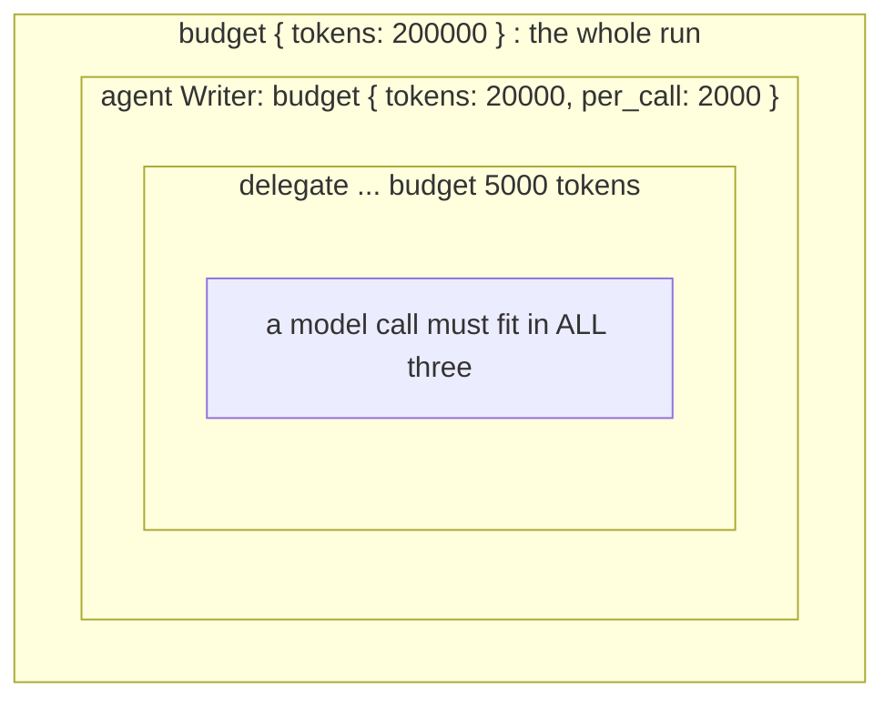
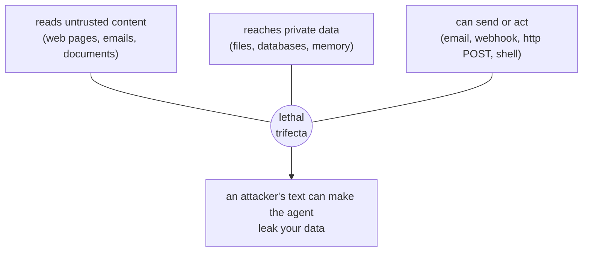

# 9. Safety and cost

An agent's next step is chosen by text, and some of that text comes from places you do not control: a web page, an email, a tool's output. Any of it can try to give the agent orders, and no prompt reliably stops that. So Loom does not rely on the model behaving. **The model reasons; the code holds the authority.** What an agent may touch, spend, send and decide is declared in the script and enforced by the runtime on every call, whatever the model says.

This chapter is the safety toolbox: budgets, guards, secrets, and the two commands that review a script before it ever runs.

## Budgets: it cannot overspend

A budget caps what model calls may spend, in **tokens** (the default), **calls**, or **money** (with a price table you supply). The runtime enforces it at the call itself: before each call it checks what is left and **refuses without calling the model** if the call cannot fit. Budgets go in three places:

```loom
substitution: braces

budget { tokens: 200000  calls: 150  warn_at: 80% }          // the whole run

agent Writer {
    model: "gemini-2.5-flash"
    system: "You write short drafts."
    budget { tokens: 20000  per_call: 2000 }                  // this agent's share; per_call caps each answer
}
agent Critic { model: "gemini-2.5-flash"  system: "Say OK only if the draft is good."  temperature: 0.1 }
agent CheapWriter { model: "gemini-2.5-flash"  system: "You write very short drafts." }

workflow Main(topic) {
    delegate "Draft {topic}" to Writer -> draft budget 5000 tokens
        on_failure { note "Out of budget: {_error}" }

    loop until (review.verdict == "OK") max 5 budget 30000 tokens {
        delegate "Review {draft}" to Critic -> review expecting { verdict: enum["OK", "FIX"] }
    } on_exhausted {
        note "Stopped by {_loopExhaustedBy} after {_loopRounds} rounds"
    }

    alt (_budget.remaining < 20000) {                          // cost-aware routing, in the script
        delegate "Polish {draft}" to CheapWriter -> final
    } else {
        delegate "Polish {draft}" to Writer -> final
    }
    return final
}
```



| Where | Caps |
|---|---|
| `budget { ... }` at the top | the whole run |
| `budget { ... }` inside an agent | that agent's share, and `per_call` for each answer |
| `budget N tokens` on a `delegate`, `loop` or `for each` | that one step |

Budgets **nest**. Every call is charged to the run, its agent and every enclosing step, and must fit all of them. Parallel branches share the same budgets exactly.

### What happens when one runs out

| Situation | Behaviour |
|---|---|
| A step's call would exceed a budget | The model is **not** called. The step fails and its `on_failure` runs with `{_error}` naming the budget. A budget refusal is **never retried**. |
| An agent runs out part-way | Its best answer so far is bound to the output variable, `{_budget.exhausted}` is `true`, and `on_failure` runs if present. |
| A loop's budget runs out | It stops and runs `on_exhausted`, with `{_loopExhaustedBy}` set to `budget` (or `rounds`). |
| Nothing handles it | The run ends as stopped by its budget (exit code 3). Every variable already bound is kept. |

A run stopped by its budget can be resumed with a bigger one: it continues from the refused step, and nothing already paid for runs twice.

### Money

Tokens are simple. For money, supply a price table, because prices go stale and none ship with Loom:

```text
# prices.properties: model = input / output, per million tokens
gemini-2.5-flash = 0.30 / 2.50
```

```bash
weave run main.loom --max-cost 0.25 --prices prices.properties
```

Local `ollama/*` models cost nothing.

### Output length and `per_call`

With a token or cost budget on the run, an agent that sets no `per_call` is sent a limit of 8,192 tokens (or the model's own maximum if smaller), and never more than the budget still affords. If an answer is cut at the limit, the run says so (`✂ 2 answers were cut at the output limit: Writer`). For longer answers, set `per_call`.

### Know the cost before you run

```bash
weave review main.loom
```

Among its findings, `weave review` prints a typical and a worst-case estimate for each workflow, step by step, and says when your cap would stop the run before the worst case.

## Guards: keep personal data and bias in check

An agent's `guard` protects everything it does:

```loom
substitution: braces

agent Support {
    model: "gemini-2.5-flash"
    system: "You answer customers."
    guard {
        pii: mask          // mask | block | warn
        bias: warn         // warn | block
    }
}

workflow Main(message) {
    delegate "{message}" to Support -> reply
    return reply
}
```

- **`pii: mask`**: every message the agent sends its model has emails, phone numbers, SSNs, card numbers and IP addresses replaced by placeholders such as `[EMAIL]`. That covers the task, context, memory and tool results. The answer is masked before it is stored.
- **`pii: block`**: a task or answer containing personal data fails the step. The error names the *kinds* of data, never the values.
- **`pii: warn`**: records it and carries on.
- **`bias`**: the answer is checked, by default with rules that catch sweeping statements about groups of people. `block` fails the step on a high-severity finding.

Audit logs record counts and kinds, never the data itself.

### A guardrail around a block

To protect a whole block of steps, wrap it:

```loom
substitution: braces

agent Summarizer { model: "gemini-2.5-flash"  system: "Summarise the text." }
agent Admin { model: "gemini-2.5-flash"  system: "Tell the administrator what happened." }

workflow Main(raw_text) {
    guardrail (PII) {
        delegate "Summarise this: {raw_text}" to Summarizer -> summary
        return summary
    } on_violation {
        note "Personal data detected in the input. Stopping."
        handoff "A privacy violation was blocked." to Admin
    }
}
```

## Secrets

**Never write a key in a script.** A literal secret is a load error, on purpose. Keys come from the environment (`env.NAME`) or the encrypted secret store (`secret.NAME`):

```loom-parse
substitution: braces

provider Box { use: sarvam  api_key: secret.BOX_KEY  base_url: "https://box.example.com" }
tool Search  { use: serpapi  api_key: secret.SERP_KEY }

agent Indic { model: "Box/sarvam-m"  system: "You answer briefly."  tools: [Search] }

workflow Main(q) {
    delegate "{q}" to Indic -> answer
    return answer
}
```

```bash
weave secrets create --secrets keys.store
weave secrets set BOX_KEY --secrets keys.store --allow-host box.example.com
weave run main.loom --secrets keys.store --secrets-key-env MYAPP_MASTER_KEY
```

- A key is fetched **for each request**, so rotating it needs no restart.
- A key stored with `--allow-host` is refused for any other host, so a script cannot send your key somewhere unexpected.
- Values are typed without echo or piped in, never passed as arguments. `weave secrets list` shows names and hosts, never values.
- Keep a local `.env` file out of git. Every starter ships a `.env.example` that names the keys and holds none.

## Review before you run: `weave audit` and `weave review`

Two commands read a script **without running it** and report what could go wrong.

```bash
weave audit main.loom        # security: what each agent can reach, ranked, exit 1 on a high finding
weave review main.loom       # security, cost, reliability, prompts and privacy, with a fix for each
weave rules                  # every rule, its id and why it exists
```

### The lethal trifecta

The audit looks hardest for the combination that makes prompt injection dangerous. An agent is at serious risk when it can do all three of:



The cure is to break the triangle: give the agent that reads the web no way to send, give the agent that sends no access to private data, or put a person's approval between them. This is why starter [07-approval](../../src/loom/starters/07-approval/) splits *drafting* from *sending*, and why the sender needs an approval.

### What else it catches

Typical findings, each with the reason and a fix:

| Finding | Why it matters |
|---|---|
| An agent can send or write and has no `on_failure` | A half-finished action with nothing deciding what happens next |
| A tool step with no `retry` or `timeout` | One slow call stalls the whole run |
| A loop with no `max` | A model that is never satisfied runs, and bills, forever |
| A secret environment variable not set | Fails before it starts, or at first use |
| A key sent to a custom address | Possible exfiltration of the key |
| A decision agent with no bias check | A compliance gap |

Run both in CI next to `weave check`. `weave audit --fail-on medium` makes medium findings fail the build.

## Effects are recorded, and never repeated

Every step that changes the world (a `webhook`, an `email`, an `http` POST, a `file` write, a `shell` command, a `run` task that declares a change) is written to the journal **before and after** it happens. If the process dies in between, a resume does not blindly repeat a payment: a step that cannot be proven idempotent is stopped and flagged for a person to check, and one that is idempotent runs again with the *same* idempotency key, so the receiver can deduplicate. A retry, a resume or a rewind never repeats a send.

## Everything in one place: the safe-by-default checklist

- Put a `budget` on the run. Give model-driven loops a `max`.
- Give every tool step `retry`, `timeout` and `on_failure`.
- Put `approve:` on any agent that can send, write or run something, and keep sending separate from reading untrusted content.
- Keep secrets in the environment or the secret store.
- Mask personal data (`guard { pii: mask }`) before it reaches a hosted model.
- Run `weave check`, `weave audit` and `weave review` before every release.
- Prefer a script rule or a task over a prompt for anything that must always hold.

The full threat model, and what Loom does *not* protect you from, is in [Secure by construction](../security/secure-by-construction.md) and the [security guide](../../SECURITY.md).

## Try it yourself

1. Run `weave review main.loom` on starter [11-daily-digest](../../src/loom/starters/11-daily-digest/). Read the findings and the "why" for each.
2. Remove a `retry`/`timeout` from a tool step in starter 07. What does `weave review` say?
3. Lower a budget to a tiny number in starter 02 and run `weave test` (nothing changes: tests are scripted) then `weave run` with a real key to see a budget stop.

Next: [Testing](10-testing.md).
