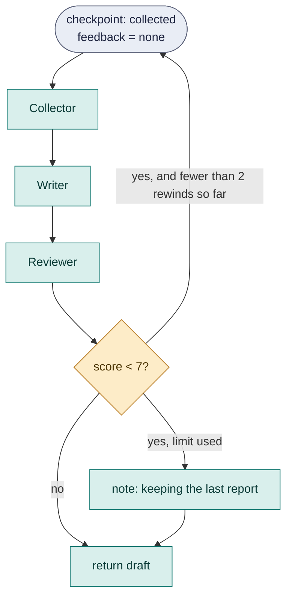
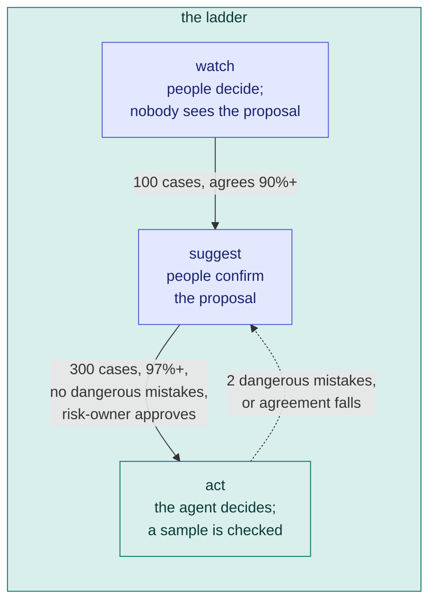

# 11. Advanced orchestration

By now you can build a workflow that routes, loops, fans out, uses tools, asks people and survives failure. This chapter is about the features that make long-running, high-stakes workflows possible: going back in time, letting an agent earn trust, running on a clock, keeping a long conversation inside the model's window, and driving the whole thing from outside.

## Checkpoints and rewind

A run can stop and carry on, but only forward. If a late step shows that an early one was wrong, you would have to start over and pay for everything again. **Checkpoints and rewinds** let a workflow go back to a named point, keep what it learned, and try again.

```loom
substitution: braces

agent Collector { model: "gemini-2.5-flash"  system: "Collect sources on the topic. Use the feedback to look somewhere new."  temperature: 0.5 }
agent Writer    { model: "gemini-2.5-flash"  system: "Write a short report from the sources."  temperature: 0.5 }
agent Reviewer  {
    model: "gemini-2.5-flash"
    system: "Score the report from 1 to 10 for how well the sources support it, and say what to fix."
    temperature: 0.0
    output_schema: { score: number, notes: string }
}

workflow Report(topic) {
    checkpoint collected starting with feedback = "none"

    delegate "Collect sources on {topic}. Feedback so far: {feedback}" to Collector -> data
    delegate "Write the report from these sources:\n{data}" to Writer -> draft
    delegate "Review this report against its sources.\nSources: {data}\nReport: {draft}" to Reviewer -> review

    rewind to collected
        when (review.score < 7)
        at most 2 times
        carrying feedback = "{review.notes}"
        side effects: keep
        if it still fails { note "Three attempts did not reach a score of 7; keeping the last report for a person to read." }

    return draft
}
```



Read it aloud: *go back to the checkpoint `collected` when the review score is below 7, at most 2 times, carrying the reviewer's notes into the next attempt, doing nothing about effects already done; if it still fails after that, say so.*

This is starter [13-rewind-and-retry](../../src/loom/starters/13-rewind-and-retry/). Compare it with the review loop of [Chapter 4](04-control-flow.md#loop-until-repeat-with-a-limit): a loop redoes the *last* step; a rewind redoes everything since a chosen point.

| Phrase | Meaning |
|---|---|
| `checkpoint Name` | Names a point between two statements. `starting with x = "..."` gives variables a value from there on, which a rewind can replace. Every workflow also has a point called `start`. |
| `rewind to Name` | Goes back to an *earlier* checkpoint in the same block or one around it. |
| `when (condition)` | One comparison. Leave it out to always go back (useful inside `on_failure`). |
| `at most N times` | **Required.** A rewind that keeps failing must stop. |
| `carrying name = "value"` | Values taken from the attempt being replaced and handed to the next one. Without them the second attempt starts from the same inputs as the first. |
| `side effects:` | `ask first` (default), `keep` or `repeat`: what to do about things the replaced attempt already did outside the run. |
| `if it still fails { ... }` | Runs once when the limit is used up. Without it the run fails and says which rewind gave up. |

### What a rewind does to the past

A rewind never deletes anything. It starts a new **attempt** of the statements after the checkpoint, and the old attempt stays in the journal as history. One rule explains everything:

> A model call is identified by where it is *and which attempt it belongs to*, so it runs again. A side effect, or a person's answer, is identified by where it is *and what it is*, so an identical one is never repeated.

So after a rewind the agents think again, but a Slack message with the same text is not posted twice, and a person is not asked the same question twice. Tokens spent in a replaced attempt stay counted against your budgets. A rewind does **not** undo facts saved in agent memory, knowledge indexes, or anything a tool wrote outside the run, and it never un-sends anything. The safest design is to put the check that triggers a rewind *before* the steps that have effects.

### From outside: `timeline`, `rewind`, `reset`, `fork`

You do not need to have written a checkpoint to go back. These work on a run directory (`--journal`):

```bash
weave timeline runs/today                       # every step, its attempt, its cost, and every rewind
weave rewind runs/today --to collected --reason "the sources were stale" \
        --set feedback="use only 2026 sources" --effects keep --resume
weave reset runs/today --failed --reason "the service is back" --resume
weave fork runs/today --to runs/what-if --at collected --effects simulate --reason "try another prompt" \
        --script report-v2.loom --resume
```

`fork` copies a run into a new folder (the original is only read), so you can try a different script on real history without touching production. With `--effects simulate`, nothing is ever performed in the copy. Every command that changes something needs a `--reason` and writes it down.

## Earned autonomy: an agent earns the right to act

Every organisation asks the same question before it lets an agent act on its own: *has this agent earned it?* Usually that is decided by feel, once, before launch. **Earned autonomy** makes it a record.

> Don't trust the agent. Make it earn it, with your own history as the exam.

A `decision` has an agent that *proposes*, a person who *decides*, and a ledger of both. The agent moves up a ladder only as the record supports it, and drops back if the record turns bad.



```loom
substitution: braces

agent Triager {
    model: "gemini-2.5-flash"
    system: "You are Triager. Decide whether a refund request should be approved, rejected or escalated."
    output_schema: { choice: enum["approve", "reject", "escalate"], reasoning: string, confidence: number }
    guard { bias: warn }
}

decision Refund {
    proposed by:            Triager
    choices:                approve, reject, escalate
    group cases by:         tier
    remember:               amount, reason
    dangerous mistake:      propose approve, person decides reject
    ask:                    support-lead
    keep records for:       180 days
    when the agent changes: test it on past cases

    trust {
        start at watch
        never go above suggest

        to suggest:  after 100 cases over 14 days, agreeing at least 90%
        to act:      after 300 cases over 30 days, agreeing at least 97%, with no dangerous mistakes
        judge on the latest 300 cases

        check 5% of cases with a person who doesn't see the proposal
        always ask a person when amount > 200

        drop to suggest when 2 dangerous mistakes in 50 cases
        drop to suggest when agreement falls below 92%

        moving up needs approval from: risk-owner
    }
}

workflow Triage(ticket, tier, amount, reason) {
    decide Refund -> verdict
    alt (verdict == "approve") {
        note "Refund approved for {ticket}."
    } else {
        note "Refund for {ticket} not approved automatically: {verdict}."
    }
}
```

This is starter [15-earned-autonomy](../../src/loom/starters/15-earned-autonomy/). The levels:

| Level | Who decides | What the person sees | Counts as evidence |
|---|---|---|---|
| `watch` | the person | the case's values only, **not** the proposal | yes |
| `suggest` | the person | the proposal and its reasoning, to confirm or override | no |
| `act` | the agent | nobody, except a checked sample and cases a limit sends to a person | the checked sample |

Why the person does not see the proposal at `watch`: if they did, they would be influenced by it, and an agreement rate measured that way would flatter the agent. `decide Refund -> verdict` binds `verdict` (what takes effect), `verdict_proposal` and `verdict_level`. Agreement is judged by the lower end of a 95% confidence interval, so 20 of 20 is not 100%.

Every case is recorded with its values, the proposal, who decided and how. Facts that arrive later (a refund was reversed, a chargeback) are added with `weave autonomy outcome`. You operate it from the command line:

```bash
weave autonomy status   runs/.loom-triggers                       # every ladder: level, evidence, what is missing for the next step
weave autonomy history  runs/.loom-triggers --decision Refund      # every change, with the reason
weave autonomy freeze   runs/.loom-triggers Refund --reason "incident 42"
weave replay refund.loom --decision Refund --store runs/.loom-triggers --candidate refund-v2.loom --since 14d
```

`weave replay` tries a changed agent on the history first: how often it would have agreed with the people who actually decided.

It does **not** learn: the ledger *grades*, it never trains or rewrites a prompt. And it does not find out by itself that a decision was wrong; that comes in through `weave autonomy outcome`.

### Ladders: a policy you write

The `trust` block fixes what "good" means: how often the agent agrees with a person. For an agent that writes a script or a draft, what matters is how much a reviewer rewrites it. A **ladder** lets you write your own rungs and conditions. The mechanism is Loom's (three modes: `blind`, `confirm`, `autonomous`); the policy is yours:

```loom-parse
import "loom/autonomy"

ladder RefundLadder {
    rung watch { mode: blind }

    rung suggest {
        mode: confirm
        climb when history.count >= 100 and history.span >= 14d
               and history.rate(agrees).lower95 >= 0.90
    }

    rung act {
        mode: autonomous
        climb when history.count >= 300 and history.rate(agrees).lower95 >= 97%
               and history.count(dangerous) == 0
        slip to suggest when history.last(50).count(dangerous) >= 2,
                             history.rate(agrees) < 0.92
        sample 5% blind
        escalate when case.amount > 200
    }

    climbing needs approval from risk-owner
}
```

Then bind it with `ladder: RefundLadder` and `ceiling: suggest` in the `decision`. Every condition is checked when the script loads, so a misspelt measure is an error before any case is decided. The full expression language is in the [reference](../../src/loom/ai-agent4j-loom/LOOM_GUIDE.md#ladders-earned-autonomy-as-a-policy-you-write).

## Schedules

A `schedule` makes a workflow run itself on a clock:

```loom
substitution: braces

tool Slack { use: webhook  url: env.SLACK_WEBHOOK  format: slack }

agent Reader { model: "gemini-2.5-flash"  system: "Find today's most useful news for the topic and report five items."  tools: [web_search] }
agent Poster { model: "gemini-2.5-flash"  system: "Post the digest you are given to Slack. Do nothing else."  tools: [Slack] }

workflow Digest(topic) {
    delegate "Today's news about {topic}" to Reader -> items retry 1 timeout 90s
        on_failure { halt "No digest today: the reader failed ({_error})." }
    delegate "Post this digest:\n{items}" to Poster -> receipt retry 1 timeout 30s
        on_failure { halt "The digest was written but may not have been posted: {_error}." }
    return receipt
}

schedule Morning {
    cron: "0 7 * * 1-5"
    timezone: "Asia/Kolkata"
    run: Digest(topic="renewable energy")
    misfire: run_once
    overlap: skip
}
```

| Setting | Meaning |
|---|---|
| `cron: "0 7 * * 1-5"` | When: minute, hour, day of month, month, day of week (here, weekdays at 07:00). Or `every: 6h`. |
| `timezone:` | The zone the cron time is in |
| `run: Workflow(arg="value")` | What to run, with arguments |
| `misfire:` | Slots missed while nothing was running: `run_once` (default) runs once, `skip` ignores them. A day's downtime does not become a day's worth of runs. |
| `overlap:` | If the previous run is still paused: `skip` (default) or `queue` |

A schedule is kept in a **trigger store**, so it survives restarts. Something has to look at the clock:

```bash
weave schedule sync main.loom --store runs/.loom-triggers   # write the schedule into the store
weave daemon runs/.loom-triggers                             # stay alive and run things when due
weave tick runs/.loom-triggers                               # or: check once (from cron or systemd)
weave triggers install runs/.loom-triggers --apply           # or: install a system trigger that ticks for you
```

This is starter [11-daily-digest](../../src/loom/starters/11-daily-digest/). The older `schedule` form, with `pattern: "24h"` and an `agent` and `task`, runs a single agent on a repeat.

## Context and compaction

A long tool loop makes the prompt grow until the model's context window is full. An agent's `context` block says **how it keeps the prompt inside the window**:

```loom
substitution: braces

agent Researcher {
    model: "claude-sonnet-5-5"
    system: "Research the question thoroughly with the tools, then answer."
    tools: [web_search]
    context {
        compact: chain(trim_tool_results, summarize, drop_oldest)   // one strategy, or chain(a, b, c) tried in order
        summarizer: "claude-haiku-5-5"                              // a cheaper model that writes the notes
        trigger: 80%                                                // start compacting above this share of the window
        target: 55%                                                 // compact down to this share
        keep_recent: 6                                              // the latest messages are never touched
        max_compactions: 20                                         // a safety stop per run
    }
}

workflow Main(question) {
    delegate "{question}" to Researcher -> answer
    return answer
}
```

| Strategy | What it does |
|---|---|
| `trim_tool_results` | Shortens bulky tool outputs first (the cheapest loss) |
| `summarize` | Has a cheaper model write notes for the oldest material |
| `drop_oldest` | Removes the oldest whole exchanges, leaving a marker |

The size of the window belongs to the *model*, so it is configured once, outside the script, in a windows file (`model = window / reserve for the answer`). `weave audit` lists each agent's strategy and the window it found. Whatever is removed, the model is told that something was removed, so it does not rest a conclusion on material that is gone. To check that for your own strategy, run `weave probe eviction`.

## Putting a workflow under control from outside

A running workflow can be reached by other programs and people:

| You want to... | Use |
|---|---|
| Watch a run live | `weave run ... --observe`, or one server for many runs: [Fabric](12-running-for-real.md#watching-a-run) |
| Turn a bad production run into a test | `weave capture` |
| Try a change against real history before shipping | `weave regress` |
| Get one verdict for CI | `weave gate` |
| Steer or stop a running agent | [Chapter 8](08-people-in-the-loop.md#steering-and-stopping-an-agent-while-it-works) |

## Try it yourself

1. In starter [13-rewind-and-retry](../../src/loom/starters/13-rewind-and-retry/), change `side effects: keep` to `ask first` and add a `webhook` tool to the Writer. What does `weave check` warn about?
2. Run `weave autonomy status` against a store where you ran starter 15 a few times by hand.
3. Add a second schedule to starter 11 with `every: 6h`.

Next: [Running it for real](12-running-for-real.md).
