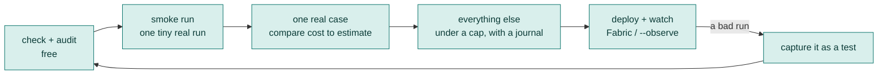
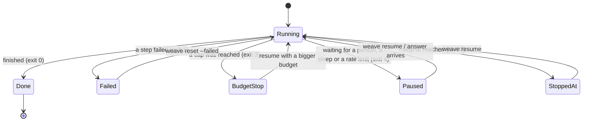

# 12. Running it for real

Everything so far has been free: you checked, tested and reviewed. This chapter is the step into production: running with real models under a cap, making a run survive crashes, packaging and deploying it, watching it, and turning what goes wrong into a test.



## Three safety nets, from the outside in

1. **The provider's limit** (on their dashboard). The one thing no bug in your code can bypass. Set it before anything else, below what you could afford to lose.
2. **Your cap**: `--max-cost`, `--max-tokens`, `--max-calls`. Counts real tokens and stops the whole run. Set it below the provider's limit.
3. **Per-step budgets**: a `budget` in the script, per agent, per call or per loop. Stops one runaway step, not the whole run.

## Run it

```bash
weave check main.loom && weave audit main.loom --fail-on medium     # free, first, always
weave run main.loom --input topic="solar roofs" --max-tokens 50000 --max-calls 40
weave run main.loom --input topic="solar roofs" --max-cost 0.50 --prices prices.properties --journal runs/one
weave run main.loom -w Digest --input topic="AI" --trace            # show each step as it runs
```

| Option | Does |
|---|---|
| `-i name=value` / `--input` | A workflow input (repeat for more) |
| `-w` / `--workflow` | Which workflow to run (default: `Main`) |
| `--max-tokens`, `--max-calls`, `--max-cost` | The run's cap; replaces the script's own |
| `--prices <file>` | The price table `--max-cost` needs |
| `--journal <dir>` | Make the run durable (see below) |
| `--trace` | Print trace events |
| `--secrets <file>`, `--secrets-key-env VAR` | The encrypted secret store |
| `--env-file <file>` | Read keys from this file instead of the `.env` beside the script |
| `--observe`, `--observe-fabric <url>` | Watch the run live (see below) |
| `--ask-via telegram`, `--steer-via console` | Where people answer and steer ([Chapter 8](08-people-in-the-loop.md)) |
| `--stop-at <step>` | Stop cleanly once that step has completed |

A spend table (calls, tokens and cost per agent) prints at the end of a budgeted run. **Exit codes**: 0 done, 1 failed, 2 bad options, 3 stopped by a budget, 4 paused, 5 stopped by `--stop-at`. A CI job or a scheduler can act on those.



### Roll out in stages

1. `check` and `audit` (free).
2. **Smoke test**: one tiny real run with a small cap. Confirm the keys, the tools, the trace and the spend report. Compare the *measured* tokens per call with what `weave review` estimated.
3. **One real run of the cheapest representative case**, then the next. Stop if the first costs more than about twice the estimate: your model of the cost is wrong, so fix it before spending more.
4. **Everything else**, with a journal so a failure does not re-pay for what finished.

## Durable runs

Run with `--journal` and the run becomes a recoverable thing:

```bash
weave run main.loom --input facts="..." --journal runs/today
weave timeline runs/today            # every step, its attempt, its cost
weave resume runs/today              # continue a paused or failed run
weave run main.loom ... --journal runs/today --wait    # stay alive and resume by yourself
```

Re-running with the same journal **replays** finished steps for free and carries on from the first step that has not happened. That is what lets a run pause for a person for days, survive a crash, and be resumed with a bigger budget without paying twice. Details are in [Chapter 8](08-people-in-the-loop.md#durable-runs-waiting-without-holding-a-thread) and [Chapter 11](11-advanced-orchestration.md#from-outside-timeline-rewind-reset-fork).

## Packaging

`weave package` turns a workflow into a runnable jar:

```bash
weave package main.loom --fat --out my-workflow.jar    # --fat includes the dependencies
java -jar my-workflow.jar topic="solar roofs"
```

Use it to hand a workflow to someone who has Java and nothing else.

## Deploying

`weave deploy` writes the files to run a workflow somewhere: a container recipe, a compose file or Kubernetes manifests, read from the script (environment names, hosts, volumes, schedules). It writes text only, and **secrets never appear**.

```bash
weave deploy main.loom --dry-run                  # print what it would write
weave deploy main.loom --target compose --out deploy/      # --target: docker, compose or k8s
weave deploy main.loom --verify deploy/           # does this folder still match the script?
```

`--verify` is worth running in CI: it fails when the script changed and the deployment files did not.

## Watching a run

A run nobody can see is a run you find out about from the invoice. Two ways to see it, from the same family of flags:

```bash
weave run main.loom --observe                       # one process: a live page on 127.0.0.1:8787
weave run main.loom --observe-fabric https://fabric.example --observe-name checkout    # many processes: report to a Fabric server
```

The live page shows the run as it happens: the cost, the workflow with each step's state, tool health, the context window and what compaction cut, security signals, and **incidents** (a loop, a failing tool, a context nearly full, the lethal trifecta). It has Pause and Stop buttons.

**Fabric** is one server that many workflows report to. Try it on your own computer:

```bash
weave fabric up           # starts it in the background; the admin password goes in <data>/admin-password.txt
weave fabric status       # is it running, and when did each client last report?
weave fabric down
```

Listening beyond your own computer needs TLS or a proxy; `weave fabric up` refuses otherwise. A production setup (who may sign in, TLS, retention, where the keys live, the rules file) is a job of its own: the `llm4j-loom-deployer` skill (installed with `weave guide --install-skill`) walks you through it, and [Going live](../guide/09-go-live.md) covers the decisions.

## Learning from production

Production is where your tests were wrong. Close the loop:

| When... | Use | What it does |
|---|---|---|
| A real run went badly | `weave capture` | Turns that run into a test case, so it can never fail the same way again |
| You change a prompt or the script | `weave regress` | Tries the change against real past runs before you ship it |
| Your CI needs one answer | `weave gate` | Runs the checks your team chose and prints one verdict |
| You want to compare two prompt versions fairly | `weave run --prompt researcher@v2` | Same run, only that prompt changes |

## Keys and secrets: two different people

The person who *writes* the workflow and the person who *runs* it are often different. The script names what it needs (`env.GEMINI_API_KEY`); the operator supplies the value (environment, `.env`, or the encrypted secret store). Never the other way round. For vaults such as Google Secret Manager, see [Going live](../guide/09-go-live.md#keys-in-google-secret-manager-or-another-vault).

## A first production checklist

- [ ] `weave check`, `weave audit --fail-on medium`, `weave review` clean or explained
- [ ] `weave test --min-coverage 80` passes in CI
- [ ] A budget on the run; loops have `max`; tool steps have `retry`, `timeout` and `on_failure`
- [ ] Anything that sends or writes has `approve:` or sits behind a `human_prompt`
- [ ] Secrets in the environment or the secret store; `.env` is git-ignored
- [ ] `--journal` on; a way for a person to answer questions (console or chat)
- [ ] Observation on (`--observe` or Fabric), and someone knows where to look
- [ ] A provider-side spend limit set
- [ ] A smoke run done, and its measured cost compared with the estimate

## Try it yourself

1. Run starter [03-review-loop](../../src/loom/starters/03-review-loop/) for real with `--max-tokens 20000 --journal runs/one`, then read `weave timeline runs/one`.
2. Run `weave deploy main.loom --dry-run` on starter [11-daily-digest](../../src/loom/starters/11-daily-digest/). Find where the schedule and the environment names appear.
3. Start Fabric, point `--observe-fabric` at it, and watch a run from a browser.

Next: [Plain Java](13-java.md).
