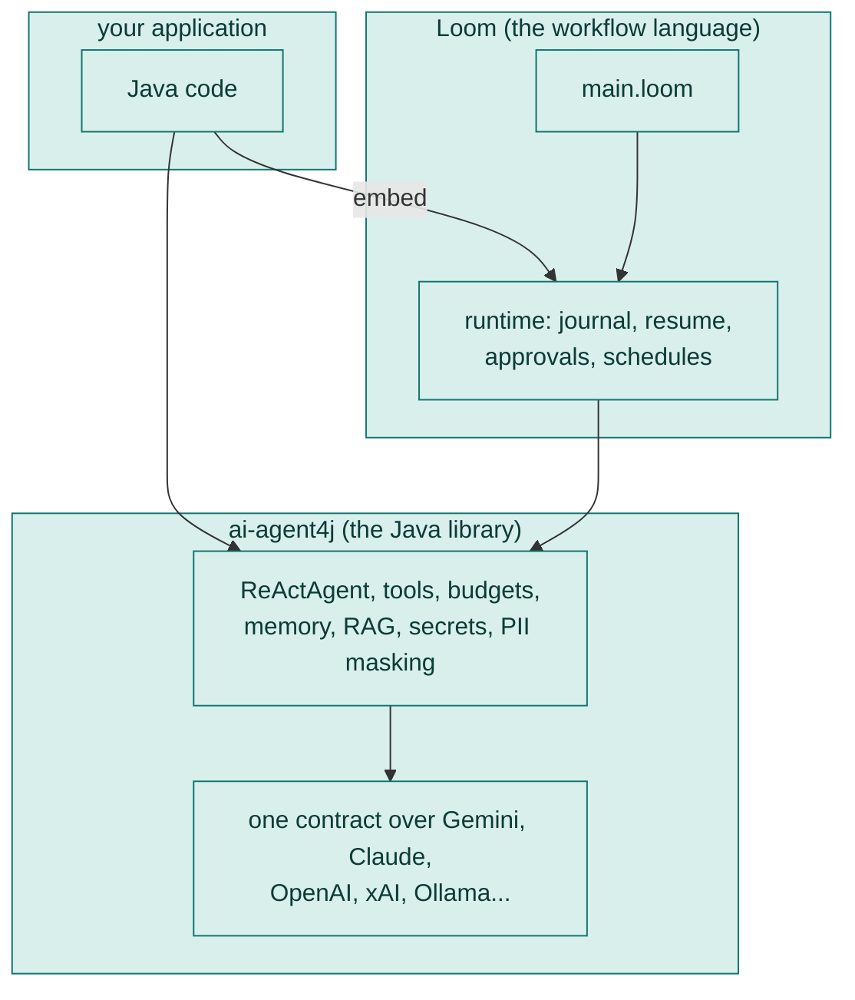

# 13. Plain Java

Loom is half of llm4j. The other half is a plain Java library, `ai-agent4j`, where **an agent is as ordinary as a `PaymentService`**: built with a builder, tested with JUnit, bounded by a budget, with no vendor SDKs underneath. You can use either half alone, or both together. This chapter shows how.



| If you want... | Use |
|---|---|
| One agent, in a Java service, with tools and a budget | `ai-agent4j` alone |
| A fixed multi-step process that survives crashes and waits for people | a Loom workflow |
| Both: a Spring or Java application that runs Loom workflows | embed Loom in Java |
| Exact code for a step inside a workflow | a Java `Task` |
| Your own tool for agents | a Java `Tool` |

## An agent in plain Java

Add the dependency:

```xml
<dependency>
    <groupId>io.github.srijithunni7182</groupId>
    <artifactId>ai-agent4j</artifactId>
    <version>6.1.0</version>
</dependency>
```

Then build an agent, give it a tool and a budget, and ask it something:

<!-- compiles -->
```java
package app;

import io.github.llm4j.DefaultLLMClient;
import io.github.llm4j.LLMClient;
import io.github.llm4j.agent.AgentResult;
import io.github.llm4j.agent.ReActAgent;
import io.github.llm4j.agent.tools.CalculatorTool;
import io.github.llm4j.budget.Budget;
import io.github.llm4j.config.LLMConfig;
import io.github.llm4j.provider.google.GoogleProvider;

public final class AskOnce {

    private AskOnce() {}

    public static void main(String[] args) {
        // the key comes from the environment, never from source code
        LLMClient client = new DefaultLLMClient(new GoogleProvider(LLMConfig.builder()
                .apiKey(System.getenv("GEMINI_API_KEY"))
                .defaultModel("gemini-2.5-flash")
                .build()));

        ReActAgent agent = ReActAgent.builder()
                .llmClient(client)
                .addTool(new CalculatorTool())
                .budget(Budget.builder().tokens(20_000).build())     // it cannot overspend
                .build();

        AgentResult result = agent.run("What is 1234 * 5678?");
        System.out.println(result.getFinalAnswer());
    }
}
```

The same `LLMClient` contract sits over Gemini, Claude, OpenAI, xAI, Perplexity, Sarvam, Ollama and more, so changing provider means changing the line that builds the client. Keys can come from the environment, your own vault, or an encrypted file, and components fetch them per request. See the [Getting Started guide](../../src/ai-agent4j/wiki/Getting-Started.md) and the [Secret Store](../../src/ai-agent4j/wiki/Secret-Store.md).

Everything an agent does in Loom is also available here: tools that need a person's approval (`requiresApproval(args)`), skills loaded from files, memory, RAG, PII masking, bias monitors, context compaction, hooks that check the question, each model call and the final answer. [Agents as objects](../AGENTS_AS_OBJECTS.md) explains the idea; the [wiki](../../src/ai-agent4j/wiki/) covers each part.

## Embedding a Loom workflow in Java

When your application wants a *workflow* (fixed steps, resumable, with approvals), load a script and run it:

<!-- compiles -->
```java
package app;

import io.github.llm4j.loom.ast.LoomScript;
import io.github.llm4j.loom.execution.DefaultLLMClientFactory;
import io.github.llm4j.loom.execution.HarnessExecutor;
import io.github.llm4j.loom.execution.LoomLoader;
import io.github.llm4j.loom.execution.ToolRegistry;
import io.github.llm4j.loom.prompt.PromptSettings;
import io.github.llm4j.loom.prompt.PromptSupport;
import io.github.llm4j.secret.EnvSecretStore;
import java.nio.file.Path;
import java.util.Map;

public final class RunWorkflow {

    private RunWorkflow() {}

    /** Load a script and run workflow Main. The result is whatever the workflow stored with `-> name`. */
    public static Object run(Path scriptFile, Map<String, String> inputs) throws Exception {
        LoomScript script = new LoomLoader().load(scriptFile.toAbsolutePath().toString());
        HarnessExecutor executor =
                new HarnessExecutor(script, new ToolRegistry(), new DefaultLLMClientFactory(System::getenv, EnvSecretStore.system()));
        executor.setBaseDir(scriptFile.toAbsolutePath().getParent());
        executor.setPromptCatalog(PromptSupport.catalog(script, scriptFile, PromptSettings.NONE));   // needed when agents use prompt files
        executor.initialize();                                                                       // add listeners and settings BEFORE this
        try {
            executor.executeWorkflow("Main", inputs);                                                // inputs are text, by parameter name
            return executor.getContext().getAll().get("draft");
        } finally {
            executor.shutdown();
        }
    }
}
```

A few rules that are easy to get wrong:

- Add trace listeners and settings **before** `initialize()`.
- Workflow inputs and answers are **text**, compared exactly (`"yes"` is not `"Yes"`).
- `setPromptCatalog(...)` is what makes prompt files work outside `weave`.

To make a run durable and let it wait for a person, give the executor a journal and a way to ask:

<!-- compiles -->
```java
package app;

import io.github.llm4j.loom.execution.HarnessExecutor;
import io.github.llm4j.loom.execution.TraceEvent;
import io.github.llm4j.loom.runtime.FileRunJournal;
import java.nio.file.Path;

public final class Durable {

    private Durable() {}

    public static void configure(HarnessExecutor executor, Path journalFile) {
        executor.setHumanInterface(question -> "yes");                       // a lambda is enough for tests; a screen blocks on a future
        executor.setJournal(new FileRunJournal(journalFile));                 // makes the run resumable
        executor.addTraceListener((TraceEvent event) -> System.out.println(event.type() + " " + event.text()));
    }
}
```

When a step needs a person and cannot wait, a `HumanInterface` can throw `RunSuspended` instead of blocking: the thread is freed, you show the question, and you answer into the journal whenever the person replies, even days later, on any server.

[The Java quick reference](../guide/12-java-quick-reference.md) is a longer, compile-checked class with spend limits, secret stores, context windows and watching a run. It is the page to copy from.

## Writing a task

A **task** is a step that must be exact: plain Java, no model, run from a workflow with `run`. It declares what it does to the world, so the runtime knows whether it is safe to repeat.

<!-- compiles -->
```java
package app;

import io.github.llm4j.agent.task.Task;
import io.github.llm4j.agent.task.TaskContext;
import io.github.llm4j.agent.task.TaskEffect;
import io.github.llm4j.agent.task.TaskResult;

/** A pure step: the same input always gives the same output, and it touches nothing. */
public final class Slugify implements Task {

    @Override
    public String getName() {
        return "Slugify";
    }

    @Override
    public TaskEffect effect() {
        return TaskEffect.NONE;          // NONE (pure), READS, or CHANGES (the default)
    }

    @Override
    public TaskResult run(TaskContext context) {
        String title = context.requireArg("title", String.class);
        return title.isBlank()
                ? TaskResult.rejected("empty title")
                : TaskResult.value(title.toLowerCase().replaceAll("[^a-z0-9]+", "-"));
    }
}
```

In a script it is `run Slugify(title = post.title) -> slug`, then `{slug.value}`. Register the class in `META-INF/services/io.github.llm4j.agent.task.Task` (one class name per line) so `weave` finds it; from Java, `executor.setTaskRegistry(new TaskRegistry().register(new Slugify()))`.

For a step that **changes** the world (a payment, a record), use `Task.changes(...)` with an `EffectPolicy` that says whether it is idempotent. The runtime hands your code an `idempotencyKey()` that is the same on a retry or a resume, which you pass to the receiving service so it can deduplicate. Because a task is plain Java, you also unit test it directly with no workflow and no model: `new Slugify().run(TaskContext.of(Map.of("title", "Hello World"), Map.of()))`.

## Writing a tool

A **tool** is something an agent may call. Implement three methods:

<!-- compiles -->
```java
package app;

import io.github.llm4j.agent.Tool;
import java.time.Instant;
import java.util.Map;

/** Returns the current time. List it in an agent's tools: [Clock]. */
public final class Clock implements Tool {

    @Override
    public String getName() {
        return "Clock";
    }

    @Override
    public String getDescription() {
        return "Returns the current time";
    }

    @Override
    public String execute(Map<String, Object> args) {
        return Instant.now().toString();
    }
}
```

Give it to a plain agent with `.addTool(new Clock())`, or to a Loom agent by registering it (`tools.register("Clock", new Clock())` on the `ToolRegistry`) or with `use: class` in the script. `requiresApproval(args)` puts a person in the loop for a risky call. And tell `weave audit` what it does to the world with `reach:` in the script, because the audit never loads your code.

## Testing a workflow from JUnit

The same engine as `weave test` is available as `LoomTest`, so a case written in Java gives the same answer as the YAML one:

<!-- compiles -->
```java
package app;

import io.github.llm4j.loom.wtest.LoomRun;
import io.github.llm4j.loom.wtest.LoomRunAssert;
import io.github.llm4j.loom.wtest.LoomTest;
import java.nio.file.Path;
import java.util.Map;

public final class ReviewLoopCheck {

    private ReviewLoopCheck() {}

    /** An approved draft is kept as it is: one writer call and one reviewer call. */
    public static void approvedDraftIsKept(Path script) {
        LoomRun run = LoomTest.of(script)
                .model("Writer", "A bottle that keeps drinks cold.")
                .typed("Reviewer", Map.of("verdict", "OK", "advice", ""))
                .run("Main", Map.of("product", "a steel water bottle"));

        LoomRunAssert.assertThat(run).completed().called("Writer", 1).called("Reviewer", 1);
    }
}
```

Put it in a real `@Test` method in your project. `LoomTest` can also script failures (`.failing("Replier", LoomTest.Failure.times(1, "timeout"))`), classifiers, tools, tasks, people (`.humans("yes")`) and run the YAML files from `tests/` as JUnit tests (`LoomTest.cases(Path.of("tests"))` gives you one test per case). For evaluating *quality* from Java, eval4j gives you golden datasets, judges and reports in plain JUnit: `weave eval main.loom --emit-test src/test/java/app/EvalTest.java` writes the opt-in test class.

## Typed access and Spring

`weave bindgen` generates typed Java for a workflow (its inputs and outputs), and the **Spring Boot starter** (`llm4j-spring-boot-starter`) wires Loom, tools and addons as beans, so a controller can inject a workflow and call it like any other service. See the [starter's README](../../src/spring/llm4j-spring-boot-starter/README.md).

## Which should I write in: Loom or Java?

A rule of thumb that holds up well:

| It is... | Write it in |
|---|---|
| The order things happen in, who is asked, what happens on failure, the limits | **Loom** (readable by a non-programmer, reviewable, auditable) |
| What an agent should say or decide | **Prompts** (in the script or prompt files) |
| A rule that must always hold, a calculation, a call to your payment system | **A Java task** |
| A capability agents need (an internal API, a database) | **A Java tool** (or a generic tool, if one fits) |
| The application around it (screens, web endpoints, scheduling infrastructure) | **Java** (embed Loom) |

## Try it yourself

1. Compile and run `AskOnce` against your own key, then add a second tool.
2. Write a `Task` for something in one of your workflows that must be exact, and unit test it with no model.
3. Write the `LoomTest` equivalent of one case from a starter's YAML and compare.

Next: [Cookbook and cheat sheet](14-cookbook.md).
