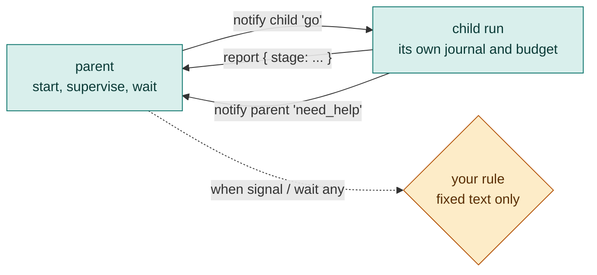

# 14. Workflows that report, signal and wait for each other

[Chapter 11](11-advanced-orchestration.md) showed how to `start` a workflow as a child, `wait` for it and `supervise` it with counted rules. This chapter adds the three things a supervisor needs once the child runs for a while: **where is it** (declared progress), **tell it something, hear something back** (signals), and **react to whichever child needs me first** (`wait any`).

None of them gives a model more authority. What a child writes is data your script may read, never something that makes your script act.



## Say where you are: `progress` and `report`

A workflow declares what it may report, after its parameters, and reports with a statement. The fields are typed (`string`, `number`, `boolean` or `enum["a", "b"]`) and flat.

```loom
agent Researcher { model: "gemini-2.5-flash" system: "Research the topic." }

workflow Research(topic) progress { stage: string, done: number, of: number } {
    report { stage: "searching", done: 0, of: 3 }
    delegate "Find sources on {topic}" to Researcher -> notes
    report { stage: "writing", done: 2, of: 3 }
    return notes
}

workflow Main(question) {
    start Research(topic = question) budget { tokens: 100000 } -> work
    supervise work { assert progress.done changes within 5m { steer "Say what you are doing." once } }
    wait work timeout 20m -> findings
    set where = work.progress.stage
    alt (work is ok) { return "{findings} (last stage: {where})" }
    return "unfinished at stage {where}"
}
```

- The parent reads the latest report as `work.progress.stage`. It is the child's own words, so Loom treats it as **unchecked**, like any model-written text.
- `assert progress.done changes within 5m { ... }` fires when the field has not changed for five minutes of running time. It never reads what the value says. There is no `when progress.done > 3`: a rule that steers or cancels never rests on a number the child wrote.
- A report lives in the child's own journal, so it survives a restart. Too many reports, or one that is too long, is dropped and recorded; it never stops the child.
- `report` and `progress` are words only in those two places. Everywhere else they stay ordinary names, so `-> report` still works.

## Tell it something, hear something back: signals

A signal is a named entry in the **receiver's journal**. One sent before the receiver is waiting is not lost, and none is read twice across a crash.

```loom
agent Researcher { model: "gemini-2.5-flash" system: "Research the topic." steerable: true streaming: true }

workflow Research(topic) {
    wait signal "go" timeout 10m -> instruction
    alt (instruction is ok) {
        delegate "Research {topic}. Note: {instruction}" to Researcher -> notes
        notify parent "found" "{notes}"
        return notes
    }
    return "never told to start"
}

workflow Main(question) {
    start Research(topic = question) budget { tokens: 100000 } -> work
    supervise work { when signal "need_help" { steer "Try a narrower reading of the topic." once } }
    notify work "go" "prefer recent sources"
    notify work "approved" "yes" sticky
    wait work signal "found" timeout 10m -> notes
    alt (notes is ok) { return notes }
    return "the research did not report"
}
```

- `notify work "go" "text"` sends from the parent; `notify parent "found" "text"` sends from the child. A plain signal is read once, in order. A **`sticky`** one is a latch: it stays set and every wait for it returns at once.
- `wait signal "go" timeout 10m -> instruction` waits in the child; `wait work signal "found" ...` waits in the parent. A timeout is required, and when it passes `instruction is ok` is false.
- A child that waits for a signal **holds no thread**. It is saved as waiting and run again when the signal arrives.
- `when signal "need_help" { ... }` is a supervise rule. Its steer text is fixed in your script: the payload of a signal **can never become a steer's text**, and `weave check` refuses a placeholder there.
- What the receiver reads is unchecked in both directions. `weave audit` lists every workflow that reads a signal (rule LA30).
- Limits: 16 unread per name, 64 in all, a name of 40 characters, 2000 characters of text. Passing one fails loudly.

## React to whichever child needs you first: `wait any`

`wait all` joins every child. `wait any` returns on the first of a signal, a child finishing, or the timeout, as an **event**.

```loom
agent Researcher { model: "gemini-2.5-flash" system: "Research the topic." }

workflow Research(topic) {
    delegate "Research {topic}" to Researcher -> notes
    notify parent "found" "{notes}"
    return notes
}

workflow Main(question) {
    start Research(topic = "panels") budget { tokens: 100000 } -> work["panels"]
    start Research(topic = "costs") budget { tokens: 100000 } -> work["costs"]
    set report = ""
    set event = "start"
    loop until (event.remaining == 0) max 8 {
        wait any work timeout 10m -> event
        alt (event.kind == "signal") { set report = "{report}{event.name}: {event.text}\n" }
        alt (event.kind == "finished") { set report = "{report}{event.name} finished: {event.status}\n" }
        alt (event.kind == "timeout") { set report = "{report}timed out\n" }
    }
    return report
}
```

The event has a `kind`, the handle's `name`, and `remaining` (children not yet reported). When several things are ready, signals come before finished children, then the order you started them. A message is taken once, so no later wait sees it. The first return is journaled, so a restart reports each event once, in the same order.

## Test it with no model and no waiting

`weave test` can script a child and the signals that reach it, on a virtual clock, so a wait of ten minutes takes no time:

```yaml
cases:
  - name: the child asks for help and is steered
    children:
      Research:
        - { state: working, after: 2m }
        - { signal: need_help, text: "no sources", after: 1m }
        - { state: completed, result: "Lima.", after: 1m }
    expect:
      signals: { received: [need_help] }
```

Starter [18-supervise-workflows](../../src/loom/starters/18-supervise-workflows/) uses a `need_help` signal rule, and its tests show both the signal and a child that stays silent. The full reference is [the guide](../../src/loom/ai-agent4j-loom/LOOM_GUIDE.md#starting-workflows-and-supervising-them-start-wait-cancel-steer-supervise).

## Try it yourself

1. In the signals example, remove `once` from the `need_help` rule. What does the audit say, and how many steers can one child now cause?
2. Change the `notify work "approved" "yes" sticky` line to a plain one, then add two `wait work signal "approved"` lines. Which one times out?
3. In starter 18's tests, add a case where no `need_help` arrives and the researcher finishes. Which `expect: signals` list is empty?

Next: [Cookbook and cheat sheet](15-cookbook.md).
