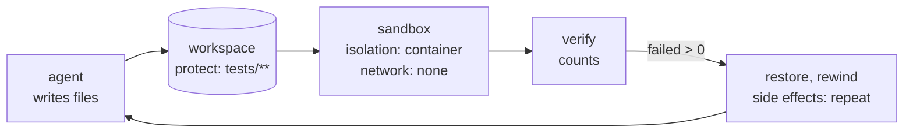

# 16. Files, checks and running code

The agents so far answered in text. Many real jobs end in **files**: a report, a configuration, a fix to some code. And many need a
**fact a model should not be trusted with**: a total, a date, whether the tests pass. This chapter adds five tool kinds for that, none of
which needs a key or Java:

| `use:` | What it is for |
|---|---|
| `compute` | Exact arithmetic in decimals, dates, a value out of JSON, figures over CSV |
| `verify` | A test report or a schema check, turned into counts the script can trust |
| `scan` | Secrets and personal data in a text, reported as a rule and a place, never the match |
| `workspace` | A folder an agent edits: exact patches, search, snapshots and restores |
| `sandbox` | Programs run on a workspace's files, isolated in a container |



## Let the script check, not the model

A model that says "the total is 300" may be right. A script that adds the column itself knows. `compute` does arithmetic in decimals, so
`0.1 + 0.2` is `0.3`, and `verify` turns a report into numbers your `alt` can test:

```loom
tool Calc  { use: compute }
tool Check { use: verify }
tool Scan  { use: scan }

workflow Close(amount, report) {
    use Calc(action = "calc", expression = "{amount} * 1.18") -> gross
    use Check(format = "junit", report = report) -> tests
    alt (tests.failed > 0) { halt "{tests.failed} tests failed" }
    use Scan(text = "Invoice total {gross.value}") -> found
    alt (found.count > 0) { halt "the text holds something that must not leave" }
    return gross.value
}
```

- These three reach nothing outside the run: they need no approval, and a resumed run replays them exactly.
- What they return keeps its origin. The counts of `verify` are data the tool parsed; the test names and messages in `tests.items` were
  written by whoever wrote the tests (perhaps a model), so they stay unchecked text. Never decide anything on the words.
- `verify` fails closed: a report it cannot read counts as one failure.

## A folder an agent edits

`workspace` is a folder the agent reads and edits with exact patches (`old` must appear once; all edits apply or none do), `find` and
`grep`. `protect:` keeps paths read only, so an agent cannot "fix" the tests that judge it. Links are never followed and nothing under
`.git` is ever written.

**Trying again from a clean state** is something the script writes, not something a rewind does by itself. Take a snapshot once, before
the checkpoint; restore it first in every attempt; rewind with `side effects: repeat` so the attempt's writes run again:

```loom
tool Draft { use: workspace  root: "report"  allow: "*.json"  mode: readwrite  overwrite: true  protect: "report.schema.json" }
tool Check { use: verify  root: "report" }

agent Writer { model: "gemini-2.5-flash"  system: "You write report.json to match report.schema.json."  tools: [Draft]  approve: [Draft] }

workflow Main(brief) {
    use Draft(action = "snapshot", name = "clean")
    checkpoint Clean starting with feedback = "none"
    use Draft(action = "restore", name = "clean")
    delegate "Write report.json for: {brief}. Feedback: {feedback}" to Writer -> written
    use Check(format = "schema", schema = "report.schema.json", source = "report.json") -> result
    rewind to Clean when (result.failed > 0) at most 2 times carrying feedback = "{result.items}" side effects: repeat
    note "{written}"
    return result.status
}
```

With `side effects: keep`, the second attempt's restore would be taken for the first one already done and skipped: nothing would be put
back. That is the difference the keyword makes. Starter [19-report-writer](../../src/loom/starters/19-report-writer/) is this workflow with
its tests.

## Running code a model wrote

`sandbox` runs a program from its `allow:` list on the workspace's files. The program is a name and an argument list, never a line for a
shell. A script has no list literal, so it gives `args` as the text of a JSON list; an agent gives a real list.

```loom
tool Data  { use: workspace  root: "data"  allow: "*.py, *.csv, *.json"  mode: readwrite  overwrite: true  protect: "sales.csv" }
tool Py    { use: sandbox  workspace: Data  isolation: container  image: "python:3.12-slim"  allow: "python3"  network: none  timeout: "2m"  unattended: true }

agent Analyst { model: "gemini-2.5-flash"  system: "Write analysis.py: it reads sales.csv and writes result.json."  tools: [Data]  approve: [Data] }

workflow Main(question) {
    delegate "{question}" to Analyst -> written
    use Py(program = "python3", args = "[\"analysis.py\"]") -> ran
    alt (ran.exit != 0) { halt "analysis.py failed: {ran.stderr}" }
    note "{written}"
    return ran.isolation
}
```

- **`isolation:` has no default.** `container` runs the program in Docker or Podman with the workspace as its only mount, protected paths
  mounted read only, no capabilities and a read-only root. `process` is a child process of the run, which is not isolation: it must say
  `network: open`, and `weave audit` flags it (LA31). A missing container runtime stops the run before its first step; nothing falls back.
- **`network: none` is the default.** `network: allow  hosts: "pypi.org"` lets the program reach those hosts through an egress proxy and
  nothing else (LA33).
- **Secrets by name only.** `env.TOKEN: secret.PYPI` gives the program one variable, looked up for each call and scrubbed from its output;
  nothing else of your environment reaches it.
- **Every run is journaled**, so a resumed run does not run the program again. What it prints is unchecked text: compare figures with
  `compute`, never with what the program says about them.

Starter [20-data-analyst](../../src/loom/starters/20-data-analyst/) checks the script's total against its own exact sum of the column,
and scans the result before it leaves. What the sandbox stops and what it does not is in
[its threat model](../security/sandbox.md).

## Testing it without Docker

`weave test` runs none of these tools: it records what a tool that changes things would have done, and you script what every tool returns.
A case for the report writer, where the first check fails:

```yaml
- name: a report that fails the check is restored and written again
  input: { brief: "Quarterly support tickets" }
  models:
    Writer: ["A first try.", "A fixed report."]
  tools:
    Check:
      - { status: "failed", failed: 1, items: [ { name: "summary", status: "failed", message: "is too long" } ] }
      - { status: "passed", failed: 0, items: [] }
  expect:
    calls: { Writer: 2 }
    told: { Writer: [ "is too long" ] }
```

## More tools, in optional modules

Four more kinds come in their own modules, added with their jar (`weave check` names the module when a script uses one without it):
`search` (web search through a provider you key), `documents` (the text of PDF, DOCX and HTML files with the page or paragraph each part
came from), `git` (status, diff, commit and an approved push, through the sandbox) and `browser` (an installed Chrome, with every request
a page makes checked). See [the extras](../../src/tools/extras/README.md).

## Try it

1. In starter 19, change `side effects: repeat` to `keep` and run its tests. Which case changes, and why?
2. In starter 20, set `isolation: process` and run `weave check` and `weave audit`. What do they say?
3. Add `group_by: "region"` to starter 20's `csv` step. What does `total` hold now, and how must the comparison change?

Back to the [tutorial index](README.md).
