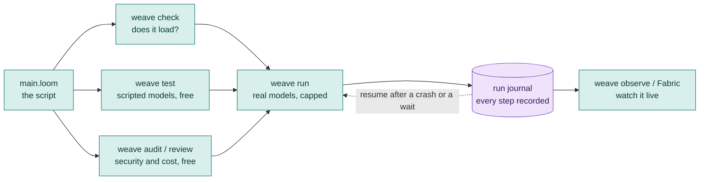

# The Loom tutorial

## Why I built Loom

Loom is a new language, but it is not meant to be an application programming language. I built it for one reason.

A workflow is a language in itself. Much like code, it moves from state to state. It is the harness we build on top of the transformers, and its intelligence is symbolic. I grew tired of expressing everything I needed in a workflow through Python or Java. A workflow is above all of that. It is a pure thing, a beautiful orchestration of intents to achieve a goal. The plumbing that Java and Python demanded killed the joy of building it.

And when I needed feedback on a workflow, it stayed difficult to give or to get. I could not see the workflow beneath all the cobwebs of the code.

Loom was born from that desire: to see the workflow, to preserve its beauty, and to get feedback on the workflow and not on the plumbing.

I hope you will see the beauty in Loom the way I do.

---

Loom is a small language for workflows that use several AI agents. You write what should happen, in what order, with what limits, and Loom runs it, records it, and can pick it up again after a crash or a few days of waiting.

This tutorial teaches all of it, from "what is an agent?" to "my workflow runs by itself, under a budget, and a person approves the risky step". It is written to be read in order, but every chapter stands on its own, so you can jump to the one you need.

You do not need to know Java to use Loom. You need Java 17 installed, and (for real runs) an API key from a model provider. Everything up to the point where you spend money runs free.

Reading this without the repository? `weave guide tutorial` writes the whole tutorial, with its diagrams, as one web page (`loom-tutorial.html`) that you open in a browser. It is the same text as these files.

## How a Loom project fits together

You write one text file. A handful of commands check it, test it, review it, run it and watch it. The first four cost nothing. That order is deliberate: **spend money last.**

## The chapters

| # | Chapter | You learn | Starters that use it |
|---|---|---|---|
| 1 | [Your first workflow](01-first-workflow.md) | Install, `agent`, `workflow`, `delegate`, `return`, and the check, test, run loop | [01](../../src/loom/starters/01-hello/) |
| 2 | [Data and variables](02-data-and-variables.md) | Where results live, `{name}`, `set`, objects, `substitution: braces`, `return`, `note`, `observe` | [02](../../src/loom/starters/02-chain/), [08](../../src/loom/starters/08-extract-and-validate/) |
| 3 | [Agents](03-agents.md) | `model`, `system`, prompt files, personas, temperature, providers, routing and fallbacks, a shared prompt | [02](../../src/loom/starters/02-chain/), [10](../../src/loom/starters/10-memory-assistant/) |
| 4 | [Control flow](04-control-flow.md) | `alt`, `loop until`, `for each`, `parallel`, `broadcast`, `call`, `import`, `halt` | [03](../../src/loom/starters/03-review-loop/), [04](../../src/loom/starters/04-router/), [05](../../src/loom/starters/05-parallel-research/), [06](../../src/loom/starters/06-plan-and-fan-out/) |
| 5 | [Structured answers and failure](05-structured-answers-and-failure.md) | `output_schema`, `expecting`, `retry`, `backoff`, `timeout`, `on_failure`, degraded runs | [03](../../src/loom/starters/03-review-loop/), [05](../../src/loom/starters/05-parallel-research/), [08](../../src/loom/starters/08-extract-and-validate/) |
| 6 | [Tools and tasks](06-tools-and-tasks.md) | Built-in and declared tools, the six generic tools, OpenAPI, MCP, approvals, `run` tasks, classifiers | [07](../../src/loom/starters/07-approval/), [11](../../src/loom/starters/11-daily-digest/) |
| 7 | [Knowledge and memory](07-knowledge-and-memory.md) | `knowledge` (answers from your documents), agent `memory`, voice and languages | [09](../../src/loom/starters/09-handbook-qa/), [10](../../src/loom/starters/10-memory-assistant/) |
| 8 | [People in the loop](08-people-in-the-loop.md) | `human_prompt`, approvals, durable runs, `sleep`, steering and stopping, `supervise` | [07](../../src/loom/starters/07-approval/), [12](../../src/loom/starters/12-wait-for-a-person/), [14](../../src/loom/starters/14-supervised-agent/) |
| 9 | [Safety and cost](09-safety-and-cost.md) | Budgets, guards, PII, secrets, the audit and review, the lethal trifecta | [07](../../src/loom/starters/07-approval/), [15](../../src/loom/starters/15-earned-autonomy/) |
| 10 | [Testing](10-testing.md) | `weave test` in full, scripted failures, coverage, golden datasets and `weave eval` | every starter has tests |
| 11 | [Advanced orchestration](11-advanced-orchestration.md) | Checkpoints and rewind, earned autonomy and ladders, schedules, context and compaction | [11](../../src/loom/starters/11-daily-digest/), [13](../../src/loom/starters/13-rewind-and-retry/), [15](../../src/loom/starters/15-earned-autonomy/) |
| 12 | [Running it for real](12-running-for-real.md) | `weave run`, journals, packaging, deploying, watching, Fabric | [11](../../src/loom/starters/11-daily-digest/), [12](../../src/loom/starters/12-wait-for-a-person/) |
| 13 | [Plain Java](13-java.md) | Use the agent library directly, embed Loom, write your own tasks and tools, test from JUnit | |
| 14 | [Cookbook and cheat sheet](14-cookbook.md) | Recipes, mistakes and their fixes, one page of syntax | |

## The starter set

[`src/loom/starters`](../../src/loom/starters/README.md) holds fifteen small, complete workflows. Each loads, has tests that need no key, and shows its own picture. Read a chapter, then open the starter that uses it, change something, and run its tests.

## Conventions in this tutorial

- Every code block marked `loom` is checked by the build with `weave check`, so the examples you copy are examples that load. A block marked `loom-error` is checked to *fail*, to show you a real error message. A block marked `loom-parse` is checked to parse but cannot be loaded on its own (it needs files beside it, such as prompts or documents).
- In the diagrams, colour carries meaning: **teal** is a step, **amber** a decision or a fork, **indigo** a person, **green** the outside world, **violet** stored data, **red** a failure or a danger, and **grey** a start, an end or a state.
- The models in the examples are `gemini-2.5-flash`. Use whichever provider you like: see [Agents](03-agents.md#models-and-providers).
- Commands are for a terminal. The same things are available in the [VS Code extension](../../src/loom/vscode-loom/README.md), which draws your workflow as you type.
- A path like `eval/golden` is relative to the folder that holds your `main.loom`.

## Where to go next

- The big picture, from a sentence to a deployed, watched workflow: [the Developer guide](../../DEVELOPER_GUIDE.md).
- The complete language reference, with every option: [LOOM_GUIDE.md](../../src/loom/ai-agent4j-loom/LOOM_GUIDE.md).
- Every command and flag: [the command reference](../COMMAND_REFERENCE.md), or `weave man <command>` in a terminal.
- A process for building a workflow the right way, with evaluation: [the workflow guide](../guide/README.md).
- Running and watching it in production: [Going live](../guide/09-go-live.md).
