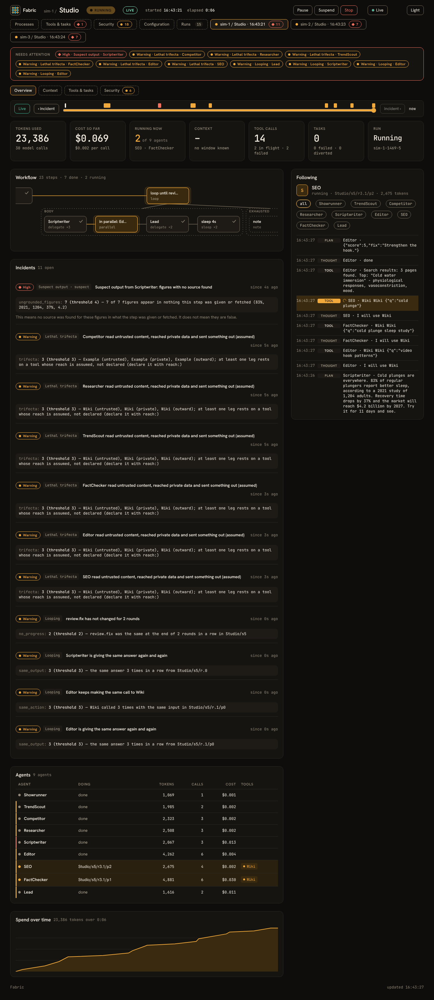
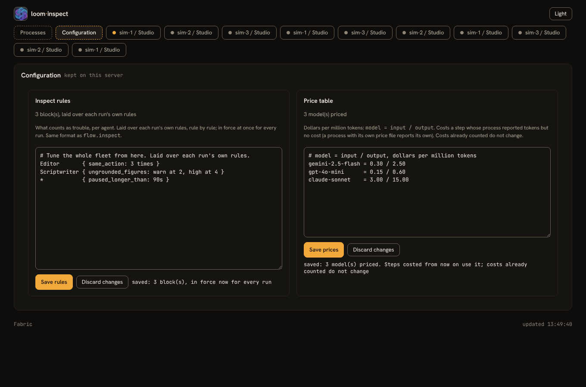

# Fabric

One console for every workflow of every Loom process. Processes report to it; it never connects to them. It needs a JDK and nothing else: no Loom runtime, no model keys, no scripts.



## Set it up

```bash
# once: the data directory, the vault, the admin password (12+ characters)
LOOM_FABRIC_ADMIN_PASSWORD='a long password' java -jar loom-fabric-6.1.0-all.jar init --data /var/lib/fabric

# one key per process, shown once
java -jar loom-fabric-6.1.0-all.jar clients add getviral-prod --data /var/lib/fabric
java -jar loom-fabric-6.1.0-all.jar clients list --data /var/lib/fabric
java -jar loom-fabric-6.1.0-all.jar clients revoke getviral-prod --data /var/lib/fabric   # takes effect at once

# run it (loopback only without TLS)
java -jar loom-fabric-6.1.0-all.jar serve --data /var/lib/fabric --port 9090
```

`init` writes `master.key` beside the vault unless you give the master key through `--master-key-file` or `LOOM_FABRIC_MASTER_KEY`. Keep it apart from the vault's backups; without it the vault cannot be read. Passwords and keys are never taken from the command line.

## TLS

Fabric will not listen on a non-loopback address without TLS or `--trust-proxy` (a reverse proxy that terminates TLS in front of it).

Public certificate (Let's Encrypt, a load balancer): `--tls-cert chain.pem --tls-key key-pkcs8.pem`, or terminate at the proxy. Processes need nothing extra.

Private CA, made for you:

```bash
java -jar loom-fabric-6.1.0-all.jar tls init --host fabric.example.com --also 10.0.2.5 --out /var/lib/fabric/tls
java -jar loom-fabric-6.1.0-all.jar serve --data /var/lib/fabric --bind 0.0.0.0 \
     --tls-keystore /var/lib/fabric/tls/server.p12 --tls-password-file /var/lib/fabric/tls/server.password
```

`tls init` writes `ca.pem`: hand it to each process as `--observe-ca ca.pem` (it is public, not a secret; it is added for this connection only and never installed JVM-wide). `serve` prints the server key pin, for `--observe-pin sha256:…` if you would rather pin one self-signed server than trust a CA. Host names are always verified.

## Point a process at it

```bash
weave secrets set LOOM_FABRIC_CLIENT_KEY --secrets keys.store          # paste the key from 'clients add'
weave daemon triggers/ --secrets keys.store \
      --observe-fabric https://fabric.example.com:9090 --observe-name getviral-prod --observe-ca ca.pem
```

`--observe-name` is required and must be a client created above. The same options work on `run`, `resume`, `tick` and `daemon`. Events are written to a local outbox first (`--observe-outbox`, default `./loom-inspect-outbox`; 256 MB or 7 days per name), so a Fabric that is down, slow or restarted never affects a workflow, and everything missed streams in when it returns. `weave observe flush` delivers what a finished process left behind; `weave observe purge` removes it.

## What it keeps

History goes to `<data>/history/<client>/<day>.jsonl` (no database): every accepted batch is forced to disk before the server acknowledges it, and a restart rebuilds the console from it. Retention is 30 days and 2 GB by default (`--retention-days`, `--retention-size`), oldest day first.

## Sign in

Open the server's address in a browser and sign in with the admin password. Failed attempts from an address wait longer each time. Signed in, you can **pause, resume, suspend or stop** a run from its page (with a confirm dialog and a CSRF-protected request). The request is queued as a command that the process collects on its signed long-poll (`/loom-inspect/v1/commands`; the answer is signed with that process's key) and carries out at the run's next step; it expires after 60 seconds, so an offline process never wakes up to an old command. Every request and every result is written to `audit.log` in the data directory (never passwords or secret values). Secrets are not managed here: their values never leave the process, so rotation is on the process's own embedded page.

## Configuration page



Signed in, the **Configuration** page edits the **inspect rules** (pick an agent, a behaviour and a threshold) and the **price table** (pick a model from those your runs use and set its input and output price) kept on the server (`<data>/config/rules.inspect`, `prices.properties`), in the same format as the files a process keeps beside its script. A save is checked first (errors come back with line numbers and nothing is kept), takes effect at once, survives a restart, and is audited. Rules are laid over each run's own rule by rule; prices cost a step whose process reported tokens but no cost.

## Packaging

`Dockerfile` and `fabric.service` (systemd) are in this directory. The Docker image has not been built in CI yet; treat it as a starting point.

## Trying it without a model

`src/examples/fabric-sim` runs this server with several simulated Loom processes (no model, no key) so you can look at every page, exercise pause, suspend and stop, kill a process or the server and watch recovery, and revoke a key. `./run.sh` there does it in one command.

A change made by `fabric clients add` or `revoke` is picked up by a running server within a second; there is no need to restart it.

## More

[Deployment guide](../../../docs/OBSERVABILITY_DEPLOYMENT.md) · [Observability guide](../../../docs/OBSERVABILITY.md) · [Fabric server (wiki)](../../../wiki/Fabric-Server.md) · [Incidents and rules](../../../wiki/Observability-Incidents-and-Rules.md) · [Controls, secrets and security](../../../wiki/Observability-Controls-and-Security.md) · [Reference](../../../wiki/Observability-Reference.md)
