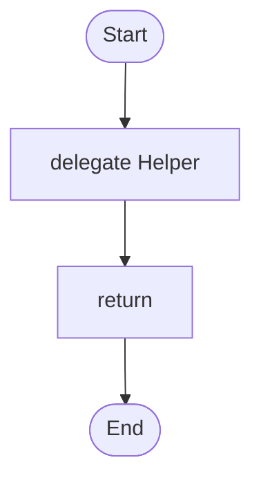

# 01 · Hello, Loom

The smallest useful workflow: one agent, one workflow, one question in, one answer out.

## What it shows

- agent, workflow, delegate and return
- how a variable ("answer") carries a result

Read more: [01-first-workflow.md](../../../../docs/tutorial/01-first-workflow.md).

## The workflow

```loom
// 01-hello: the smallest useful workflow. One agent, one workflow, one question in, one answer out.

substitution: braces

agent Helper {
    model: "gemini-2.5-flash"
    system: "You are a friendly assistant. Answer in two sentences at most."
}

workflow Main(question) {
    delegate "{question}" to Helper -> answer
    return answer
}
```

## The shape of it

This picture is drawn by `weave graph` from the file above, not by hand.

<!-- graph:start -->

<!-- graph:end -->

## Run it

```bash
cp .env.example .env        # then put your keys in .env (it is git-ignored)
weave check main.loom       # does it load? what is missing?
weave test main.loom --coverage   # scripted models: no key, no network, no cost
weave run main.loom --workflow Main --input question="What is a workflow?" --max-tokens 50000 --max-calls 20   # a real run, capped
```

## What it needs

- `GEMINI_API_KEY` (any model works: change the `model:` lines)

## Try changing it

- Change the agent's `system:` prompt and run the test again: it still passes, because the model is scripted.
- Add a second `delegate` that asks a different agent to shorten the answer.

Back to the [starter set](../README.md).
