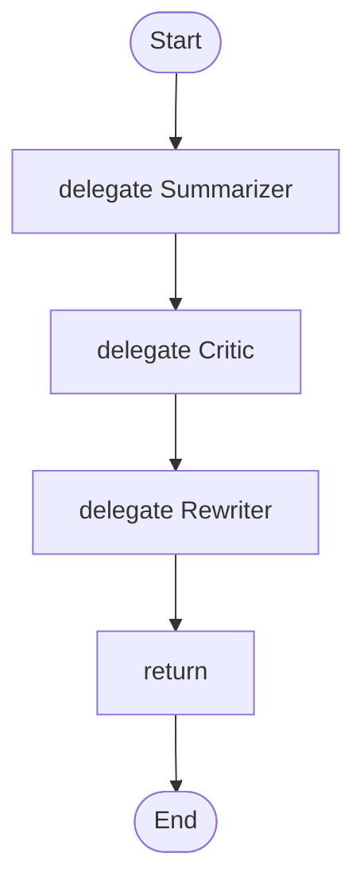

# 02 · A chain of agents

Three agents in a row: summarize, critique, rewrite. Each step uses what the step before wrote.

## What it shows

- passing a result to the next step
- `budget` as a spend cap for the whole run
- low temperatures for checking roles

Read more: [02-data-and-variables.md](../../../../docs/tutorial/02-data-and-variables.md), [03-agents.md](../../../../docs/tutorial/03-agents.md).

## The workflow

```loom
// 02-chain: agents in a row. Each step's answer is stored in a variable and used by the next step.

substitution: braces

budget { tokens: 60000  calls: 10 }

agent Summarizer { model: "gemini-2.5-flash"  system: "Summarize the text in three bullet points."  temperature: 0.2 }
agent Critic     { model: "gemini-2.5-flash"  system: "Point out what the summary left out. Be brief."  temperature: 0.2 }
agent Rewriter   { model: "gemini-2.5-flash"  system: "Improve the summary using the critique. Keep three bullets."  temperature: 0.3 }

workflow Main(text) {
    delegate "Summarize:\n{text}" to Summarizer -> summary
    delegate "Text:\n{text}\n\nSummary:\n{summary}" to Critic -> critique
    delegate "Summary:\n{summary}\n\nCritique:\n{critique}" to Rewriter -> final_summary
    return final_summary
}
```

## The shape of it

This picture is drawn by `weave graph` from the file above, not by hand.

<!-- graph:start -->

<!-- graph:end -->

## Run it

```bash
cp .env.example .env        # then put your keys in .env (it is git-ignored)
weave check main.loom       # does it load? what is missing?
weave test main.loom --coverage   # scripted models: no key, no network, no cost
weave run main.loom --workflow Main --input text="Loom runs agents in a fixed order." --max-tokens 50000 --max-calls 20   # a real run, capped
```

## What it needs

- `GEMINI_API_KEY` (any model works: change the `model:` lines)

## Try changing it

- Swap the order of the Critic and the Rewriter and read `weave graph` again.
- Lower `budget { calls: 10 }` to 2 and see the run stop before the third agent.

Back to the [starter set](../README.md).
