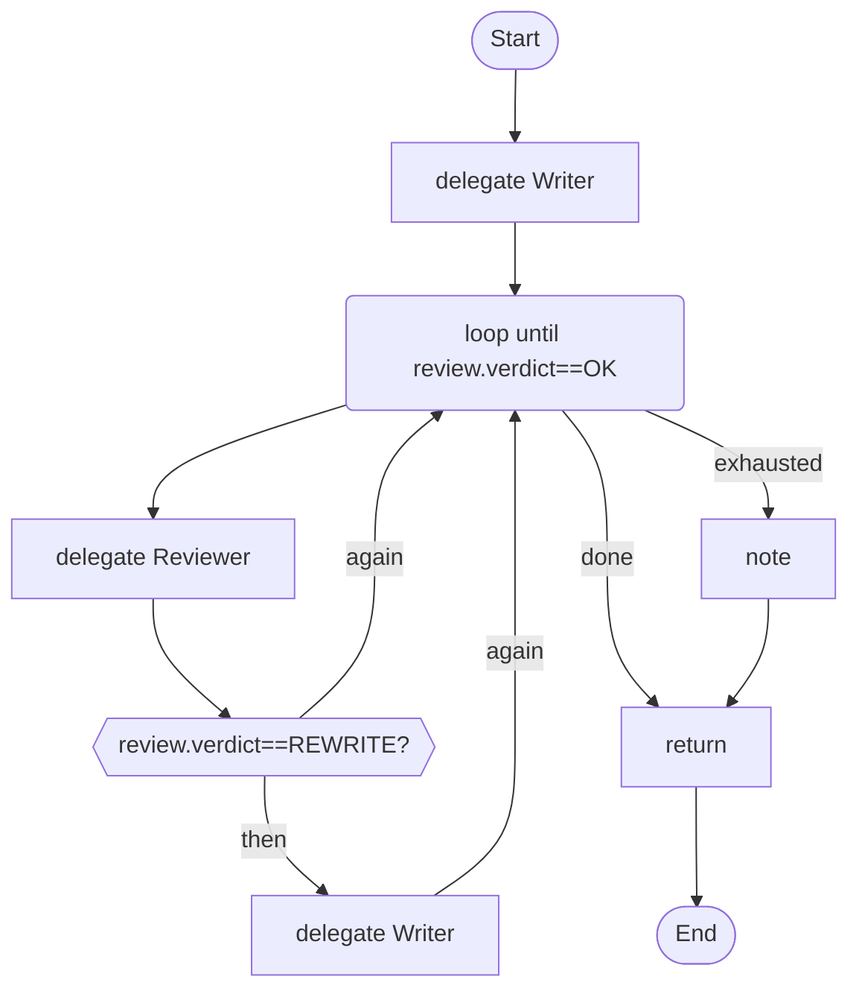

# 03 · Write, review, rewrite

A writer and a reviewer. The loop rewrites until the reviewer says OK, and it can never run more than three rounds.

## What it shows

- `loop until ... max N`
- `on_exhausted`
- `expecting { ... }`: a checked answer shape for one step

Read more: [04-control-flow.md](../../../../docs/tutorial/04-control-flow.md), [05-structured-answers-and-failure.md](../../../../docs/tutorial/05-structured-answers-and-failure.md).

## The workflow

```loom
// 03-review-loop: write, review, rewrite until the reviewer is satisfied. The loop is bounded: it can never run away.

substitution: braces

budget { tokens: 150000  calls: 20 }

agent Writer   { model: "gemini-2.5-flash"  system: "Write clear, short product descriptions."  temperature: 0.7 }
agent Reviewer { model: "gemini-2.5-flash"  system: "Review the description. Say OK only if it is clear and under 60 words."  temperature: 0.1 }

workflow Main(product) {
    delegate "Write a product description for: {product}" to Writer -> draft

    loop until (review.verdict == "OK") max 3 {
        delegate "Review this description:\n{draft}" to Reviewer -> review expecting { verdict: enum["OK", "REWRITE"], advice: string }
        alt (review.verdict == "REWRITE") {
            delegate "Rewrite it. The reviewer says: {review.advice}\n\n{draft}" to Writer -> draft
        }
    } on_exhausted {
        note "The reviewer was still not satisfied after {_loopRound} rounds; using the last draft."
    }

    return draft
}
```

## The shape of it

This picture is drawn by `weave graph` from the file above, not by hand.

<!-- graph:start -->

<!-- graph:end -->

## Run it

```bash
cp .env.example .env        # then put your keys in .env (it is git-ignored)
weave check main.loom       # does it load? what is missing?
weave test main.loom --coverage   # scripted models: no key, no network, no cost
weave run main.loom --workflow Main --input product="a steel water bottle" --max-tokens 50000 --max-calls 20   # a real run, capped
```

## What it needs

- `GEMINI_API_KEY` (any model works: change the `model:` lines)

## Try changing it

- Raise `max 3` to 10 and note what `weave review` says about the cost.
- Make the reviewer stricter in its `system:` prompt and add a test case for it.

Back to the [starter set](../README.md).
