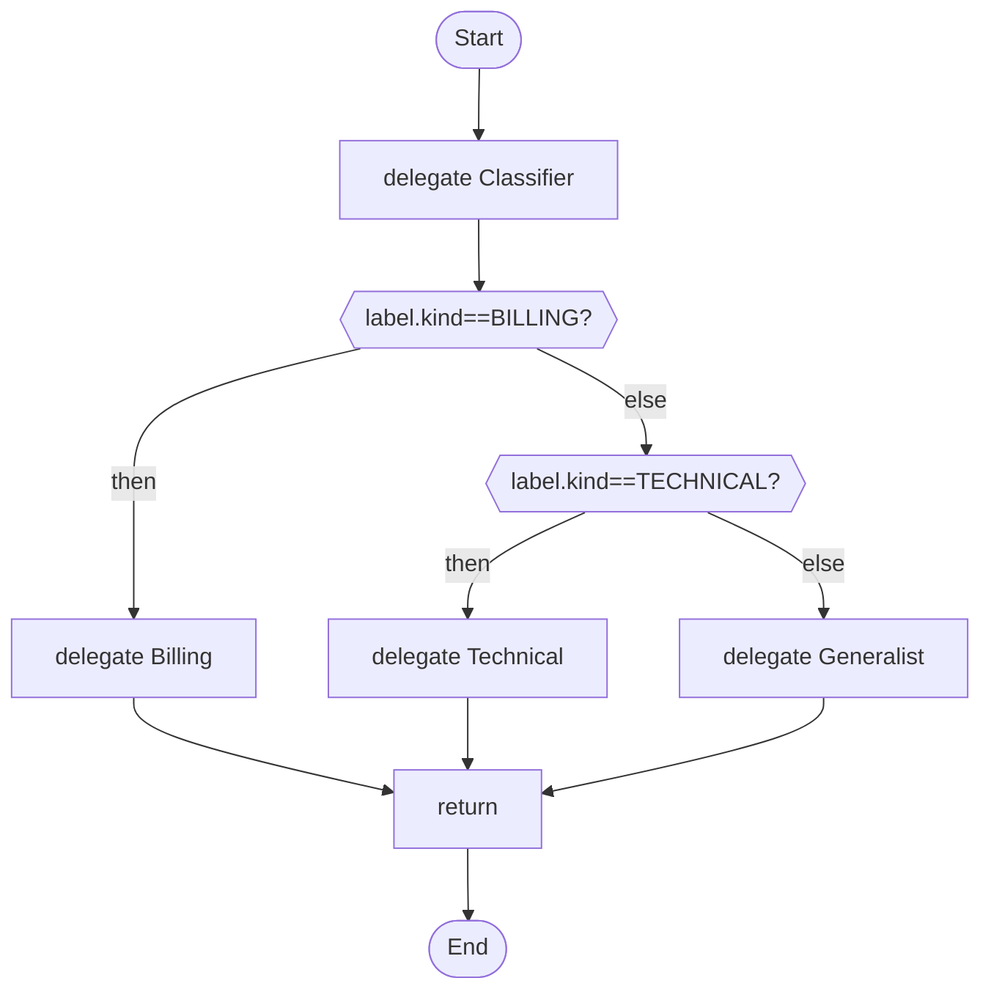

# 04 · A router

A classifier labels a message; the script, not the model, decides which specialist answers.

## What it shows

- `output_schema` with an `enum`
- `alt` / `else` as routing
- why routing belongs in the script

Read more: [04-control-flow.md](../../../../docs/tutorial/04-control-flow.md), [05-structured-answers-and-failure.md](../../../../docs/tutorial/05-structured-answers-and-failure.md).

## The workflow

```loom
// 04-router: decide which specialist should answer. The classifier only labels; the script's own `alt` does the routing,
// so no wording in a message can change which branch runs.

substitution: braces

agent Classifier {
    model: "gemini-2.5-flash"
    system: "Classify the customer message."
    temperature: 0.0
    output_schema: { kind: enum["BILLING", "TECHNICAL", "OTHER"] }
}
agent Billing   { model: "gemini-2.5-flash"  system: "You answer billing questions politely and briefly." }
agent Technical { model: "gemini-2.5-flash"  system: "You answer technical questions with numbered steps." }
agent Generalist { model: "gemini-2.5-flash"  system: "You answer general questions briefly." }

workflow Main(message) {
    delegate "Classify: {message}" to Classifier -> label

    alt (label.kind == "BILLING") {
        delegate "{message}" to Billing -> reply
    } else {
        alt (label.kind == "TECHNICAL") {
            delegate "{message}" to Technical -> reply
        } else {
            delegate "{message}" to Generalist -> reply
        }
    }

    return reply
}
```

## The shape of it

This picture is drawn by `weave graph` from the file above, not by hand.

<!-- graph:start -->

<!-- graph:end -->

## Run it

```bash
cp .env.example .env        # then put your keys in .env (it is git-ignored)
weave check main.loom       # does it load? what is missing?
weave test main.loom --coverage   # scripted models: no key, no network, no cost
weave run main.loom --workflow Main --input message="I was charged twice." --max-tokens 50000 --max-calls 20   # a real run, capped
```

## What it needs

- `GEMINI_API_KEY` (any model works: change the `model:` lines)

## Try changing it

- Add a fourth label (SALES) and a fourth agent; `weave test --coverage` tells you which case you still need.
- Try the `intentclassifier` form in the tutorial, chapter 6.

Back to the [starter set](../README.md).
