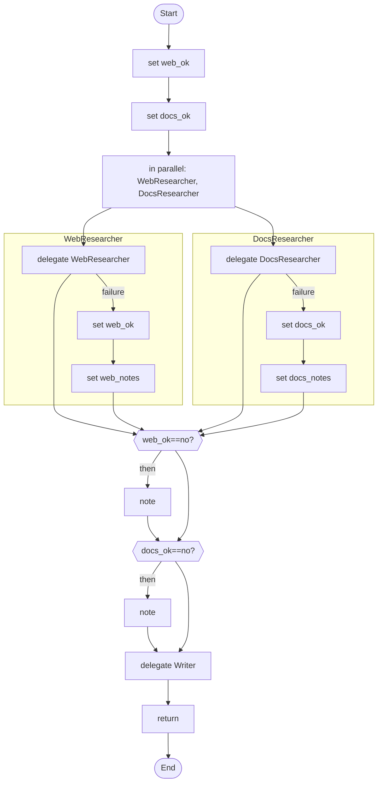

# 05 · Parallel research that tolerates failure

Two researchers work at the same time. If one fails, the other still counts and the writer says what is missing.

## What it shows

- `parallel { }`
- `retry`, `timeout` and `on_failure` on a step
- one flag per branch (never a shared variable)
- `degraded` runs

Read more: [04-control-flow.md](../../../../docs/tutorial/04-control-flow.md), [05-structured-answers-and-failure.md](../../../../docs/tutorial/05-structured-answers-and-failure.md).

## The workflow

```loom
// 05-parallel-research: ask several specialists at the same time, and carry on even if one of them fails.
// Each branch has its own flag (web_ok, docs_ok): branches run together, so they must never share one variable.

substitution: braces

budget { tokens: 200000  calls: 20 }

agent WebResearcher  { model: "gemini-2.5-flash"  system: "Search the web and report what you find in five lines."  tools: [web_search] }
agent DocsResearcher { model: "gemini-2.5-flash"  system: "Report what the company documents say, in five lines." }
agent Writer         { model: "gemini-2.5-flash"  system: "Write a short report from the notes you are given. Say what is missing."  temperature: 0.4 }

workflow Main(topic) {
    set web_ok = "yes"
    set docs_ok = "yes"

    parallel {
        delegate "Find recent public information about {topic}" to WebResearcher -> web_notes retry 1 timeout 60s
            on_failure { set web_ok = "no"  set web_notes = "nothing found on the web" }
        delegate "Find what our documents say about {topic}" to DocsResearcher -> docs_notes retry 1 timeout 60s
            on_failure { set docs_ok = "no"  set docs_notes = "nothing found in the documents" }
    }

    alt (web_ok == "no") {
        note "The web research failed, so the report below rests on documents only."
    }
    alt (docs_ok == "no") {
        note "The document research failed, so the report below rests on the web only."
    }

    delegate "Topic: {topic}\nWeb notes: {web_notes}\nDocument notes: {docs_notes}" to Writer -> report
    return report
}
```

## The shape of it

This picture is drawn by `weave graph` from the file above, not by hand.

<!-- graph:start -->

<!-- graph:end -->

## Run it

```bash
cp .env.example .env        # then put your keys in .env (it is git-ignored)
weave check main.loom       # does it load? what is missing?
weave test main.loom --coverage   # scripted models: no key, no network, no cost
weave run main.loom --workflow Main --input topic="solar roofs" --max-tokens 50000 --max-calls 20   # a real run, capped
```

## What it needs

- `GEMINI_API_KEY` (any model works: change the `model:` lines)

## Try changing it

- Add a third researcher and its own flag.
- Change `retry 1` to `retry 3 backoff 2s` (the wait doubles each time).

Back to the [starter set](../README.md).
