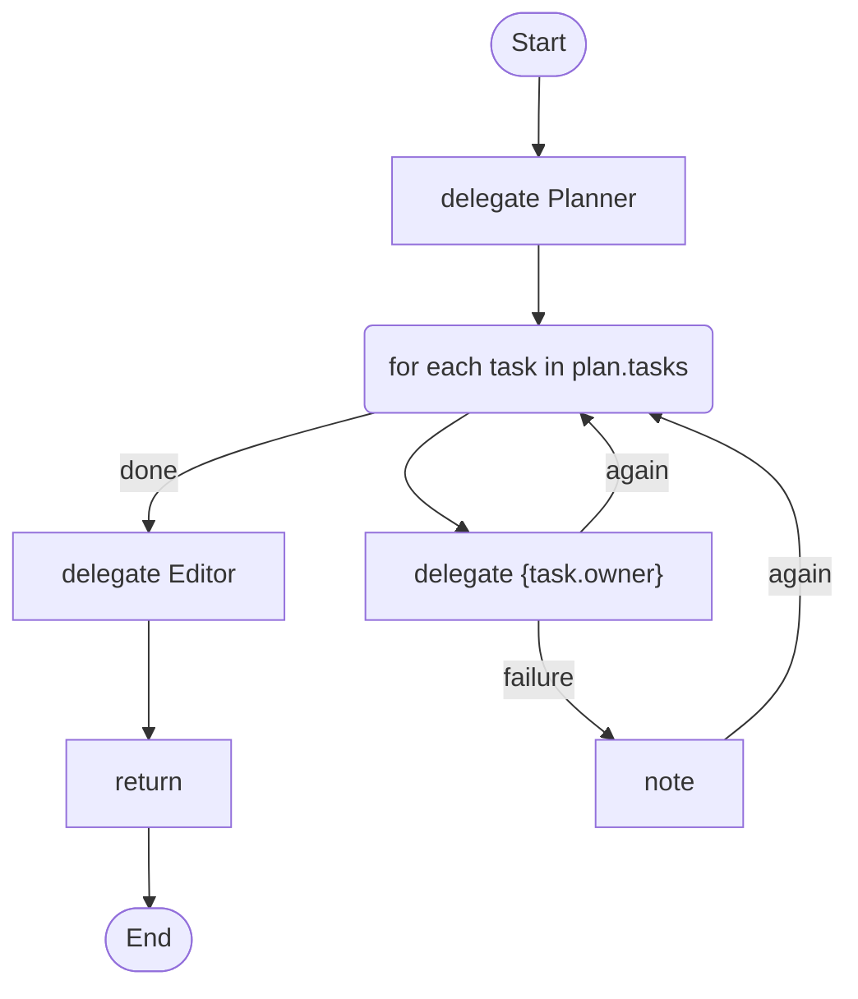

# 06 · Plan, then fan out

A planner returns a list of tasks; the script runs one step per task at the same time, each by the agent the plan names.

## What it shows

- `parallel for each`
- `delegate ... to {task.owner} -> {task.name}`: runtime routing
- a list in an `output_schema`

Read more: [04-control-flow.md](../../../../docs/tutorial/04-control-flow.md).

## The workflow

```loom
// 06-plan-and-fan-out: one agent makes a plan (a list), and the script runs one step per item, all at once.
// The agent for each item comes from the plan itself, so one line routes work to whoever should do it.

substitution: braces

budget { tokens: 300000  calls: 40 }

agent Planner {
    model: "gemini-2.5-flash"
    system: "Split the goal into 2 to 4 small tasks. Give each task a name, a description and an owner: Researcher or Writer."
    temperature: 0.2
    output_schema: { tasks: list }
}
agent Researcher { model: "gemini-2.5-flash"  system: "Do the research task and report briefly." }
agent Writer     { model: "gemini-2.5-flash"  system: "Do the writing task and report briefly." }
agent Editor     { model: "gemini-2.5-flash"  system: "Combine the pieces into one short, consistent document." }

workflow Main(goal) {
    delegate "Plan this goal: {goal}" to Planner -> plan

    parallel for each task in plan.tasks {
        delegate "{task.description}" to {task.owner} -> {task.name}
            retry 1 timeout 90s
            on_failure { note "Task {task.name} failed: {_error}" }
    }

    delegate "Goal: {goal}\nHere is what the team produced:\n{plan.tasks}" to Editor -> document
    return document
}
```

## The shape of it

This picture is drawn by `weave graph` from the file above, not by hand.

<!-- graph:start -->

<!-- graph:end -->

## Run it

```bash
cp .env.example .env        # then put your keys in .env (it is git-ignored)
weave check main.loom       # does it load? what is missing?
weave test main.loom --coverage   # scripted models: no key, no network, no cost
weave run main.loom --workflow Main --input goal="Explain solar roofs" --max-tokens 50000 --max-calls 20   # a real run, capped
```

## What it needs

- `GEMINI_API_KEY` (any model works: change the `model:` lines)

## Try changing it

- Add a third owner (Designer) and its agent. An owner the plan names that is not declared fails the run ("Agent not found"), so keep the planner's prompt and your agents in step.
- Use plain `for each` to run the tasks one after another.

Back to the [starter set](../README.md).
