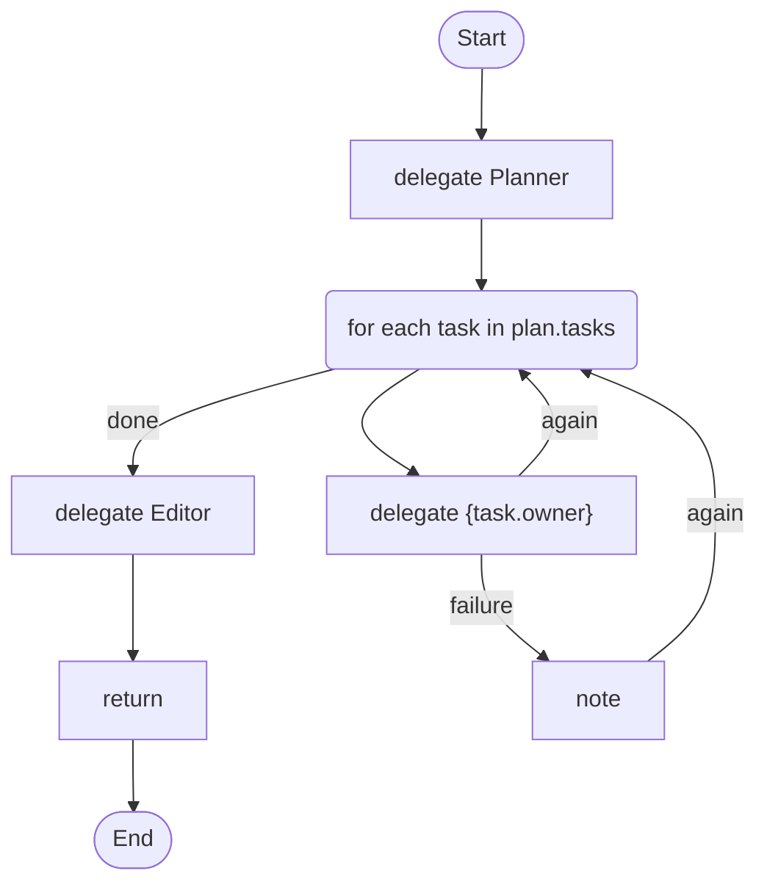

# 06 · Plan, then fan out

A planner returns a list of tasks; the script runs one step per task at the same time, each by the agent the plan names.

## What it shows

- `parallel for each ... max 4`: a bound on a list a model wrote; a longer list fails the run before any task starts
- `delegate ... to {task.owner} -> results[task.name]`: runtime routing, bounded by an `enum` in the plan's schema, with each answer stored under its task's name in one variable
- a typed list in an `output_schema`: `owner` can only be `Researcher` or `Writer`, so a model cannot send work to any other agent

Read more: [04-control-flow.md](../../../../docs/tutorial/04-control-flow.md).

## The workflow

```loom
// 06-plan-and-fan-out: one agent makes a plan (a list), and the script runs one step per item, all at once.
// The agent for each item comes from the plan itself, so one line routes work to whoever should do it. The plan is
// typed: `owner` can only be one of the two agents, so a model cannot send work anywhere else, and each answer is stored
// under its task's name in one variable, `results`, so a task name cannot overwrite anything.

substitution: braces

budget { tokens: 300000  calls: 40 }

agent Planner {
    model: "gemini-2.5-flash"
    system: "Split the goal into 2 to 4 small tasks. Give each task a short one-word name, a description and an owner."
    temperature: 0.2
    output_schema: { tasks: list<{ name: string, description: string, owner: enum["Researcher", "Writer"] }> }
}
agent Researcher { model: "gemini-2.5-flash"  system: "Do the research task and report briefly." }
agent Writer     { model: "gemini-2.5-flash"  system: "Do the writing task and report briefly." }
agent Editor     { model: "gemini-2.5-flash"  system: "Combine the pieces into one short, consistent document." }

workflow Main(goal) {
    delegate "Plan this goal: {goal}" to Planner -> plan

    // the planner is asked for 2 to 4 tasks; a longer list fails the run before any task starts (usually a problem upstream)
    parallel for each task in plan.tasks max 4 {
        delegate "{task.description}" to {task.owner} -> results[task.name]
            retry 1 timeout 90s
            on_failure { note "Task {task.name} failed: {_error}" }
    }

    delegate "Goal: {goal}\nHere is what the team produced:\n{results}" to Editor -> document
    return document
}
```

## The shape of it

This picture is drawn by `weave graph` from the file above, not by hand.

<!-- graph:start -->

<!-- graph:end -->

## Run it

```bash
cp .env.example .env        # then put your keys in .env (it is git-ignored)
weave check main.loom       # does it load? what is missing?
weave test main.loom --coverage   # scripted models: no key, no network, no cost
weave run main.loom --workflow Main --input goal="Explain solar roofs" --max-tokens 50000 --max-calls 20   # a real run, capped
```

## What it needs

- `GEMINI_API_KEY` (any model works: change the `model:` lines)

## Try changing it

- Add a third owner (Designer) and its agent. An owner the plan names that is not declared fails the run ("Agent not found"), so keep the planner's prompt and your agents in step.
- Use plain `for each` to run the tasks one after another.

Back to the [starter set](../README.md).
