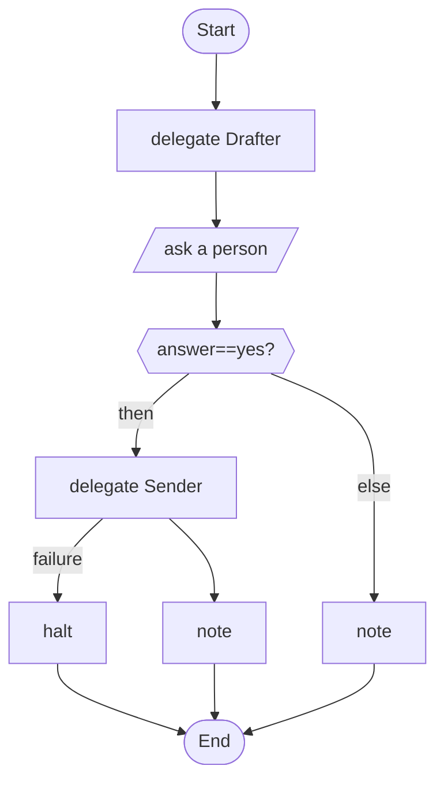

# 07 · A person approves before anything is sent

The model drafts; a person says yes or no; only then does the sending agent act. Both the script and the agent are guarded.

## What it shows

- `human_prompt`
- `approve: [Tool]` on an agent
- a `webhook` tool and why its URL comes from `env`
- `guard { pii: mask }`

Read more: [08-people-in-the-loop.md](../../../../docs/tutorial/08-people-in-the-loop.md), [09-safety-and-cost.md](../../../../docs/tutorial/09-safety-and-cost.md), [06-tools-and-tasks.md](../../../../docs/tutorial/06-tools-and-tasks.md).

## The workflow

```loom
// 07-approval: the model drafts, a person approves, and only then does anything leave the building.
// The approval is plain script logic and an `approve:` on the agent that holds the sending tool, so no wording in
// a message can talk the model past it.

substitution: braces

budget { tokens: 100000  calls: 20 }

tool Notify { use: webhook  url: env.SLACK_WEBHOOK  format: slack }

agent Drafter {
    model: "gemini-2.5-flash"
    system: "Draft a short, polite announcement from the facts you are given."
    temperature: 0.4
    guard { pii: mask }
}
agent Sender {
    model: "gemini-2.5-flash"
    system: "Send the announcement you are given with the Notify tool. Do nothing else."
    tools: [Notify]
    approve: [Notify]
}

workflow Main(facts) {
    delegate "Draft an announcement from: {facts}" to Drafter -> draft

    human_prompt "Here is the draft:\n\n{draft}\n\nSend it to the team channel? (yes/no)" -> answer
    alt (answer == "yes") {
        delegate "Send this announcement:\n{draft}" to Sender -> receipt retry 1 timeout 30s
            on_failure { halt "The announcement may not have been sent: {_error}. Check the channel before trying again." }
        note "Sent. {receipt}"
    } else {
        note "Not sent. The draft is kept for editing:\n{draft}"
    }
}
```

## The shape of it

This picture is drawn by `weave graph` from the file above, not by hand.

<!-- graph:start -->

<!-- graph:end -->

## Run it

```bash
cp .env.example .env        # then put your keys in .env (it is git-ignored)
weave check main.loom       # does it load? what is missing?
weave test main.loom --coverage   # scripted models: no key, no network, no cost
weave run main.loom --workflow Main --input facts="Office closed on Friday." --max-tokens 50000 --max-calls 20   # a real run, capped
```

## What it needs

- `GEMINI_API_KEY` (any model works: change the `model:` lines)
- `SLACK_WEBHOOK` (a Slack incoming-webhook URL)

## Try changing it

- Run `weave audit main.loom` and read what it says about the Sender.
- Change the question to ask for an edit, and loop until the person says yes.

Back to the [starter set](../README.md).
