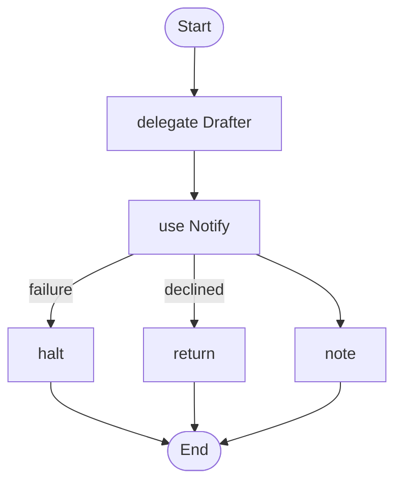

# 07 · A person approves once, at the edge

The model drafts. A person is asked **once**, about the exact text that will be posted, and the script sends it. No model carries out the send, so no wording in a message can talk it past the approval.

This starter used to ask twice: a `human_prompt` and an `alt` in the script, and then `approve:` on a sending agent, which asked again about the tool call. One question at the edge is enough, and it is the one about the payload.

## What it shows

- `use Tool(...) approve "…" -> var`: a tool called by the script, after one question to a person
- `on_declined { … }`: a no is a decision, not a failure, so the script handles it apart
- `on_failure { halt … }`: a failed send says to check the channel, because it may have gone out
- no `retry` on the send: a Slack webhook ignores an idempotency key, so a retry after an unknown outcome could post twice, and `weave check` refuses it
- `effect: changes` on the tool, the developer's word about what it does
- `guard { pii: mask }` on the drafter

Read more: [08-people-in-the-loop.md](../../../../docs/tutorial/08-people-in-the-loop.md), [09-safety-and-cost.md](../../../../docs/tutorial/09-safety-and-cost.md), [06-tools-and-tasks.md](../../../../docs/tutorial/06-tools-and-tasks.md).

## The workflow

```loom
// 07-approval: the model drafts, a person approves once, at the edge, and the script sends. No model carries out the
// send, so no wording in a message can talk it past the approval; the person sees the exact text that will be posted.

budget { tokens: 100000  calls: 20 }

agent Drafter { model: "gemini-2.5-flash"  system: "Draft a short, polite announcement from the facts you are given."  temperature: 0.4  guard { pii: mask } }
tool Notify { use: webhook  url: env.SLACK_WEBHOOK  format: slack  effect: changes }

workflow Main(facts) {
    delegate "Draft an announcement from: {facts}" to Drafter -> draft
    use Notify(text = draft) approve "Send this to the team channel?" -> receipt timeout 30s
        on_declined { return "Not sent. The draft is kept for editing:\n{draft}" }
        on_failure { halt "The announcement may not have been sent: {_error}. Check the channel before trying again." }
    note "Sent. {receipt}"
}
```

## The shape of it

This picture is drawn by `weave graph` from the file above, not by hand.

<!-- graph:start -->

<!-- graph:end -->

## Run it

```bash
cp .env.example .env        # then put your keys in .env (it is git-ignored)
weave check main.loom       # does it load? what is missing?
weave test main.loom --coverage   # scripted models: no key, no network, no cost
weave run main.loom --workflow Main --input facts="Office closed on Friday." --max-tokens 50000 --max-calls 20   # a real run, capped
```

## What it needs

- `GEMINI_API_KEY` (any model works: change the `model:` lines)
- `SLACK_WEBHOOK` (a Slack incoming-webhook URL)

## Try changing it

- Run `weave audit main.loom` and read what it says about the Sender.
- Change the question to ask for an edit, and loop until the person says yes.

Back to the [starter set](../README.md).
