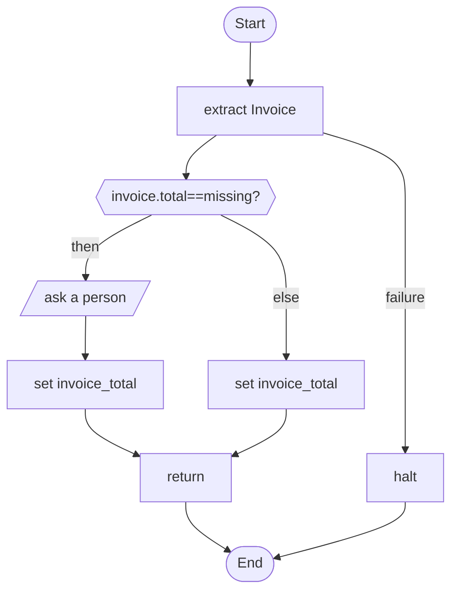

# 08 · Extract, then validate

Free text becomes checked fields. An **extractor** reads only the text it is handed; the script applies its own rule (a total the text does not state goes to a person) and stops on purpose when the text cannot be read.

## What it shows

- `extractor` and `extract`: a step that pulls fields out of text and sees nothing else (no transcript, no shared prompt)
- `optional:` and `== missing`: a field the text may not state
- `halt` for stopping on purpose
- `return { ... }` handing back an object

Read more: [05-structured-answers-and-failure.md](../../../../docs/tutorial/05-structured-answers-and-failure.md), [02-data-and-variables.md](../../../../docs/tutorial/02-data-and-variables.md).

## The workflow

```loom
// 08-extract-and-validate: turn free text into checked fields. The extractor sees only the text it is handed and the
// fields it must fill (never the run so far), a field the text does not state is `missing` (or fails the step if it is
// required), and the script then applies its own rules to the fields.

substitution: braces

budget { tokens: 80000  calls: 15 }

extractor Invoice {
    model: "gemini-2.5-flash"
    instructions: "Read the invoice. Use the vendor's legal name."
    fields {
        vendor: string
        invoice_number: string
        total: number
        currency: enum["USD", "EUR", "INR", "OTHER"]
    }
    optional: [total]
}

workflow Main(text) {
    extract Invoice from text -> invoice retry 1 on_failure {
        halt "Could not read an invoice from the text: {_error}"
    }

    alt (invoice.total == missing) {
        human_prompt "No total was stated for invoice {invoice.invoice_number} from {invoice.vendor}. What is the total?" -> typed_total
        set invoice_total = "{typed_total}"
    } else {
        set invoice_total = "{invoice.total}"
    }

    return { vendor: "{invoice.vendor}", number: "{invoice.invoice_number}", total: "{invoice_total}", currency: "{invoice.currency}" }
}
```

## The shape of it

This picture is drawn by `weave graph` from the file above, not by hand.

<!-- graph:start -->

<!-- graph:end -->

## Run it

```bash
cp .env.example .env        # then put your keys in .env (it is git-ignored)
weave check main.loom       # does it load? what is missing?
weave test main.loom --coverage   # scripted models: no key, no network, no cost
weave run main.loom --workflow Main --input text="ACME Ltd invoice INV-7, total 120.50 USD" --max-tokens 50000 --max-calls 20   # a real run, capped
```

## What it needs

- `GEMINI_API_KEY` (any model works: change the `model:` lines)

## Try changing it

- Add a currency rule: ask a person when the currency is OTHER.
- Add a `retry 2` and read how a wrong shape is corrected once.
- Make `total` required (remove it from `optional:`) and see the step fail at once when the text does not state it, instead of asking a person.

Back to the [starter set](../README.md).
