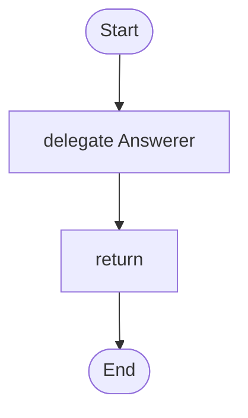

# 09 · Answer from your own documents

Your documents are indexed by meaning; the relevant passages are put in front of each question, and the agent says so when the handbook does not answer.

## What it shows

- `knowledge` bases
- `mode: context` versus `mode: tool`
- keeping answers grounded

Read more: [07-knowledge-and-memory.md](../../../../docs/tutorial/07-knowledge-and-memory.md).

## The workflow

```loom
// 09-handbook-qa: answer questions from your own documents. The relevant passages are found first (by meaning) and put
// in front of the question, and the agent is told to say so when the handbook does not answer.

substitution: braces

budget { tokens: 80000  calls: 10 }

knowledge Handbook {
    source: "handbook/"
    embedding: "gemini/text-embedding-004"
    chunk_size: 600
    top_k: 3
    store: "index/handbook.json"
}

agent Answerer {
    model: "gemini-2.5-flash"
    system: "Answer only from the handbook passages you are given. If they do not answer the question, say: The handbook does not say."
    temperature: 0.1
    knowledge: [Handbook]
}

workflow Main(question) {
    delegate "{question}" to Answerer -> answer
    return answer
}
```

## The shape of it

This picture is drawn by `weave graph` from the file above, not by hand.

<!-- graph:start -->

<!-- graph:end -->

## Run it

```bash
cp .env.example .env        # then put your keys in .env (it is git-ignored)
weave check main.loom       # does it load? what is missing?
weave run main.loom --workflow Main --input question="How many days of leave do I get?" --max-tokens 50000 --max-calls 20   # a real run, capped
```

There is no `tests/` folder here on purpose: `weave test` cannot script the embedding calls that index the documents, so this starter is checked with `weave check` only. Everything around the agent is covered by the other starters.

## What it needs

- `GEMINI_API_KEY` (any model works: change the `model:` lines)

## Try changing it

- Add your own files to `handbook/`.
- Switch to `mode: tool` so the agent searches only when it decides to.

Back to the [starter set](../README.md).
