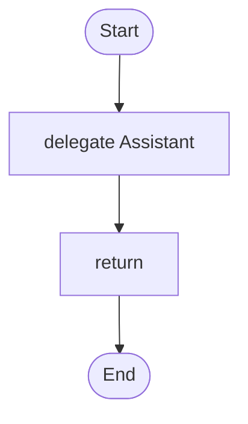

# 10 · An assistant that remembers

Each person has their own conversation, kept between runs. Personal data is masked before it reaches the model.

## What it shows

- agent `memory { }`
- `session:` per user
- `persona`
- `guard { pii: mask }`

Read more: [07-knowledge-and-memory.md](../../../../docs/tutorial/07-knowledge-and-memory.md), [09-safety-and-cost.md](../../../../docs/tutorial/09-safety-and-cost.md).

## The workflow

```loom
// 10-memory-assistant: an assistant that remembers each person's conversation between runs, and keeps personal data away from the model.
// `session: "{user_id}"` is read from the workflow's variables on every call, so one agent serves many people and they never see
// each other's messages.

substitution: braces

budget { tokens: 60000  calls: 12 }

persona Concierge {
    role: "a hotel concierge"
    tone: "warm and concise"
    constraints: ["Never promise a room you cannot confirm.", "Ask one question at a time."]
}

agent Assistant {
    model: "gemini-2.5-flash"
    persona: Concierge
    temperature: 0.5
    memory { conversation: "chats"  limit: 10  session: "{user_id}" }
    guard { pii: mask }
}

workflow Main(user_id, message) {
    delegate "{message}" to Assistant -> reply
    return reply
}
```

## The shape of it

This picture is drawn by `weave graph` from the file above, not by hand.

<!-- graph:start -->

<!-- graph:end -->

## Run it

```bash
cp .env.example .env        # then put your keys in .env (it is git-ignored)
weave check main.loom       # does it load? what is missing?
weave test main.loom --coverage   # scripted models: no key, no network, no cost
weave run main.loom --workflow Main --input user_id="u-17" --input message="Do you have a quiet room?" --max-tokens 50000 --max-calls 20   # a real run, capped
```

## What it needs

- `GEMINI_API_KEY` (any model works: change the `model:` lines)

## Try changing it

- Add `facts:` memory so it learns lasting preferences.
- Run it twice with the same `user_id` and once with another.

Back to the [starter set](../README.md).
