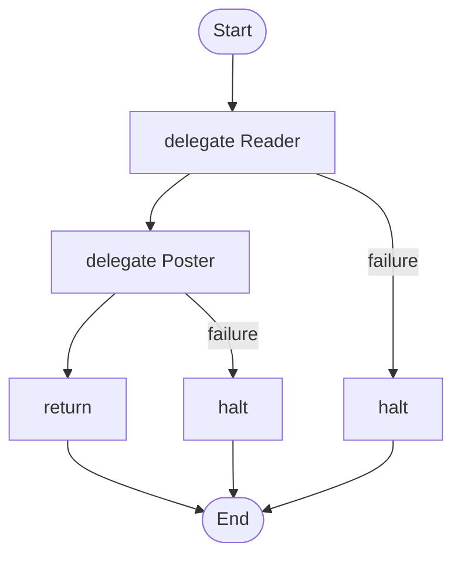

# 11 · A digest that runs itself

A workflow on a clock: weekdays at 7 in the morning, posts a news digest to Slack. A missed run happens once, not once per missed day.

## What it shows

- `schedule` blocks and `cron`
- `weave schedule`, `weave daemon`, `weave tick`
- `halt` when a stage cannot go on

Read more: [11-advanced-orchestration.md](../../../../docs/tutorial/11-advanced-orchestration.md), [12-running-for-real.md](../../../../docs/tutorial/12-running-for-real.md), [06-tools-and-tasks.md](../../../../docs/tutorial/06-tools-and-tasks.md).

## The workflow

```loom
// 11-daily-digest: a workflow that runs itself on a clock. The `schedule` block is kept in a trigger store, so it survives restarts
// (weave schedule sync, then weave daemon or weave tick). A missed run happens once, not once per missed day.

substitution: braces

budget { tokens: 120000  calls: 12 }

tool Slack { use: webhook  url: env.SLACK_WEBHOOK  format: slack }

agent Reader {
    model: "gemini-2.5-flash"
    system: "Find today's most useful news for the topic and report five items with one line each."
    tools: [web_search]
}
agent Poster {
    model: "gemini-2.5-flash"
    system: "Post the digest you are given to Slack with a short title. Do nothing else."
    tools: [Slack]
}

workflow Digest(topic) {
    delegate "Today's news about {topic}" to Reader -> items retry 1 timeout 90s
        on_failure { halt "No digest today: the reader failed ({_error})." }
    delegate "Post this digest:\n{items}" to Poster -> receipt retry 1 timeout 30s
        on_failure { halt "The digest was written but may not have been posted: {_error}." }
    return receipt
}

schedule Morning {
    cron: "0 7 * * 1-5"
    timezone: "Asia/Kolkata"
    run: Digest(topic="renewable energy")
    misfire: run_once
    overlap: skip
}
```

## The shape of it

This picture is drawn by `weave graph` from the file above, not by hand.

<!-- graph:start -->

<!-- graph:end -->

## Run it

```bash
cp .env.example .env        # then put your keys in .env (it is git-ignored)
weave check main.loom       # does it load? what is missing?
weave test main.loom --coverage   # scripted models: no key, no network, no cost
weave run main.loom --workflow Digest --input topic="renewable energy" --max-tokens 50000 --max-calls 20   # a real run, capped
```

## What it needs

- `GEMINI_API_KEY` (any model works: change the `model:` lines)
- `SLACK_WEBHOOK` (a Slack incoming-webhook URL)

## Try changing it

- Change the schedule to `every: 6h`.
- Add a second schedule with a different topic.

Back to the [starter set](../README.md).
