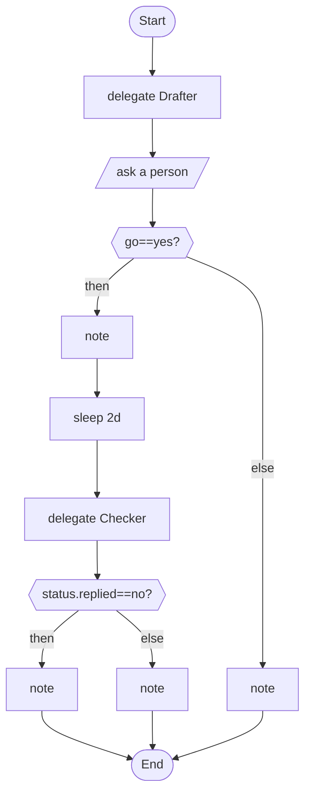

# 12 · A workflow that can wait for days

It drafts a message, waits for a person, sends, sleeps two days and follows up. With a run journal it holds no thread while it waits.

## What it shows

- `human_prompt` and `sleep`
- durable runs and `--journal`
- `rate_limits { on_limit: suspend }`
- virtual time in tests

Read more: [08-people-in-the-loop.md](../../../../docs/tutorial/08-people-in-the-loop.md), [12-running-for-real.md](../../../../docs/tutorial/12-running-for-real.md).

## The workflow

```loom
// 12-wait-for-a-person: a workflow that can wait for days. With a run journal (weave run --journal ...), a question to a person or a
// `sleep` pauses the run and holds no thread; it carries on when the answer arrives or the time has passed. Write the script as if
// the time simply passes.

substitution: braces

budget { tokens: 80000  calls: 15 }

rate_limits { on_limit: suspend  max_wait: 24h  max_resumes: 50 }

agent Drafter  { model: "gemini-2.5-flash"  system: "Write a short, polite message to the customer."  temperature: 0.4 }
agent Checker  { model: "gemini-2.5-flash"  system: "State whether the customer replied. Answer yes or no."  output_schema: { replied: enum["yes", "no"] } }

workflow Main(customer, topic) {
    delegate "Write to {customer} about: {topic}" to Drafter -> message
    human_prompt "Draft for {customer}:\n{message}\nSend it? (yes/no)" -> go
    alt (go == "yes") {
        note "Sent to {customer}."
        sleep 2d
        delegate "Did {customer} reply about {topic}?" to Checker -> status
        alt (status.replied == "no") {
            note "No reply from {customer} after two days: follow up."
        } else {
            note "{customer} replied."
        }
    } else {
        note "Not sent."
    }
}
```

## The shape of it

This picture is drawn by `weave graph` from the file above, not by hand.

<!-- graph:start -->

<!-- graph:end -->

## Run it

```bash
cp .env.example .env        # then put your keys in .env (it is git-ignored)
weave check main.loom       # does it load? what is missing?
weave test main.loom --coverage   # scripted models: no key, no network, no cost
weave run main.loom --workflow Main --input customer="Asha" --input topic="renewal" --max-tokens 50000 --max-calls 20   # a real run, capped
```

## What it needs

- `GEMINI_API_KEY` (any model works: change the `model:` lines)

## Try changing it

- Change `sleep 2d` to `sleep 30s` and see that it waits in place.
- Run it with `--journal run.json`, stop it at the question, and resume.

Back to the [starter set](../README.md).
