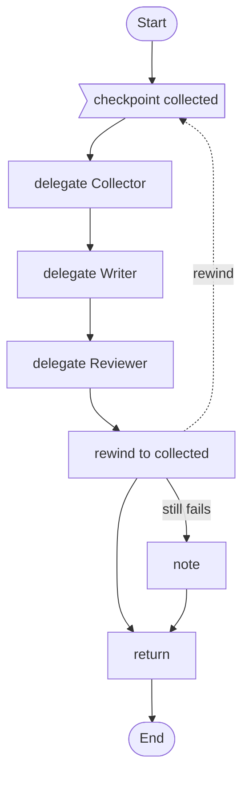

# 13 · Go back to a checkpoint

When a late review shows an early step was wrong, the run goes back to a named point, carries the reviewer's notes, and tries again, at most twice.

## What it shows

- `checkpoint` and `rewind`
- `carrying`
- `side effects:`
- `if it still fails`

Read more: [11-advanced-orchestration.md](../../../../docs/tutorial/11-advanced-orchestration.md).

## The workflow

```loom
// 13-rewind-and-retry: when a late check shows an early step was wrong, go back to a named point, keep what was learned, and try
// again, a limited number of times. Compare with 03-review-loop, which only rewrites the last step.

substitution: braces

budget { tokens: 250000  calls: 30 }

agent Collector { model: "gemini-2.5-flash"  system: "Collect sources on the topic. Use the feedback to look somewhere new."  temperature: 0.5 }
agent Writer    { model: "gemini-2.5-flash"  system: "Write a short report from the sources."  temperature: 0.5 }
agent Reviewer  {
    model: "gemini-2.5-flash"
    system: "Score the report from 1 to 10 for how well the sources support it, and say what to fix."
    temperature: 0.0
    output_schema: { score: number, notes: string }
}

workflow Report(topic) {
    checkpoint collected starting with feedback = "none"

    delegate "Collect sources on {topic}. Feedback so far: {feedback}" to Collector -> data
    delegate "Write the report from these sources:\n{data}" to Writer -> draft
    delegate "Review this report against its sources.\nSources: {data}\nReport: {draft}" to Reviewer -> review

    rewind to collected
        when (review.score < 7)
        at most 2 times
        carrying feedback = "{review.notes}"
        side effects: keep
        if it still fails { note "Three attempts did not reach a score of 7; keeping the last report for a person to read." }

    return draft
}
```

## The shape of it

This picture is drawn by `weave graph` from the file above, not by hand.

<!-- graph:start -->

<!-- graph:end -->

## Run it

```bash
cp .env.example .env        # then put your keys in .env (it is git-ignored)
weave check main.loom       # does it load? what is missing?
weave test main.loom --coverage   # scripted models: no key, no network, no cost
weave run main.loom --workflow Report --input topic="solar roofs" --max-tokens 50000 --max-calls 20   # a real run, capped
```

## What it needs

- `GEMINI_API_KEY` (any model works: change the `model:` lines)

## Try changing it

- Set `side effects: ask first` and add a tool that sends something.
- Raise `at most 2 times` and watch the budget.

Back to the [starter set](../README.md).
