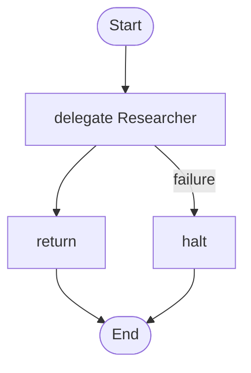

# 14 · Rules that watch an agent

Counts, not opinions: if an agent repeats itself, its tool keeps failing, its window fills, or it takes too many steps, a rule steers, wraps up or cancels it.

## What it shows

- `supervise` rules
- `steer`, `wrap_up`, `cancel use partial`
- `max_iterations`

Read more: [08-people-in-the-loop.md](../../../../docs/tutorial/08-people-in-the-loop.md), [11-advanced-orchestration.md](../../../../docs/tutorial/11-advanced-orchestration.md).

## The workflow

```loom
// 14-supervised-agent: rules that watch an agent and act without a person. Every signal is a count (repeats, failures, steps, how
// full the window is), never a model's opinion, so a rule cannot be talked out of firing.

substitution: braces

budget { tokens: 200000  calls: 40 }

agent Researcher {
    model: "gemini-2.5-flash"
    system: "Research the question with the tools you have, then answer in a short paragraph."
    tools: [web_search, calculator]
    max_iterations: 20
}

supervise Researcher {
    when looping(3)                  { steer "You are repeating yourself. Try a different search." once }
    when tool_failing(web_search, 3) { wrap_up }
    when context > 90%               { wrap_up }
    when steps > 15                  { cancel use partial }
}

workflow Brief(question) {
    delegate "{question}" to Researcher -> findings retry 1 timeout 180s
        on_failure { halt "The research failed: {_error}" }
    return findings
}
```

## The shape of it

This picture is drawn by `weave graph` from the file above, not by hand.

<!-- graph:start -->

<!-- graph:end -->

## Run it

```bash
cp .env.example .env        # then put your keys in .env (it is git-ignored)
weave check main.loom       # does it load? what is missing?
weave test main.loom --coverage   # scripted models: no key, no network, no cost
weave run main.loom --workflow Brief --input question="What is the capital of Peru?" --max-tokens 50000 --max-calls 20   # a real run, capped
```

## What it needs

- `GEMINI_API_KEY` (any model works: change the `model:` lines)

## Try changing it

- Add a rule for a second tool.
- Read the steering section of the reference for how a person steers a running agent.

Back to the [starter set](../README.md).
