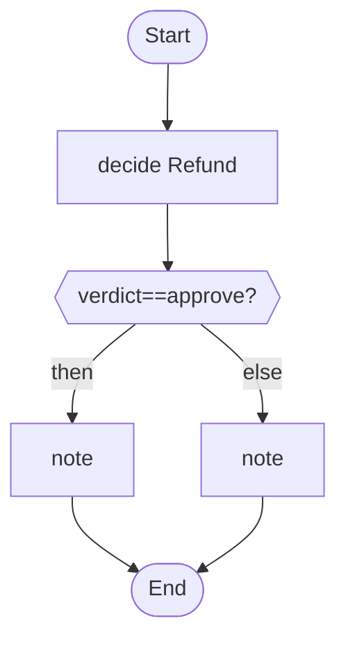

# 15 · Earn the right to act alone

The agent proposes, a person decides, and a ledger moves the agent up a ladder (watch, suggest, act) only as the record supports. It can also drop back.

## What it shows

- `decision` and `trust`
- `decide Name -> verdict`
- `weave autonomy status`
- why autonomy is a record, not a setting

Read more: [11-advanced-orchestration.md](../../../../docs/tutorial/11-advanced-orchestration.md), [09-safety-and-cost.md](../../../../docs/tutorial/09-safety-and-cost.md).

## The workflow

```loom
// 15-earned-autonomy: an agent does not get to act on its own because you hope it is good. It proposes, a person decides, and a
// ledger of both moves it up a ladder (watch, suggest, act) only as the record supports. It also drops back when the record turns bad.
// `weave autonomy status` shows where each ladder stands.

substitution: braces

budget { tokens: 100000  calls: 20 }

agent Triager {
    model: "gemini-2.5-flash"
    system: "You are Triager. Decide whether a refund request should be approved, rejected or escalated."
    output_schema: { choice: enum["approve", "reject", "escalate"], reasoning: string, confidence: number }
    guard { bias: warn }
}

decision Refund {
    proposed by:            Triager
    choices:                approve, reject, escalate
    group cases by:         tier
    remember:               amount, reason
    dangerous mistake:      propose approve, person decides reject
    ask:                    support-lead
    keep records for:       180 days
    when the agent changes: test it on past cases

    trust {
        start at watch
        never go above suggest

        to suggest:  after 100 cases over 14 days, agreeing at least 90%
        to act:      after 300 cases over 30 days, agreeing at least 97%, with no dangerous mistakes
        judge on the latest 300 cases

        check 5% of cases with a person who doesn't see the proposal
        always ask a person when amount > 200

        drop to suggest when 2 dangerous mistakes in 50 cases
        drop to suggest when agreement falls below 92%

        moving up needs approval from: risk-owner
    }
}

workflow Triage(ticket, tier, amount, reason) {
    decide Refund -> verdict
    alt (verdict == "approve") {
        note "Refund approved for {ticket}."
    } else {
        note "Refund for {ticket} not approved automatically: {verdict}."
    }
}
```

## The shape of it

This picture is drawn by `weave graph` from the file above, not by hand.

<!-- graph:start -->

<!-- graph:end -->

## Run it

```bash
cp .env.example .env        # then put your keys in .env (it is git-ignored)
weave check main.loom       # does it load? what is missing?
weave test main.loom --coverage   # scripted models: no key, no network, no cost
weave run main.loom --workflow Triage --input ticket="T-1" --input tier="gold" --input amount=50 --input reason="late parcel" --max-tokens 50000 --max-calls 20   # a real run, capped
```

## What it needs

- `GEMINI_API_KEY` (any model works: change the `model:` lines)

## Try changing it

- Read `weave autonomy status` after a few cases.
- Lower `never go above suggest` to `act` only when the record supports it.

Back to the [starter set](../README.md).
