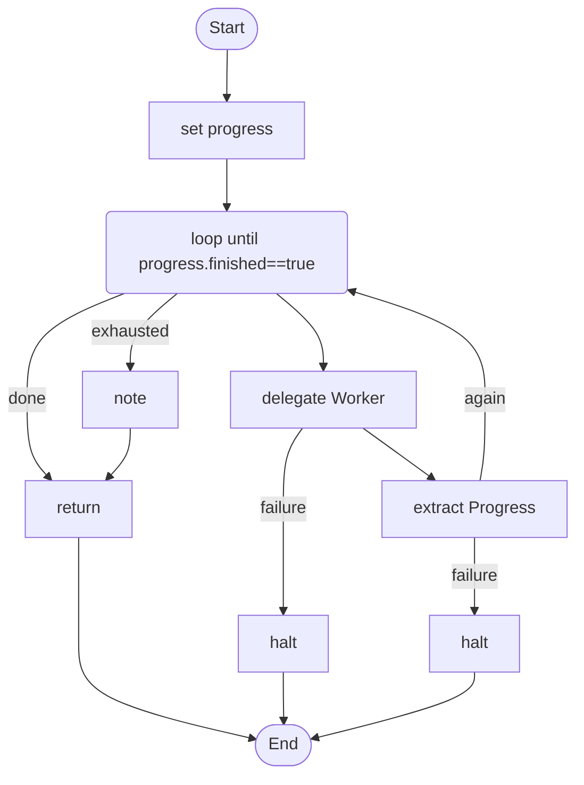

# 16 · Step by step

A long job done one small step at a time. The progress (what is done, what is next, whether the goal is reached) is a typed value that the **script** owns, not something an agent has to remember inside a long conversation.

## What it shows

- Why a long agent loses track: its progress lives in the conversation, which can be compacted or grown past what the model attends to.
- The recipe: a bounded `loop`, a **worker** with `memory { transcript: none }` that does one step, and an `extractor` (`Progress`) that reads the worker's report and writes the new progress into a variable.
- Progress is typed, journaled (a resumed run continues from it), bounded, visible in the graph and testable.

Read more: [11-advanced-orchestration.md](../../../../docs/tutorial/11-advanced-orchestration.md), [05-structured-answers-and-failure.md](../../../../docs/tutorial/05-structured-answers-and-failure.md).

## The workflow

```loom
// 16-step-by-step-agent: a long job done one small step at a time. What is done and what is next is a typed value the script owns
// (`progress`), not something an agent has to remember in a long conversation that may be compacted. The worker is fresh every
// round and sees no transcript; an extractor reads its report and writes the new progress; the loop is bounded.

substitution: braces

budget { tokens: 150000  calls: 40 }

tool Files { use: file  root: "work"  mode: write }

agent Worker {
    model: "gemini-2.5-flash"
    system: "You do ONE step of a larger job. You are told the goal, what is already done and the single step to do now. Do that step with your tools, then report in plain prose what you did and anything the next step needs to know."
    tools: [Files]
    memory { transcript: none }
    max_iterations: 8
}

extractor Progress {
    model: "gemini-2.5-flash"
    instructions: "Read the goal, the previous progress and the worker's report. List every step now done, say the one step to do next, and say whether the whole goal is finished."
    fields {
        done: list<string>
        next: string
        finished: boolean
    }
}

workflow Main(goal) {
    set progress = { done: "nothing yet", next: "plan the first step", finished: "false" }

    loop until (progress.finished == "true") max 6 {
        delegate "GOAL: {goal}\nDONE SO FAR: {progress.done}\nDO THIS ONE STEP NOW: {progress.next}" to Worker -> report retry 1 timeout 120s on_failure {
            halt "The worker failed: {_error}"
        }
        extract Progress from (goal = goal, previous = progress, report = report) -> progress retry 1 on_failure {
            halt "Could not record the progress: {_error}"
        }
    } on_exhausted {
        note "Stopped after {_loopRound} steps without finishing. Done so far: {progress.done}"
    }

    return progress.done
}
```

## The shape of it

This picture is drawn by `weave graph` from the file above, not by hand.

<!-- graph:start -->

<!-- graph:end -->

## Run it

```bash
cp .env.example .env        # then put your keys in .env (it is git-ignored)
weave check main.loom       # does it load? what is missing?
weave test main.loom --coverage   # scripted models: no key, no network, no cost
weave run main.loom --workflow Main --input goal="write a one-page report on tides" --max-tokens 60000 --max-calls 30   # a real run, capped
```

## What it needs

- `GEMINI_API_KEY` (any model works: change the `model:` lines)

## Try changing it

- Give the worker a second tool, and add a `human_prompt` after the extract when `progress.next` mentions "delete".
- Lower `max 6` to `max 2` and read the `on_exhausted` note.
- Run it with `--journal run.json`, stop it half way (Ctrl+C), run it again, and watch it continue from the recorded progress.

Back to the [starter set](../README.md).
