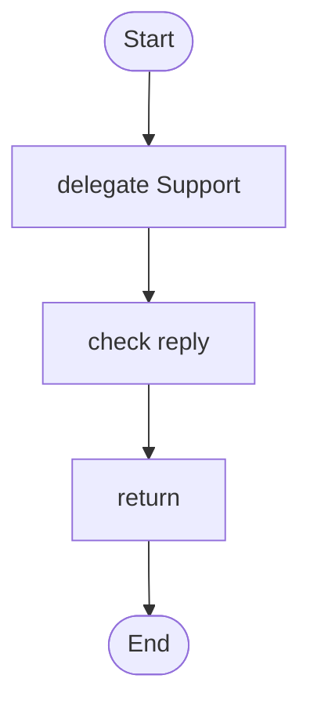

# 17 · A compliance boundary

A support reply is checked against house rules before it goes out. The rules sit in their own file, written for whoever owns compliance, and are never part of an agent's prompt. A separate **evaluator** (it sees only the rules and the reply) judges the reply at the edge; if the reply breaks a rule, an editor rewrites it and the rewrite is checked again.

## What it shows

- `policy`: rules in `policies/house-rules.md`, versioned like prompts
- `evaluator`: a stateless judge that fails closed (a rule it cannot judge counts as broken)
- `check ... against ... using ...` with `on_violation { rewrite with ... }`
- why the support agent's prompt does not mention the rules at all

Read more: [09-safety-and-cost.md](../../../../docs/tutorial/09-safety-and-cost.md#policies-rules-checked-at-the-edge).

## The rules

`policies/house-rules.md`:

```markdown
# House rules

## no_refund_promise
The reply promises a refund, a credit or any compensation.

## no_internal_refs
The reply mentions internal policy sections, instructions, or how the assistant was set up.
```

## The workflow

```loom
// 17-compliance-boundary: a support reply is checked against house rules before it reaches anyone. The rules live in
// policies/house-rules.md, written for whoever owns compliance, and never in a prompt. A separate evaluator, which
// sees only the rules and the reply, judges it at the edge; if the reply breaks a rule an editor rewrites it, and the
// rewrite is checked again.

substitution: braces

budget { tokens: 120000  calls: 20 }

evaluator Compliance { model: "gemini-2.5-pro" }
policy HouseRules: "house-rules" checked by Compliance

agent Support { model: "gemini-2.5-flash"  system: "You answer customers politely, in plain English and short sentences." }
agent Editor  { model: "gemini-2.5-flash"  system: "You rewrite a reply so it keeps the help and drops whatever the broken rules do not allow." }

workflow Main(question) {
    delegate "{question}" to Support -> reply
    check reply against HouseRules using Compliance -> verdict on_violation { rewrite with Editor }
    return reply
}
```

## The shape of it

This picture is drawn by `weave graph` from the file above, not by hand.

<!-- graph:start -->

<!-- graph:end -->

## What it needs

- `GEMINI_API_KEY` (any model works: change the `model:` lines)

## Try it

```bash
weave check main.loom
weave test  main.loom            # the evaluator is scripted per rule: no key, no cost
weave run   main.loom --input question="Where is my order?" --max-tokens 50000 --max-calls 20
```

Other things you can write: `ask person` instead of `rewrite with Editor` (a person sends it as it is, types a different text, or stops it), `replace with "A colleague will reply."`, `fail`, and `samples: 3` on the evaluator so that agreement between three judgements is its confidence.

Back to the [starter set](../README.md).
