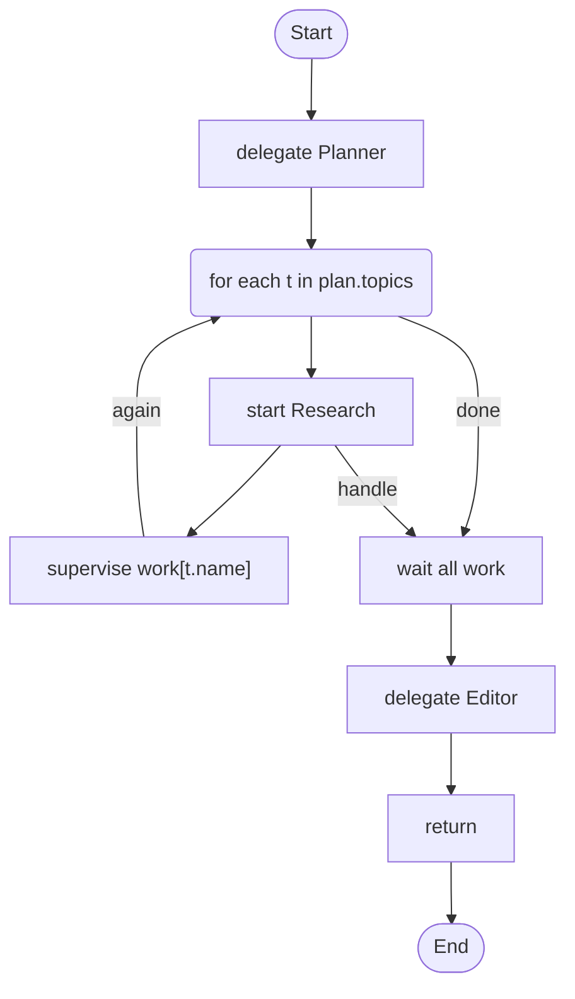

# 18 · Start workflows and watch them

Start three researchers at once, each as a child of its own. While they run, rules count what each one spends and how long it sits idle, a judge asks whether it stays on topic, one that overspends is cancelled with what it had, and one that drifts is steered. Every child has its own budget, and a restart finds the same children again.

## What it shows

- `start ... budget { }` and a handle, here one per topic (`-> work[t.name]`)
- `supervise` on a handle: counted rules, a judged assertion, `steer` and `cancel use partial`
- `wait all` and a result that records every outcome, a failed child included
- `max_children`, a budget on every child and one on the judge

Read more: [Starting workflows and supervising them](../../ai-agent4j-loom/LOOM_GUIDE.md#starting-workflows-and-supervising-them-start-wait-cancel-steer-supervise), and [14 · Rules that watch an agent](../14-supervised-agent/) for the same idea on one agent.

## The workflow

```loom
// 18-supervise-workflows: start a workflow without waiting for it, then watch it. A planner names the topics; each topic
// becomes a researcher that runs as a child of its own, all at once. While they run, rules count what each one spends and
// how long it sits idle, and a judge asks whether it stays on topic. A researcher that finds nothing asks its supervisor for help with a signal, and the supervisor steers it. A child that spends too much is cancelled and keeps
// what it had; one that drifts is steered. Every child has its own budget, and a restart finds the same children again.

substitution: braces
max_children: 3

budget { tokens: 400000  calls: 80 }

evaluator TopicJudge { model: "gemini-2.5-flash" }

agent Planner {
    model: "gemini-2.5-flash"
    system: "Split the question into 2 or 3 topics. Give each a short one-word name and the topic to research."
    temperature: 0.2
    output_schema: { topics: list<{ name: string, topic: string }> }
}
agent Researcher {
    model: "gemini-2.5-flash"
    system: "Research the topic and answer in a short paragraph."
    steerable: true
    streaming: true
}
agent Editor { model: "gemini-2.5-flash"  system: "Combine the findings into one short report. Say which topics are missing." }

workflow Research(topic) {
    delegate "Research: {topic}" to Researcher -> notes
    alt (notes == "") { notify parent "need_help" "found nothing on {topic}" }
    checkpoint collected
    return notes
}

workflow Main(question) {
    delegate "Question: {question}" to Planner -> plan

    for each t in plan.topics max 3 {
        start Research(topic = t.topic) timeout 20m budget { tokens: 100000 } -> work[t.name]
        supervise work[t.name] budget { tokens: 20000 } {
            when tokens > 90000 { cancel use partial }
            when tokens > 60000 { steer "You are using a lot. Narrow the topic and answer with what you have." once }
            when idle > 3m      { steer "You seem stuck. Narrow the topic." once }
            assert "searches only for the topic" using TopicJudge every 2m max 4 { steer "Go back to the topic." once }
            when signal "need_help" { steer "Try a narrower reading of the topic." once }
        }
    }

    wait all work timeout 25m -> results
    delegate "Question: {question}\nFindings by topic:\n{results}" to Editor -> report
    return report
}
```

## The shape of it

This picture is drawn by `weave graph` from the file above, not by hand. The dotted line joins a `start` to what uses its handle.

<!-- graph:start -->

<!-- graph:end -->

## Run it

```bash
cp .env.example .env        # then put your keys in .env (it is git-ignored)
weave check main.loom       # does it load? what is missing?
weave test main.loom --coverage   # scripted models: no key, no network, no cost
weave run main.loom --journal runs/r1 --input question="How do solar roofs work?" --max-tokens 400000 --max-calls 80   # a real run, capped; the children keep their runs next to runs/r1
```

To see a restart, stop the run with Ctrl-C while the researchers work and run `weave resume runs/r1`: it finds the same children and repeats no effect. `weave audit main.loom` lists who may steer a child (LA28) and the judge (LA29).

## What it needs

- `GEMINI_API_KEY` (any model works: change the `model:` lines)
- `--journal`, because `start` needs somewhere to keep each child's run

## Try changing it

- Raise or lower the rules, or add `assert never calls web_search { cancel }` if the researchers get a tool.
- Give the judge `seeing content` and read what `weave audit` says about it.

Back to the [starter set](../README.md).
