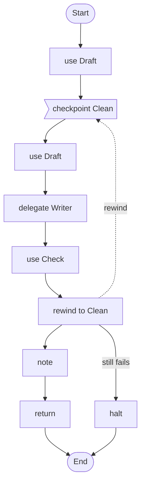

# 19 · Write, check, and try again from a clean state

An agent writes a report into a folder, a schema check says whether it is right, and when it is not the workflow puts the folder back as it was and lets the agent try again with what the check found, at most twice.

## What it shows

- `workspace` with `snapshot` and `restore`, and `protect:` on the schema that judges the work
- `verify` turning a schema check into counts the script can trust (`result.failed`)
- restore as a step the script takes, with `rewind ... side effects: repeat`

Read more: [Editing files and trying again](../../ai-agent4j-loom/LOOM_GUIDE.md#editing-files-and-trying-again-workspace), [workspace](../../../tools/ai-agent4j-tools/docs/workspace.md), [verify](../../../tools/ai-agent4j-tools/docs/verify.md).

## The workflow

```loom
// 19-report-writer: an agent writes a report into a folder, a check validates it, and when the check fails the workflow puts
// the folder back as it was and tries again with what the check said. Restore is a step the script takes: snapshot once,
// restore at the start of each attempt, and rewind with side effects: repeat so the attempt's writes run again.

budget { tokens: 200000  calls: 30 }

tool Draft { use: workspace  root: "report"  allow: "*.json, *.md"  mode: readwrite  overwrite: true  protect: "report.schema.json" }
tool Check { use: verify  root: "report" }

agent Writer {
    model: "gemini-2.5-flash"
    system: "You write report.json in your folder: a JSON object with a title, a summary of at most 80 words and a list of findings. Read report.schema.json first. Use the feedback to fix what failed."
    tools: [Draft]
    approve: [Draft]
    temperature: 0.3
}

workflow Main(brief) {
    use Draft(action = "snapshot", name = "clean")
    checkpoint Clean starting with feedback = "none"
    use Draft(action = "restore", name = "clean")

    delegate "Write report.json for this brief: {brief}\nFeedback from the last check: {feedback}" to Writer -> written
    use Check(format = "schema", schema = "report.schema.json", source = "report.json") -> result

    rewind to Clean
        when (result.failed > 0)
        at most 2 times
        carrying feedback = "{result.items}"
        side effects: repeat
        if it still fails { halt "report.json still does not match its schema after three attempts" }

    note "{written}"
    return result.status
}
```

## The shape of it

This picture is drawn by `weave graph` from the file above, not by hand.

<!-- graph:start -->

<!-- graph:end -->

## Run it

```bash
cp .env.example .env        # then put your keys in .env (it is git-ignored)
weave check main.loom       # does it load? what is missing?
weave test main.loom --coverage   # scripted models and tools: no key, no network, no cost
weave run main.loom --workflow Main --input brief="Quarterly support tickets" --max-tokens 50000 --max-calls 20   # a real run, capped
```

## What it needs

- `GEMINI_API_KEY` (any model works: change the `model:` line)
- The writer edits files, so a person approves its writes (`approve: [Draft]`); set `--ask-via` for a run nobody watches

## Try changing it

- Make the schema stricter (a `maxItems` on `findings`) and watch the second attempt fix it.
- Change `side effects: repeat` to `keep`: the second restore is then taken for the first and nothing is put back.

Back to the [starter set](../README.md).
