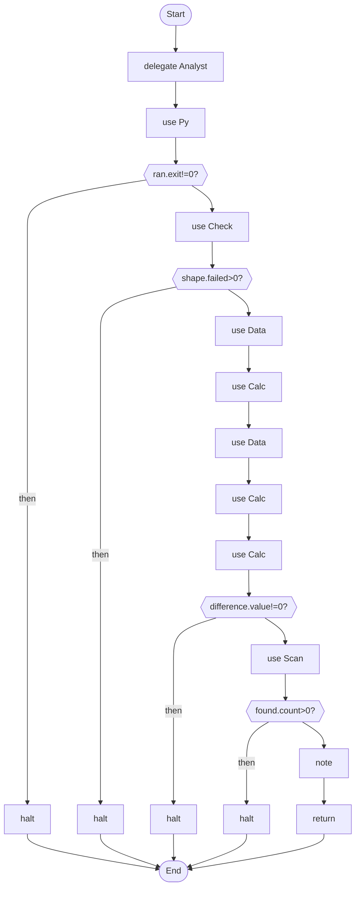

# 20 · Run a script on data, safely

An agent writes a short Python script, a sandbox runs it against a CSV in a container with no network, and the workflow checks the script's answer against its own exact sum of the same column before anything leaves. The model's code sees only the data folder and cannot change the data.

## What it shows

- `sandbox` with `isolation: container` and `network: none` on a `workspace`, with `protect:` on the data
- `verify` checking the shape of the result, `compute` checking its figure exactly, `scan` before it leaves
- a script's arguments given as the text of a JSON list

Read more: [Running programs](../../ai-agent4j-loom/LOOM_GUIDE.md#running-programs-sandbox), [sandbox](../../../tools/ai-agent4j-tools/docs/sandbox.md), [the sandbox's threat model](../../../../docs/security/sandbox.md).

## The workflow

```loom
// 20-data-analyst: an agent writes a short script, a sandbox runs it against a CSV with no network, the workflow checks the
// script's answer against its own exact sum of the same column, and scans the summary before it leaves. The model's code
// runs in a container, sees only the data folder, and cannot change sales.csv.

budget { tokens: 150000  calls: 20 }

tool Data  { use: workspace  root: "data"  allow: "*.py, *.csv, *.json"  mode: readwrite  overwrite: true  protect: "sales.csv" }
tool Py    { use: sandbox  workspace: Data  isolation: container  image: "python:3.12-slim"  allow: "python3"  network: none  timeout: "2m"  unattended: true }
tool Calc  { use: compute }
tool Check { use: verify  root: "data" }
tool Scan  { use: scan }

agent Analyst {
    model: "gemini-2.5-flash"
    system: "You write analysis.py in your folder. It reads sales.csv with the standard library only and writes result.json: {\"total\": <the sum of the revenue column>, \"note\": <one sentence>}. Do not print anything else."
    tools: [Data]
    approve: [Data]
    temperature: 0.2
}

workflow Main(question) {
    delegate "{question}\nWrite analysis.py as your instructions say." to Analyst -> written
    use Py(program = "python3", args = "[\"analysis.py\"]") -> ran
    alt (ran.exit != 0) { halt "analysis.py failed: {ran.stderr}" }

    use Check(format = "schema", schema = "result.schema.json", source = "result.json") -> shape
    alt (shape.failed > 0) { halt "result.json is not in the expected shape: {shape.items}" }

    use Data(action = "read", path = "result.json") -> result
    use Calc(action = "json", document = result.content, path = "total") -> claimed
    use Data(action = "read", path = "sales.csv") -> sales
    use Calc(action = "csv", text = sales.content, column = "revenue", op = "sum") -> total
    use Calc(action = "calc", expression = "{claimed.value} - {total.value}") -> difference
    alt (difference.value != "0") { halt "the script's total {claimed.value} is not the sum of the revenue column ({total.value})" }

    use Scan(text = result.content) -> found
    alt (found.count > 0) { halt "the result holds something that must not leave: {found.findings}" }
    note "{written}"
    return result.content
}
```

## The shape of it

This picture is drawn by `weave graph` from the file above, not by hand.

<!-- graph:start -->

<!-- graph:end -->

## Run it

```bash
cp .env.example .env        # then put your keys in .env (it is git-ignored)
weave check main.loom       # does it load? what is missing?
weave test main.loom --coverage   # scripted models and tools: no key, no Docker, no cost
docker pull python:3.12-slim      # the image the sandbox runs
weave run main.loom --workflow Main --input question="What was the total revenue?" --max-tokens 50000 --max-calls 20   # a real run, capped
```

## What it needs

- `GEMINI_API_KEY` (any model works: change the `model:` line)
- Docker or Podman, and the `python:3.12-slim` image; a missing runtime stops the run before its first step, and nothing falls back to running the script on your machine

## Try changing it

- Add `group_by: "region"` to the `csv` step and ask for revenue by region.
- Set `network: allow  hosts: "pypi.org, files.pythonhosted.org"` to let the script install a package, and see what `weave audit` says (LA33).

Back to the [starter set](../README.md).
