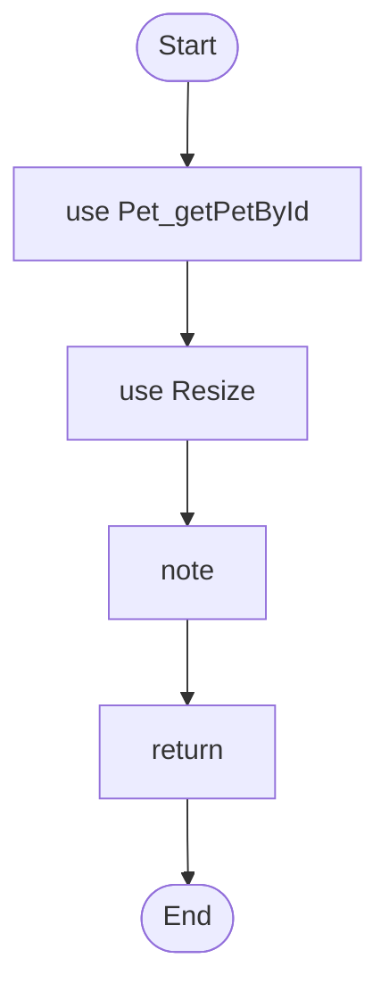

# 21 · Connect a system

Two tools a person did not write by hand: **one operation** of an API with a published description, and **one command line** with typed holes. `weave connect` writes the first from the OpenAPI description (the Swagger Petstore's, recorded for this starter), with the effect proposed and approved and a pin that notices when the operation changes; the second is a template you write, which the workflow fills.

## What it shows

- `use: openapi` with `operation:`, `effect: reads` and `pin:`: one tool per operation, as `weave connect openapi` writes it
- `use: command` in a container: the command is yours, each value is one argument, a path stays in the `photos` folder
- an effect recorded in a test (`Resize`, kind `command`) and none for the read, and `fail:` with the category `credential_rejected`

Read more: [Connecting a system](../../../../wiki/Connecting-a-System.md), [the guide](../../ai-agent4j-loom/LOOM_GUIDE.md#connecting-a-system-weave-connect), [Securing integrations](../../../../docs/security/integrations.md), [command](../../../tools/ai-agent4j-tools/docs/command.md).

## The workflow

```loom
// 21-connect-a-system: tools that `weave connect` wrote, used by a workflow with no model at all. Pet_getPetById is one operation of
// the Swagger Petstore's description, declared as a read, with a pin that notices a changed signature; Resize is a command line the
// author wrote, whose three holes the workflow fills. The command runs in a container that sees only the photos folder, and a value
// is always one argument.

budget { tokens: 10000  calls: 5 }

// weave connect openapi specs/petstore.json --operations getPetById --prefix Pet --write main.loom
tool Pet_getPetById {
    use: openapi
    spec: "specs/petstore.json"
    operation: "getPetById"
    effect: reads
    on_unknown: retry
    pin: "sha256-1d928873cc62b27e"
}

tool Photos { use: workspace  root: "photos"  allow: "*.png, *.txt"  mode: readwrite }
tool Resize {
    use: command
    isolation: container
    image: "dpokidov/imagemagick:7"
    workspace: Photos
    run: "convert {input} -resize {percent}% {output}"
    param.input: "path in"
    param.output: "path out"
    param.percent: "int 1..400"
}

workflow Main(petId, picture) {
    use Pet_getPetById(petId = petId) -> found
    use Resize(input = picture, output = "small.png", percent = 50) -> resized
    note "{found}"
    return resized
}
```

## The shape of it

This picture is drawn by `weave graph` from the file above, not by hand.

<!-- graph:start -->

<!-- graph:end -->

## Try it

```bash
cp -r 21-connect-a-system my-project && cd my-project
weave check main.loom
weave test  main.loom                                           # no key, no network, nothing is run
weave connect openapi main.loom --refresh --check               # reads the live description again: exit 1 when the operation changed (it needs the network)
weave doctor main.loom --network                                # one TLS connection to each integration host
```

To call the real service, run the workflow with `weave run main.loom --input petId=1 --input picture=cat.png`: it needs Docker for `Resize` and a `cat.png` in `photos/`. The Petstore is a public demo service whose data changes, so the real answer may differ from the recorded one.

## Where the files came from

`specs/petstore.json` is the description the Swagger Petstore serves (Apache-2.0), and `specs/METADATA.json` says when it was recorded and what was changed (two example email addresses, as the fixture says). Re-record it by hand before a release, never in CI.
