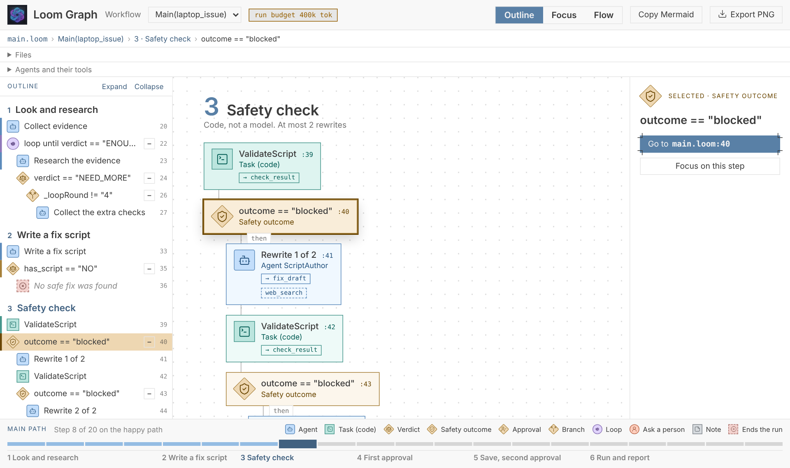
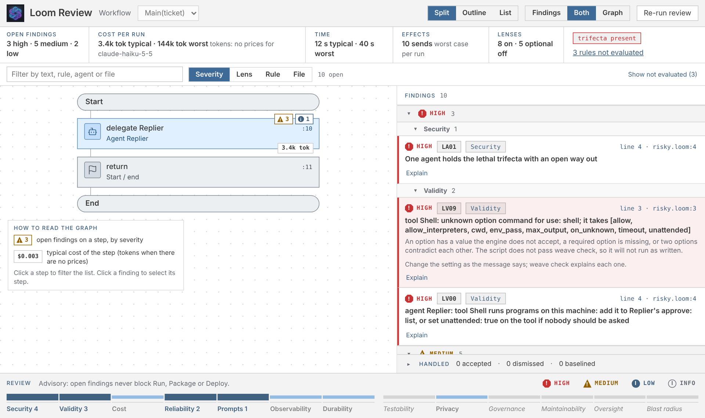
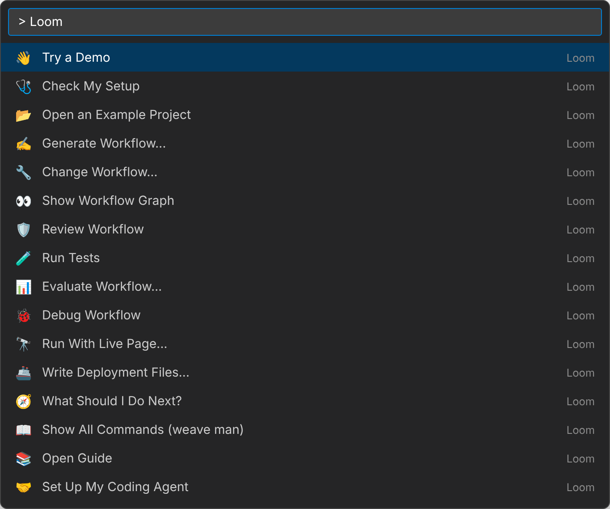

# Loom for llm4j: AI agent workflows

**Build, review, test and run multi-agent AI workflows in VS Code.** Describe one in a sentence, see it as a graph, review it for cost and security, and test it without a model or an API key.

[Repository](https://github.com/srijithunni7182/llm4j) · [Quickstart](https://github.com/srijithunni7182/llm4j/blob/main/docs/QUICKSTART.md) · [Tutorial](https://github.com/srijithunni7182/llm4j/blob/main/docs/tutorial/README.md) · [Language guide](https://github.com/srijithunni7182/llm4j/blob/main/src/loom/ai-agent4j-loom/LOOM_GUIDE.md) · [Full extension reference](https://github.com/srijithunni7182/llm4j/blob/main/src/loom/vscode-loom/REFERENCE.md) · [Issues](https://github.com/srijithunni7182/llm4j/issues)



## Get started

1. Install the extension. It carries its own engine and needs only **Java 17** or newer.
2. Open the Command Palette and run **Loom: Try a Demo**. It runs a bundled workflow on demo models, so it needs no key and costs nothing.
3. Run **Loom: Generate Workflow...** to turn a sentence into a checked project, or open any `.loom` file.

## What it does

- **Generate and change.** Write a workflow from a sentence. Change it with a diff you accept or reject.
- **See the graph.** A live graph of the workflow in three views: Outline, Focus and Flow.
- **Review.** Findings on cost, security and risk beside the graph, with a fix for each and the [OWASP Top 10 for LLM Applications](https://github.com/srijithunni7182/llm4j/blob/main/docs/security/owasp-llm-top-10.md) mapping.
- **Test and evaluate.** Tests with scripted models and no keys; evaluations against a dataset.
- **Debug.** Breakpoints, stepping (and stepping back) and variables, with the models mocked.
- **Run and watch.** A real run, capped by cost, with a live page for cost, context and incidents.
- **Ship.** Docker, Compose and Kubernetes files read from the script.
- **Set up your coding agent.** Teaches Claude Code, Copilot, Cursor or any `AGENTS.md` agent to build with Loom.
- **Language support.** Highlighting, checks from the engine's own parser, completion, hover, go to definition, rename and snippets.



## What a workflow looks like

Loom is a small language for workflows of AI agents. The model reads and writes; the script holds the rules. Here the script, not the model, decides when a refund needs a person:

```loom
budget { tokens: 100000  calls: 20 }

agent Triage {
    model: "gemini-2.5-flash"
    system: "Read the customer's email. Say what they want and any refund amount they state."
    guard { pii: mask }
}

workflow Main(email) {
    delegate "Classify this message:\n{email}" to Triage -> triage expecting {
        kind: enum["REFUND", "QUESTION"],
        amount: number
    }
    alt (triage.kind == "REFUND") {
        alt (triage.amount > 100) {
            human_prompt "Approve a refund of {triage.amount}? (yes/no)" -> decision
            note "Decision: {decision}"
        } else {
            note "Within the limit: refund approved automatically."
        }
    } else {
        note "Not a refund: reply directly."
    }
}
```

## Every command, under "Loom" in the Command Palette



## Privacy and cost

- Editing, checks, the graph, review, tests and debugging run on your machine and send nothing anywhere.
- Only generate, change and a live run call a model. They use your own keys, are capped by a setting, and a live run asks before it starts.

## Learn more

- [Full extension reference](https://github.com/srijithunni7182/llm4j/blob/main/src/loom/vscode-loom/REFERENCE.md): every command, view, setting, snippet and keyboard key
- [Developer guide](https://github.com/srijithunni7182/llm4j/blob/main/DEVELOPER_GUIDE.md): the whole journey from an idea to a watched run
- [20 starter workflows](https://github.com/srijithunni7182/llm4j/blob/main/src/loom/starters/README.md) to copy from
- [Thirteen architecture mistakes the checks catch](https://github.com/srijithunni7182/llm4j/blob/main/docs/REVIEWABLE_ARCHITECTURE.md)
- [The `weave` command line](https://github.com/srijithunni7182/llm4j/blob/main/docs/COMMAND_REFERENCE.md), for the same steps in a terminal or CI
- [Changelog](https://github.com/srijithunni7182/llm4j/blob/main/src/loom/vscode-loom/CHANGELOG.md)

Apache 2.0. Part of [llm4j](https://github.com/srijithunni7182/llm4j), the Java stack for AI agents.
