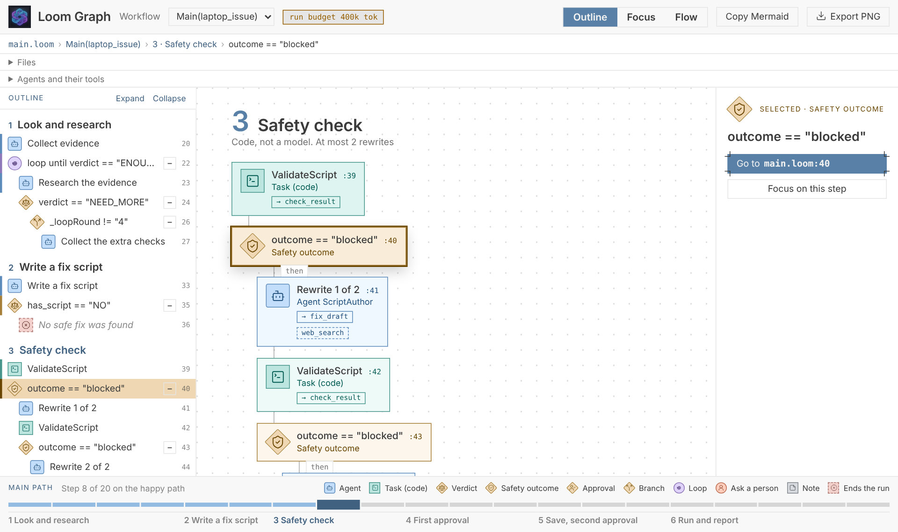
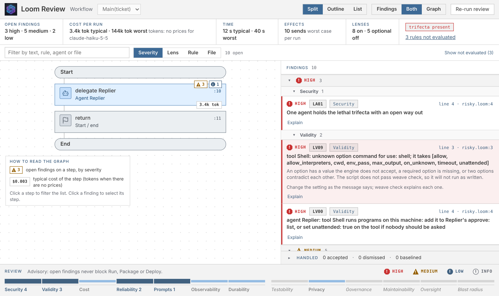
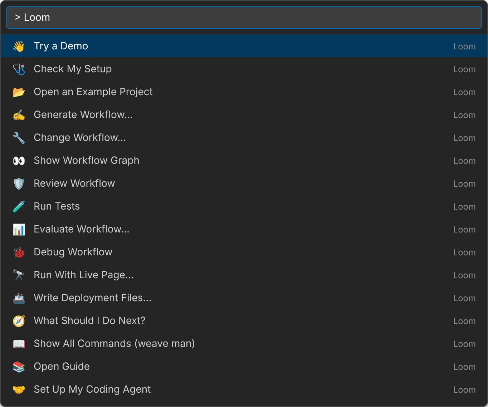

# Loom for llm4j: AI agent workflows

**Build, review, test and run multi-agent AI workflows in VS Code.** Describe one in a sentence, see it as a graph, review it for cost and security, and test it without a model or an API key.

[Repository](https://github.com/srijithunni7182/llm4j) · [Quickstart](https://github.com/srijithunni7182/llm4j/blob/main/docs/QUICKSTART.md) · [Tutorial](https://github.com/srijithunni7182/llm4j/blob/main/docs/tutorial/README.md) · [Language guide](https://github.com/srijithunni7182/llm4j/blob/main/src/loom/ai-agent4j-loom/LOOM_GUIDE.md) · [Full extension reference](https://github.com/srijithunni7182/llm4j/blob/main/src/loom/vscode-loom/REFERENCE.md) · [Issues](https://github.com/srijithunni7182/llm4j/issues)



## Get started

1. Install the extension (VS Code 1.101 or newer). It carries its own engine and needs only **Java 17** or newer.
2. Run **Loom: Set Up My Coding Agent**. Your coding agent (Claude Code, GitHub Copilot, Cursor or Codex) gets Loom's four skills and can design, build, test and deploy workflows for you. The chat then opens with a starter prompt typed in.
3. Run **Loom: Set Up the Guide**. The Loom Guide explains each stage while your agent builds, opens the graph, review and report at the right moment, and asks for the decisions that are yours. It runs on the Copilot or Claude Code you already use and never edits a file.
4. Run **Loom: Try a Demo**. It runs a bundled workflow on demo models, so it needs no key and costs nothing.
5. Run **Loom: Generate Workflow...** to turn a sentence into a checked project, or **Loom: New Workflow from Starter...** to copy one of twenty ready workflows, or open any `.loom` file.

The same path is a guided **Walkthrough**: run **Loom: Open Walkthrough**. It opens by itself the first time the extension runs.

## What it does

- **Generate and change.** Write a workflow from a sentence. Change it with a diff you accept or reject.
- **See the graph.** A live graph of the workflow in three views: Outline, Focus and Flow.
- **Review.** Findings on cost, security and risk beside the graph, with a fix for each and the [OWASP Top 10 for LLM Applications](https://github.com/srijithunni7182/llm4j/blob/main/docs/security/owasp-llm-top-10.md) mapping.
- **Test and evaluate.** Tests with scripted models and no keys; evaluations against a dataset.
- **Debug.** Breakpoints, stepping (and stepping back) and variables, with the models mocked.
- **Run and watch.** A real run, capped by cost, with a live page for cost, context and incidents.
- **Ship.** Docker, Compose and Kubernetes files read from the script.
- **Set up your coding agent.** Teaches Claude Code, Copilot, Cursor or any `AGENTS.md` agent to build with Loom.
- **The Loom Guide.** A companion agent in Copilot or Claude Code that teaches you the stack while your workflow is built: why each stage exists, what the graph, review and report show, what a skip loses. It never edits files.
- **Language support.** Highlighting, checks from the engine's own parser, completion, hover, go to definition, rename and snippets.



## The Loom Guide: learn the stack while you build

Your coding agent writes the workflow. The **Loom Guide** makes sure you understand it. It is a companion agent that runs in **GitHub Copilot Chat** or **Claude Code**, on the subscription you already have, and **never edits a file**.

- **Explains each stage before it happens.** Why the golden dataset comes before the script, what an approval protects, what the evaluation measured. Every explanation is about your project: your agents, your findings, your numbers.
- **Shows instead of telling.** It opens the graph on the right node, the Review panel on a finding, or the eval4j report, at the moment they matter.
- **Leaves the decisions to you.** Thresholds, budgets, accepted risks and going live: it recommends, gives the trade-off and asks.
- **Steers your coding agent through you.** It drafts an instruction, and you put it in your agent's chat yourself.
- **Thorough by default.** It recommends every stage. When you skip one, it says once what you will miss, records the skip, and moves on.
- **Notices what you might miss.** When a stage starts failing, a result goes out of date, or your coding agent claims something the project does not show, a note appears in the status bar with **Ask the Guide**.
- **Keeps keys and money safe.** It never asks for a key in the chat. Before anything costs money, it says what it will cost and which cap holds it.

**Set it up:** run **Loom: Set Up the Guide** (the extension also offers it once, after the walkthrough). It writes the agent for Copilot (`.github/agents/llm4j-guide.agent.md`) and for Claude Code (`.claude/agents/llm4j-guide.md`), and an `.mcp.json` entry with no machine-specific path, so your team can commit all three. Then run **Loom: Open the Guide**, or pick **llm4j-guide** in Copilot Chat's agent list. [More about the Guide](https://github.com/srijithunni7182/llm4j/blob/main/wiki/The-Loom-Guide.md).

## What a workflow looks like

Loom is a small language for workflows of AI agents. The model reads and writes; the script holds the rules. Here the script, not the model, decides when a refund needs a person:

```loom
budget { tokens: 100000  calls: 20 }

agent Triage {
    model: "gemini-2.5-flash"
    system: "Read the customer's email. Say what they want and any refund amount they state."
    guard { pii: mask }
}

workflow Main(email) {
    delegate "Classify this message:\n{email}" to Triage -> triage expecting {
        kind: enum["REFUND", "QUESTION"],
        amount: number
    }
    alt (triage.kind == "REFUND") {
        alt (triage.amount > 100) {
            human_prompt "Approve a refund of {triage.amount}? (yes/no)" -> decision
            note "Decision: {decision}"
        } else {
            note "Within the limit: refund approved automatically."
        }
    } else {
        note "Not a refund: reply directly."
    }
}
```

## Every command, under "Loom" in the Command Palette



## Privacy and cost

- Editing, checks, the graph, review, tests and debugging run on your machine and send nothing anywhere.
- Only generate, change and a live run call a model. They use your own keys, are capped by a setting, and a live run asks before it starts.
- The Loom Guide runs inside Copilot or Claude Code on your own subscription. The extension itself calls no model for it and opens no network connection: the Guide and the editor talk through files in `.loom/guide/`, which is git-ignored.

## Learn more

- [Full extension reference](https://github.com/srijithunni7182/llm4j/blob/main/src/loom/vscode-loom/REFERENCE.md): every command, view, setting, snippet and keyboard key
- [The Loom Guide](https://github.com/srijithunni7182/llm4j/blob/main/wiki/The-Loom-Guide.md): what it knows, what it can open, and how its behaviour is tested
- [Developer guide](https://github.com/srijithunni7182/llm4j/blob/main/DEVELOPER_GUIDE.md): the whole journey from an idea to a watched run
- [20 starter workflows](https://github.com/srijithunni7182/llm4j/blob/main/src/loom/starters/README.md) to copy from
- [Thirteen architecture mistakes the checks catch](https://github.com/srijithunni7182/llm4j/blob/main/docs/REVIEWABLE_ARCHITECTURE.md)
- [The `weave` command line](https://github.com/srijithunni7182/llm4j/blob/main/docs/COMMAND_REFERENCE.md), for the same steps in a terminal or CI
- [Changelog](https://github.com/srijithunni7182/llm4j/blob/main/src/loom/vscode-loom/CHANGELOG.md)

Apache 2.0. Part of [llm4j](https://github.com/srijithunni7182/llm4j), the Java stack for AI agents.
