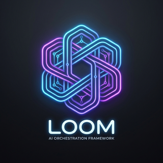

## Four gates, one workflow

The skills work as a pipeline, and the agent does not move on until a gate is passed:

1. `llm4j-harness-design`: what the agents may touch, how a run ends, what it costs at most.
2. `llm4j-workflow-guide`: builds the `.loom` script and checks it with `weave check`.
3. `llm4j-eval-design`: decides how you will know the agents are good, and writes the tests.
4. `llm4j-loom-deployer`: runs the workflow where you can watch it, under a budget.

The skills have the agent run `weave check` and `weave review` on what it writes, and tell you what is still open.

[Start Workflow in Agent Chat](command:loom.startWorkflowInChat)

The chat opens with `Use the llm4j-harness-design skill to design and build a Loom workflow for:`. Finish the sentence and send it.
