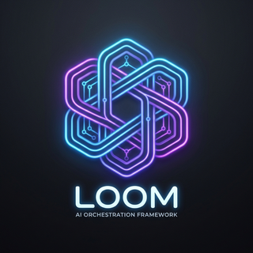

## See one run, with no key and no cost

A demo runs a bundled multi-agent workflow on this machine with mocked models. It needs no API key and spends nothing. It pauses at each step so you can see what happens.

[Try a Demo](command:loom.try)

Prefer to start from a shape that fits your goal? Pick a starter (approvals, classifier routing, parallel fan-out, budgeted agents). It is copied into your folder, opened in the editor, and its tests run without a key.

[New Workflow from Starter...](command:loom.newFromStarter)

New to the language? The Loom tutorial is a fifteen-chapter walk from a first workflow to production. It opens as an offline web page in your browser.

[Open Loom Tutorial](command:loom.openTutorial)
