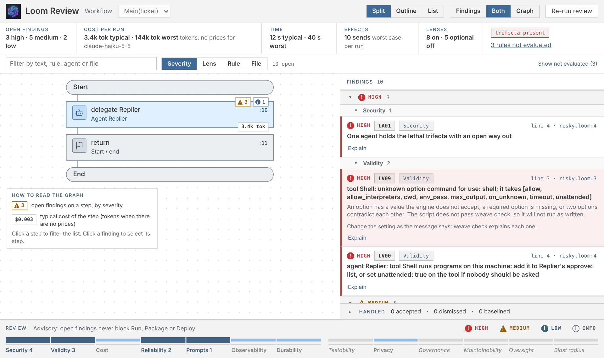
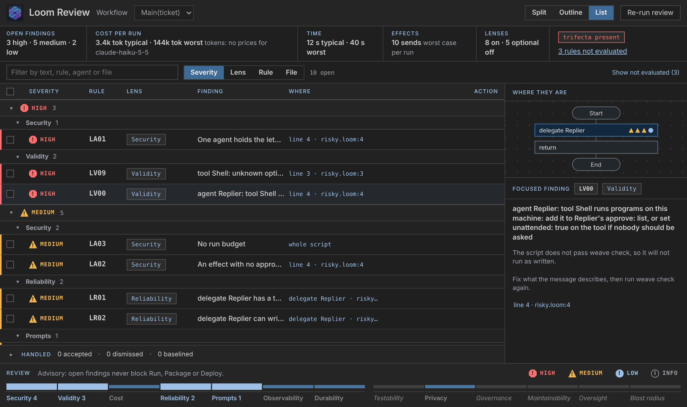

# Loom in VS Code

The **Loom** extension (`srijithunni7182.vscode-llm4j-loom`) is the quickest way to see what a Loom workflow does and what could go wrong with it, before anything runs. Everything in it uses the same parser and the same review engine as `weave check` and `weave review`, so the editor and the command line cannot disagree, and nothing is sent anywhere: it needs no keys, no network and runs no model.

Install it from the Marketplace, or from the `.vsix` of a release. It needs **Java 17 or newer** (it uses the `weave` jar it carries); the setting `loom.javaPath` points it at a particular Java.

## What you get

| | |
|---|---|
| **Checks** | The problems of `weave check` as squiggles and in the Problems panel, when you open or save a script. |
| **Workflow graph** | **Loom: Show Workflow Graph** draws the steps beside the script (Outline, Focus and Flow views), follows `import`s and your edits. |
| **Review** | **Loom: Review Workflow** opens the findings of `weave review` linked with the graph: security, validity, cost, reliability, prompts and more, each with why it matters and what to do. Three layouts: Split, Outline and List. |
| **Handling findings** | Fix one or all the safe ones as a single undoable change, review a fix that needs your judgement (you choose, you see the diff), accept a finding with a reason and a scope, dismiss it on your machine only, or record today's findings as a baseline. |
| **Editing** | Go to definition, find references, rename across files, completion that knows the fields of a variable and the labels of an enum, hover, outline and signature help. |
| **Debugging** | Press F5 on a `.loom` file, or click *Debug* above a workflow: breakpoints (line, conditional, on an agent), variables with the statement that set each, step over / in / out, **step back**, edit a variable, with mock models and nothing sent or written; live models ask first and run under a cap. See [Debugging a workflow](Debugging-a-Workflow.md). |
| **First run** | **Loom: Try a Demo**, **Open an Example Project** and **Check My Setup**, also as buttons in the Loom view of a folder with no workflow yet. |
| **Generate and change** | **Loom: Generate Workflow...** (a sentence in, a plan to read, a project that passed five gates) and **Loom: Change Workflow...** (a diff with the review and cost difference; nothing is written until you accept). |
| **Test, evaluate, run, ship** | **Loom: Run Tests** (scripted models, no keys), **Evaluate Workflow...** (mock run, dataset check, starter dataset), **Run With Live Page...** (a real run, asks first, capped by `loom.observe.maxTokens`), **Write Deployment Files...** (Docker, Compose, Kubernetes) and **What Should I Do Next?**. Each types one `weave` command into an integrated terminal. |
| **Guide and coding agents** | **Loom: Open Guide** opens the written guide from the jar; **Show All Commands (weave man)** lists every command; **Set Up My Coding Agent** teaches Claude Code, Copilot, Cursor or any `AGENTS.md` agent to build with Loom. |

## The review, in a minute

1. Open a `.loom` file and run **Loom: Review Workflow** (or click *Review* above a workflow).
2. The strip at the top says how many findings are open, what one run costs (typical and worst case), how long it takes, how many sends and writes it can cause, and whether an agent holds the lethal trifecta.
3. Click a finding: its step is selected in the graph and the editor jumps to its line. Click a step: only its findings are listed.
4. Handle what you can: **Fix** on a safe one, **Review fix…** where there is a choice, **Accept…** with a reason when the finding is fine as it is, **Dismiss** to hide it for yourself.
5. Edit the script: the result shows **stale** at once and refreshes when you save. Open findings never stop **Run**; at most you are told once.

## Rename and completion

Rename an agent with F2 and every use in every file changes with it, as one undo. If the new name is taken, is a keyword, or a file that would change is read-only, or an import cannot be found, nothing changes and the message says which. Completion offers only what fits where you are and never something that would fail `weave check`: type `intent.` after a `intentclassify Intent on message -> intent` and you get the classifier's questions, each with its labels; type `intent.kind == ` and you get the labels.

## When something is limited

The status bar says so once, in one place, and everything else keeps working. No Java (or Java older than 17): syntax colours, snippets and the simpler completions remain. The engine will not start: checks and graphs run `weave` for each request. A slow engine: the last result stays, marked stale. A mismatch between the engine and the extension: reinstall.

## Settings

| Setting | Default | |
|---|---|---|
| `loom.javaPath` | `java` | The Java to run `weave.jar` with |
| `loom.review.on` | `save` | When the review runs: `save`, `type` (the validity lens only) or `manual` |
| `loom.review.layout` | `split` | The layout the panel opens in |
| `loom.review.minSeverity` | `low` | The lowest severity shown as a squiggle |
| `loom.semantic.enable` | `true` | Definition, references, rename, completion and hover from the engine |
| `loom.observe.maxTokens` | `50000` | The most tokens a run started from Run With Live Page may use |
| `loom.serve.memoryMb`, `loom.serve.timeoutMs` | `64`, `10000` | How much the engine may keep, and the longest it may take for one request |

The full list, the keyboard keys and the commands are in the [extension README](../src/loom/vscode-loom/README.md); the protocol between the extension and the engine is in [docs/serve/PROTOCOL.md](../docs/serve/PROTOCOL.md); the language itself is in the [Loom guide](../src/loom/ai-agent4j-loom/LOOM_GUIDE.md).
